# REA blockchain domain: master tracker

Built 2026-11-28 from `morluto/rea` issues. Versioned only on the notes branch `notes/blockchain-plan`, never on a code or PR branch.

## Files

| File | Covers | Issues |
| --- | --- | --- |
| [tier-1-evm.md](tier-1-evm.md) | Tier 1: advanced EVM and decompilation | #3734, #3733, #3736, #2388, #2389, #2390, #2391, #2392, #2393, #2394, #2395, #2396 |
| [tier-2-chains.md](tier-2-chains.md) | Tier 2: non-EVM VMs and UTXO chains | #3730, #3731, #3732, #3738, #3739, #3747, #2003 |
| [tier-3-rollups.md](tier-3-rollups.md) | Tier 3: rollups and cross-chain | #3745, #3743, #3744 |
| [tier-4-zk.md](tier-4-zk.md) | Tier 4: zero knowledge | #3740, #3741 |
| [tier-5-wallets.md](tier-5-wallets.md) | Tier 5: wallets and frontends | #3737 |
| [related.md](related.md) | Filed outside the tracker's index (related) | #3746, #3748, #3716, #3137 |
| [solizardking-solana.md](solizardking-solana.md) | What Solizardking is working on, and how to avoid conflicts | #7339, #2003 |

**Implementation plan:** `plan.md` does not exist yet. We create it once an area is chosen.

## The plan as matbrgz wrote it

Master tracker: [#3729](https://github.com/morluto/rea/issues/3729), opened by matbrgz on 2026-10-14 and closed by matbrgz on 2026-10-15. It has no comments, so the reason is not recorded. Closing it delivered nothing: the issues it lists are separate, and the tier files show their state.

**Goal:** a cross-chain reverse engineering platform built on the existing EVM (#972, #2388–#2396) and Solana (#2003) foundations.

| Tier | Area | Issues |
| --- | --- | --- |
| 1 | EVM semantics and decompilation | #3734, #3733, #3736, #2388–#2396 |
| 2 | Non-EVM VMs and UTXO chains | #3730, #3731, #3732, #3738, #3739, #3747, #2003 |
| 3 | Layer 2 rollups and bridges | #3745, #3743, #3744 |
| 4 | Zero-knowledge circuits and zkVMs | #3740, #3741 |
| 5 | Wallets, providers and frontends | #3737 |

The tracker's tiers are a grouping. It states no delivery order, dates or assignees.

**His non-goals (apply to every item):**
- No private key or seed recovery, no wallet cracking, no authenticator bypass.
- No transaction signing or execution without approval. Modelling is reconstructive, over historical or user-supplied data.
- No automated exploit generation.

**How he wants individual items built:** each issue body has its own architecture, capability list and acceptance criteria. For #2388–#2396 he also added a "Triage & Architectural Review Notes" comment. Read both in the tier file before starting an item.

**Gaps in the tracker:**
- It lists the bridge issue as #3742. #3742 is an unrelated Electron PR; the bridge issue is #3745.
- Its titles for #3743 and #3745 differ from the current issue titles.
- #3746 (TON) and #3748 (Foundry/Hardhat) are by the same author but not in its index.

## What is delivered so far (2026-11-28)

| Tier | Delivered in `main` | In an open PR | Nothing yet (no linked PR found) |
| --- | --- | --- | --- |
| 1 | #2388, CBOR metadata half only (#2790) | #2389 (our #12743) | #2390–#2396, #3733, #3734, #3736 |
| 2 | None | Solana programs (#7339 by Solizardking, overlaps #2003, not linked to it) | #3730, #3731, #3732, #3738, #3739, #3747 |
| 3–5 | None | None | #3737, #3740, #3741, #3743–#3745 |

No tier is complete.

## Tracker source text

Verbatim issue text and comments follow. Badge images are removed and heading levels shifted. Claims are the authors', not verified here.

### #3729 [Tracker] Blockchain reverse engineering coverage: EVM, Bitcoin, Move, Solana, Starknet, rollups, ZK, wallets and cross-chain protocols

*matbrgz, closed, https://github.com/morluto/rea/issues/3729*

#### Scope & Strategic Vision

Blockchain and smart contract ecosystems have evolved far beyond simple EVM bytecode disassembly. Modern decentralized applications (dApps), rollups, decentralized finance (DeFi) protocols, zero-knowledge verifiers, and multi-chain architectures represent complex distributed state machines spanning:
- **EVM Ecosystem Expansion**: Account abstraction (ERC-4337 / EIP-7702), deployment lineages (`CREATE2` factories, EIP-1167 minimal clones), and stack-to-SSA decompilation.
- **UTXO & Script Architectures**: Bitcoin raw transactions, Taproot / Tapscript trees, Partially Signed Bitcoin Transactions (PSBT v2), and Miniscript policies.
- **Next-Gen Smart Contract VMs**: MoveVM (Aptos resources & Sui objects), Cairo / Sierra (Starknet zk-STARKs), CosmWasm, and Solana sBPF CPI graphs.
- **Runtime Upgrades & Substrate**: Polkadot SCALE metadata introspection and runtime Wasm diffing.
- **Layer 2 Rollups & Bridges**: OP Stack derivation, Arbitrum Nitro retryables, cross-chain messaging envelopes (Wormhole, LayerZero, IBC).
- **Zero-Knowledge Systems**: R1CS circuits, PLONKish constraints, zkVM guest programs (RISC Zero, SP1), and on-chain verifier contracts.
- **Wallets & Frontend Integration**: EIP-1193 provider injection, WalletConnect v2 session handshakes, and user transaction simulation without private keys.

This tracker coordinates REA's cross-chain reverse engineering platform, building on existing EVM (#972, #2388–#2396) and Solana (#2003) foundations.

#### Strict Safety & Compliance Non-Goals

All blockchain reverse engineering capabilities operate strictly under non-custodial, read-only analysis:
- **No Private Key Extraction / Wallet Cracking**: REA does not attempt seed phrase cracking, private key recovery, or bypass of authenticator security.
- **No Transaction Signing / Execution Without Approval**: All transaction modeling is simulated or reconstructive over historical/user-provided data.
- **No Automated Exploit Generation**: Focus is on transparency, decompilation, protocol auditing, and state machine reconstruction.

#### Architectural Breakdown

```mermaid
flowchart TD
    A["Blockchain Reverse Engineering Platform"] --> B["Tier 1: EVM Advanced Semantics & Decompilation"]
    A --> C["Tier 2: Non-EVM VM Architectures (Bitcoin, Move, Cairo, Substrate)"]
    A --> D["Tier 3: Layer 2 Rollups & Cross-Chain Bridges"]
    A --> E["Tier 4: Zero-Knowledge Proofs & zkVMs"]
    A --> F["Tier 5: Wallets, Frontends & Node Storage"]

    B --> B1["EVM Deployment Lineage & Clones (#3734)"]
    B --> B2["ERC-4337 & EIP-7702 Account Abstraction (#3733)"]
    B --> B3["EVM Stack-to-SSA Pseudocode Decompilation (#3736)"]
    B --> B4["Solidity Bytecode & Metadata Suite (#2388-#2396)"]

    C --> C1["Bitcoin PSBT, Taproot & Miniscript (#3730)"]
    C --> C2["Move VM: Aptos Resources & Sui Objects (#3731)"]
    C --> C3["Starknet: Cairo & Sierra / CASM (#3732)"]
    C --> C4["Polkadot / Substrate SCALE Metadata & Wasm (#3738)"]
    C --> C5["CosmWasm & IBC Packet Lifecycles (#3739)"]
    C --> C6["Solana Transactions & CPIs (#3747, #2003)"]

    D --> D1["Cross-Chain Bridge Envelopes (#3742)"]
    D --> D2["OP Stack Rollup Derivation Pipeline (#3743)"]
    D --> D3["Arbitrum Nitro Inbox & Retryables (#3744)"]

    E --> E1["ZK Circuits: Circom & PLONKish (#3740)"]
    E --> E2["zkVMs: RISC Zero, SP1, zkWasm (#3741)"]

    F --> F1["Wallets & dApp RPC Boundaries (#3737)"]
```

---

#### Complete Tracked Issues Index

#### 1. Advanced EVM Semantics & Pseudocode Decompilation
- [ ] #3734 — `[Feature] EVM deployment lineage reverse engineering: CREATE/CREATE2 initcode, constructors, factories, clones and library-link graphs`
- [ ] #3733 — `[Feature] ERC-4337 / EIP-7702 account-abstraction reverse engineering: UserOperations, EntryPoint, paymasters, factories and delegated-code graphs`
- [ ] #3736 — `[Feature] EVM pseudocode decompilation: stack-to-SSA IR, expressions and Solidity-like control/data-flow reconstruction`
- [ ] #2388 — `[Feature] Solidity: inspect bytecode CBOR metadata losslessly and bind supplied metadata files`
- [ ] #2389 — `[Feature] Solidity: select exact solc Standard JSON contract artifacts and bytecode kinds`
- [ ] #2390 — `[Feature] Solidity: map EVM byte PCs to original and generated source spans`
- [ ] #2391 — `[Feature] Solidity: decode supplied ABI calldata, logs and revert payloads with explicit ambiguity`
- [ ] #2392 — `[Feature] Solidity: inspect and compare compiler storage layouts without inferring live state`
- [ ] #2393 — `[Feature] Solidity: inspect offline proxy patterns and supplied implementation-slot evidence`
- [ ] #2394 — `[Feature] Solidity: inspect recorded EVM opcode/call traces and attribute debugging locations`
- [ ] #2395 — `[Design] Solidity: expose fork-profiled EVM disassembly and bounded control-flow evidence`
- [ ] #2396 — `[Feature] Solidity: compare exact bytecode with separately explained compiler patch spans`

#### 2. Non-EVM Smart Contract VMs & UTXO Chains
- [ ] #3730 — `[Feature] Bitcoin reverse engineering: raw transactions, PSBT, Script/Tapscript, descriptors, Miniscript and UTXO-flow reconstruction`
- [ ] #3731 — `[Feature] Move VM reverse engineering: bytecode modules, abilities, resources, types and call graphs`
- [ ] #3732 — `[Feature] Starknet reverse engineering: Cairo, Sierra/CASM, class hashes, entrypoints and storage graphs`
- [ ] #3738 — `[Feature] Polkadot/Substrate reverse engineering: SCALE metadata, runtime Wasm, pallets, extrinsics and runtime-upgrade diffs`
- [ ] #3739 — `[Feature] CosmWasm and IBC reverse engineering: Wasm contracts, schemas, packet lifecycles and cross-chain state machines`
- [ ] #3747 — `[Feature] Solana transaction reverse engineering: instructions, CPIs, account roles, logs and state-change graphs`
- [ ] #2003 — `[Feature] Offline Solana sBPF program interface recovery`

#### 3. Layer 2 Rollups & Cross-Chain Messaging
- [ ] #3742 — `[Feature] Cross-chain bridge reverse engineering: LayerZero, Wormhole, Axelar and canonical message envelopes`
- [ ] #3743 — `[Feature] OP Stack rollup reverse engineering: L1 batch derivation, channel frames, span batches and L2 state reconstruction`
- [ ] #3744 — `[Feature] Arbitrum Nitro reverse engineering: Inbox batches, retryables, ArbOS calls and L1-to-L2 message reconstruction`

#### 4. Zero-Knowledge Proofs & zkVMs
- [ ] #3740 — `[Feature] Zero-knowledge circuit reverse engineering: Circom/R1CS, PLONKish/Halo2 constraints and verifier graphs`
- [ ] #3741 — `[Feature] zkVM reverse engineering: RISC Zero, SP1 and zkWasm guest images, receipts, journals and proof metadata`

#### 5. Wallets, Providers & Frontends
- [ ] #3737 — `[Feature] Wallet and dApp reverse engineering: EIP-1193 providers, WalletConnect sessions, JSON-RPC requests and frontend-to-wallet graphs`
