# REA blockchain domain plan

Local reference, built 2026-11-28 from `morluto/rea` issues. It is versioned only on the notes branch `notes/blockchain-plan`, never on a code or PR branch, because the repo's `AGENTS.md` keeps plans out of the project history.

Sections 1 and 2 are our notes. Section 3 is live status. Section 4 is the original text from matbrgz and others.

## 1. The plan as matbrgz wrote it

Master tracker: [#3729](https://github.com/morluto/rea/issues/3729), opened by matbrgz on 2026-10-14 and closed by matbrgz on 2026-10-15. It has no comments, so the reason is not recorded. Closing it delivered nothing: the issues it lists are separate, and section 3 shows their state.

**Goal:** a cross-chain reverse engineering platform built on the existing EVM (#972, #2388–#2396) and Solana (#2003) foundations.

| Tier | Area | Issues |
| --- | --- | --- |
| 1 | EVM semantics and decompilation | #3734, #3733, #3736, #2388–#2396 |
| 2 | Non-EVM VMs and UTXO chains | #3730, #3731, #3732, #3738, #3739, #3747, #2003 |
| 3 | Layer 2 rollups and bridges | #3745, #3743, #3744 |
| 4 | Zero-knowledge circuits and zkVMs | #3740, #3741 |
| 5 | Wallets, providers and frontends | #3737 |

The tracker's tiers are a grouping. It states no delivery order, dates or assignees.

**His non-goals (apply to every item):**
- No private key or seed recovery, no wallet cracking, no authenticator bypass.
- No transaction signing or execution without approval. Modelling is reconstructive, over historical or user-supplied data.
- No automated exploit generation.

**How he wants individual items built:** each issue body has its own architecture, capability list and acceptance criteria. For #2388–#2396 he also added a "Triage & Architectural Review Notes" comment. Read both in section 4 before starting an item.

**Gaps in the tracker:**
- It lists the bridge issue as #3742. #3742 is an unrelated Electron PR; the bridge issue is #3745.
- Its titles for #3743 and #3745 differ from the current issue titles.
- #3746 (TON) and #3748 (Foundry/Hardhat) are by the same author but not in its index.

### What is delivered so far (2026-11-28)

| Tier | Delivered in `main` | In an open PR | Nothing yet (no linked PR found) |
| --- | --- | --- | --- |
| 1 | #2388, CBOR metadata half only (#2790) | #2389 (our #12743) | #2390–#2396, #3733, #3734, #3736 |
| 2 | None | Solana programs (#7339 by Solizardking, overlaps #2003, not linked to it) | #3730, #3731, #3732, #3738, #3739, #3747 |
| 3–5 | None | None | #3737, #3740, #3741, #3743–#3745 |

No tier is complete. 
## 2. Solana PR #7339 review (Solizardking)

Checked 2026-11-28 at head `cafa37dcd`. This covered the description, file list, guide, composition wiring, threads, CI and fork branches. It was **not** a line-by-line code audit, and no tests were run.

**What the PR adds** (60 files, +8,672 / −19):
- `analyze_solana_program`: sBPF ELF64 parser, linear disassembler, Anchor dispatch recovery, syscall name resolution; input is a local file or a read-only RPC fetch by program id.
- `analyze_solana_programs`: batch mode, optional hand-off folder for Ghidra/IDA.
- `solana_receipts`: joins an analysis with recorded differential-test results.
- A guide, a skill reference and tests.

**State:**
- 15 commits ahead, 297 behind `main`. Conflicts: `scripts/lib/module-layers.mjs`, `scripts/lib/test-projects.mjs`, `src/composition/capabilityDeclarations.ts`, `src/composition/capabilityServices.ts`, `src/server/createServer.ts`.
- 37 of 38 review threads resolved. The open one (`SolanaElf.ts`, shared symbol names repeated downstream) is partly left open by the author as a maintainer decision.
- The only check reported is Greptile (pass); no build or test CI is listed.
- Human owner is blank and readiness boxes are unchecked. The description says an AI agent prepared it.
- The description is stale: it says 42 files and 47 tests at an older commit.
- No maintainer scope decision for the new domain is recorded in the PR.

**Relation to #2003:** the PR says no related issue exists, but #2003 covers this area and is not linked.

| #2003 asks for | In #7339 (from its guide) |
| --- | --- |
| Offline only, no RPC | Includes optional RPC fetch |
| Instruction names recovered from Anchor log strings | Names only when the caller supplies them |
| Account and event type discriminators | Not described |
| ELF facts, version, entrypoint, syscalls | Covered |
| Engine: adapt `sbpf-inspect` WASM (proposal by trenbonole) | Own TypeScript decoder |

trenbonole offered on #2003 to implement the first increment; bornsl0ppy offered to test and review.

**Other work on Solizardking's fork, not in the PR:**
- Fork `main` (merged through fork PRs #3 and #4, Nov 25–26): Solana formal verification (Certora, Harmonic Aristotle) service, provider and skills, plus a `ree` skill and README changes.
- `feat/solana-tag-dispatch-core` (Oct 28): 1-byte Shank/Borsh tag dispatch and a Metaplex Core loop.
- `feat/solana-sbpf` (Oct 26): an earlier attempt touching the Ghidra, Hopper and IDA paths.
- From branch names and commits, the latest activity is formal verification. Whether it will be sent upstream is unknown.

**What this means for us:** do not open a parallel Solana PR. Useful help would be a review comment pointing out the #2003 overlap, sent only after you approve it.


## 3. Status of every item (read from GitHub 2026-11-28)


### Tier 1: advanced EVM and decompilation

| Issue | Title | Author | State | Priority / labels | Comments | Linked PRs |
| --- | --- | --- | --- | --- | --- | --- |
| [#3734](https://github.com/morluto/rea/issues/3734) | EVM deployment lineage reverse engineering: CREATE/CREATE2 initcode, constructors, factories, clones and library-link graphs | matbrgz | open | enhancement, provider: evm | 0 | none found |
| [#3733](https://github.com/morluto/rea/issues/3733) | ERC-4337 / EIP-7702 account-abstraction reverse engineering: UserOperations, EntryPoint, paymasters, factories and delegated-code graphs | matbrgz | open | enhancement | 0 | none found |
| [#3736](https://github.com/morluto/rea/issues/3736) | EVM pseudocode decompilation: stack-to-SSA IR, expressions and Solidity-like control/data-flow reconstruction | matbrgz | open | enhancement, area: native, area: evidence, provider: evm | 0 | none found |
| [#2388](https://github.com/morluto/rea/issues/2388) | Solidity: inspect bytecode CBOR metadata losslessly and bind supplied metadata files | matbrgz | open | enhancement, P2: medium, area: domain, provider: evm | 1 | #2420 (closed), #2790 (merged) |
| [#2389](https://github.com/morluto/rea/issues/2389) | Solidity: select exact solc Standard JSON contract artifacts and bytecode kinds | matbrgz | open | enhancement, P2: medium, area: domain, provider: evm | 2 | #12743 (open), #2415 (closed), #3024 (closed) |
| [#2390](https://github.com/morluto/rea/issues/2390) | Solidity: map EVM byte PCs to original and generated source spans | matbrgz | open | enhancement, P2: medium, area: domain, provider: evm | 1 | none found |
| [#2391](https://github.com/morluto/rea/issues/2391) | Solidity: decode supplied ABI calldata, logs and revert payloads with explicit ambiguity | matbrgz | open | enhancement, P2: medium, area: domain, provider: evm | 1 | none found |
| [#2392](https://github.com/morluto/rea/issues/2392) | Solidity: inspect and compare compiler storage layouts without inferring live state | matbrgz | open | enhancement, P2: medium, area: domain, provider: evm | 1 | none found |
| [#2393](https://github.com/morluto/rea/issues/2393) | Solidity: inspect offline proxy patterns and supplied implementation-slot evidence | matbrgz | open | enhancement, P2: medium, area: evidence, provider: evm | 1 | none found |
| [#2394](https://github.com/morluto/rea/issues/2394) | Solidity: inspect recorded EVM opcode/call traces and attribute debugging locations | matbrgz | open | enhancement, P2: medium, area: evidence, provider: evm | 1 | none found |
| [#2395](https://github.com/morluto/rea/issues/2395) | Solidity: expose fork-profiled EVM disassembly and bounded control-flow evidence | matbrgz | open | enhancement, P2: medium, area: domain, area: native, area: evidence, design, provider: evm | 1 | none found |
| [#2396](https://github.com/morluto/rea/issues/2396) | Solidity: compare exact bytecode with separately explained compiler patch spans | matbrgz | open | enhancement, P2: medium, area: domain, provider: evm | 1 | none found |

### Tier 2: non-EVM VMs and UTXO chains

| Issue | Title | Author | State | Priority / labels | Comments | Linked PRs |
| --- | --- | --- | --- | --- | --- | --- |
| [#3730](https://github.com/morluto/rea/issues/3730) | Bitcoin reverse engineering: raw transactions, PSBT, Script/Tapscript, descriptors, Miniscript and UTXO-flow reconstruction | matbrgz | open | enhancement, area: evidence | 0 | none found |
| [#3731](https://github.com/morluto/rea/issues/3731) | Move VM reverse engineering: bytecode modules, abilities, resources, types and call graphs | matbrgz | open | enhancement | 0 | none found |
| [#3732](https://github.com/morluto/rea/issues/3732) | Starknet reverse engineering: Cairo, Sierra/CASM, class hashes, entrypoints and storage graphs | matbrgz | open | enhancement | 0 | none found |
| [#3738](https://github.com/morluto/rea/issues/3738) | Polkadot/Substrate reverse engineering: SCALE metadata, runtime Wasm, pallets, extrinsics and runtime-upgrade diffs | matbrgz | open | enhancement, area: setup, area: runtime | 0 | none found |
| [#3739](https://github.com/morluto/rea/issues/3739) | CosmWasm and IBC reverse engineering: Wasm contracts, schemas, packet lifecycles and cross-chain state machines | matbrgz | open | enhancement, area: domain, area: evidence | 0 | none found |
| [#3747](https://github.com/morluto/rea/issues/3747) | Solana transaction reverse engineering: instructions, CPIs, account roles, logs and state-change graphs | matbrgz | open | enhancement | 0 | none found |
| [#2003](https://github.com/morluto/rea/issues/2003) | Offline Solana sBPF program interface recovery | trenbonole | open | enhancement, P3: low, area: native | 3 | none found |

### Tier 3: rollups and cross-chain

| Issue | Title | Author | State | Priority / labels | Comments | Linked PRs |
| --- | --- | --- | --- | --- | --- | --- |
| [#3745](https://github.com/morluto/rea/issues/3745) | Cross-chain bridge reverse engineering: message envelopes, nonces, proofs, relayers and source-to-destination state machines | matbrgz | open | enhancement, area: bridge | 0 | none found |
| [#3743](https://github.com/morluto/rea/issues/3743) | OP Stack reverse engineering: L1 batches, deposits, withdrawals, derivation and fault-proof artifacts | matbrgz | open | enhancement, area: evidence | 0 | none found |
| [#3744](https://github.com/morluto/rea/issues/3744) | Arbitrum Nitro reverse engineering: Inbox batches, retryables, ArbOS calls and L1-to-L2 message reconstruction | matbrgz | open | enhancement, area: evidence | 0 | none found |

### Tier 4: zero knowledge

| Issue | Title | Author | State | Priority / labels | Comments | Linked PRs |
| --- | --- | --- | --- | --- | --- | --- |
| [#3740](https://github.com/morluto/rea/issues/3740) | Zero-knowledge circuit reverse engineering: Circom/R1CS, PLONKish/Halo2 constraints and verifier graphs | matbrgz | open | enhancement, area: tests | 0 | none found |
| [#3741](https://github.com/morluto/rea/issues/3741) | zkVM reverse engineering: RISC Zero, SP1 and zkWasm guest images, receipts, journals and proof metadata | matbrgz | open | enhancement | 0 | none found |

### Tier 5: wallets and frontends

| Issue | Title | Author | State | Priority / labels | Comments | Linked PRs |
| --- | --- | --- | --- | --- | --- | --- |
| [#3737](https://github.com/morluto/rea/issues/3737) | Wallet and dApp reverse engineering: EIP-1193 providers, WalletConnect sessions, JSON-RPC requests and frontend-to-wallet graphs | matbrgz | open | enhancement, area: providers | 0 | none found |

### Filed outside the tracker's index (related)

| Issue | Title | Author | State | Priority / labels | Comments | Linked PRs |
| --- | --- | --- | --- | --- | --- | --- |
| [#3746](https://github.com/morluto/rea/issues/3746) | TON / TVM reverse engineering: BOC cells, TL-B schemas, TVM bytecode and message/state graphs | matbrgz | open | enhancement | 0 | none found |
| [#3748](https://github.com/morluto/rea/issues/3748) | Foundry and Hardhat project reverse engineering: build-info, deployments, broadcasts, libraries and contract dependency graphs | matbrgz | open | enhancement, area: domain, area: build | 0 | none found |
| [#3716](https://github.com/morluto/rea/issues/3716) | Common Bytecode and VM Framework: unified instruction decoding, CFG synthesis, SSA analysis and source decompilation | matbrgz | open | area: native, design | 0 | none found |
| [#3137](https://github.com/morluto/rea/issues/3137) | research(architecture): establish demand and compatibility gates for external domain modules | N0zoM1z0 | open | enhancement, P1: high, area: domain, triage, roadmap, performance, design | 0 | none found |

---

## 4. Source text, verbatim

Issue text and comments copied as written on GitHub. Badge images are removed and heading levels are shifted. Claims inside are the authors', not verified here.


## Tracker


### #3729 [Tracker] Blockchain reverse engineering coverage: EVM, Bitcoin, Move, Solana, Starknet, rollups, ZK, wallets and cross-chain protocols

*matbrgz, closed, https://github.com/morluto/rea/issues/3729*

#### Scope & Strategic Vision

Blockchain and smart contract ecosystems have evolved far beyond simple EVM bytecode disassembly. Modern decentralized applications (dApps), rollups, decentralized finance (DeFi) protocols, zero-knowledge verifiers, and multi-chain architectures represent complex distributed state machines spanning:
- **EVM Ecosystem Expansion**: Account abstraction (ERC-4337 / EIP-7702), deployment lineages (`CREATE2` factories, EIP-1167 minimal clones), and stack-to-SSA decompilation.
- **UTXO & Script Architectures**: Bitcoin raw transactions, Taproot / Tapscript trees, Partially Signed Bitcoin Transactions (PSBT v2), and Miniscript policies.
- **Next-Gen Smart Contract VMs**: MoveVM (Aptos resources & Sui objects), Cairo / Sierra (Starknet zk-STARKs), CosmWasm, and Solana sBPF CPI graphs.
- **Runtime Upgrades & Substrate**: Polkadot SCALE metadata introspection and runtime Wasm diffing.
- **Layer 2 Rollups & Bridges**: OP Stack derivation, Arbitrum Nitro retryables, cross-chain messaging envelopes (Wormhole, LayerZero, IBC).
- **Zero-Knowledge Systems**: R1CS circuits, PLONKish constraints, zkVM guest programs (RISC Zero, SP1), and on-chain verifier contracts.
- **Wallets & Frontend Integration**: EIP-1193 provider injection, WalletConnect v2 session handshakes, and user transaction simulation without private keys.

This tracker coordinates REA's cross-chain reverse engineering platform, building on existing EVM (#972, #2388–#2396) and Solana (#2003) foundations.

#### Strict Safety & Compliance Non-Goals

All blockchain reverse engineering capabilities operate strictly under non-custodial, read-only analysis:
- **No Private Key Extraction / Wallet Cracking**: REA does not attempt seed phrase cracking, private key recovery, or bypass of authenticator security.
- **No Transaction Signing / Execution Without Approval**: All transaction modeling is simulated or reconstructive over historical/user-provided data.
- **No Automated Exploit Generation**: Focus is on transparency, decompilation, protocol auditing, and state machine reconstruction.

#### Architectural Breakdown

```mermaid
flowchart TD
    A["Blockchain Reverse Engineering Platform"] --> B["Tier 1: EVM Advanced Semantics & Decompilation"]
    A --> C["Tier 2: Non-EVM VM Architectures (Bitcoin, Move, Cairo, Substrate)"]
    A --> D["Tier 3: Layer 2 Rollups & Cross-Chain Bridges"]
    A --> E["Tier 4: Zero-Knowledge Proofs & zkVMs"]
    A --> F["Tier 5: Wallets, Frontends & Node Storage"]

    B --> B1["EVM Deployment Lineage & Clones (#3734)"]
    B --> B2["ERC-4337 & EIP-7702 Account Abstraction (#3733)"]
    B --> B3["EVM Stack-to-SSA Pseudocode Decompilation (#3736)"]
    B --> B4["Solidity Bytecode & Metadata Suite (#2388-#2396)"]

    C --> C1["Bitcoin PSBT, Taproot & Miniscript (#3730)"]
    C --> C2["Move VM: Aptos Resources & Sui Objects (#3731)"]
    C --> C3["Starknet: Cairo & Sierra / CASM (#3732)"]
    C --> C4["Polkadot / Substrate SCALE Metadata & Wasm (#3738)"]
    C --> C5["CosmWasm & IBC Packet Lifecycles (#3739)"]
    C --> C6["Solana Transactions & CPIs (#3747, #2003)"]

    D --> D1["Cross-Chain Bridge Envelopes (#3742)"]
    D --> D2["OP Stack Rollup Derivation Pipeline (#3743)"]
    D --> D3["Arbitrum Nitro Inbox & Retryables (#3744)"]

    E --> E1["ZK Circuits: Circom & PLONKish (#3740)"]
    E --> E2["zkVMs: RISC Zero, SP1, zkWasm (#3741)"]

    F --> F1["Wallets & dApp RPC Boundaries (#3737)"]
```

---

#### Complete Tracked Issues Index

#### 1. Advanced EVM Semantics & Pseudocode Decompilation
- [ ] #3734 — `[Feature] EVM deployment lineage reverse engineering: CREATE/CREATE2 initcode, constructors, factories, clones and library-link graphs`
- [ ] #3733 — `[Feature] ERC-4337 / EIP-7702 account-abstraction reverse engineering: UserOperations, EntryPoint, paymasters, factories and delegated-code graphs`
- [ ] #3736 — `[Feature] EVM pseudocode decompilation: stack-to-SSA IR, expressions and Solidity-like control/data-flow reconstruction`
- [ ] #2388 — `[Feature] Solidity: inspect bytecode CBOR metadata losslessly and bind supplied metadata files`
- [ ] #2389 — `[Feature] Solidity: select exact solc Standard JSON contract artifacts and bytecode kinds`
- [ ] #2390 — `[Feature] Solidity: map EVM byte PCs to original and generated source spans`
- [ ] #2391 — `[Feature] Solidity: decode supplied ABI calldata, logs and revert payloads with explicit ambiguity`
- [ ] #2392 — `[Feature] Solidity: inspect and compare compiler storage layouts without inferring live state`
- [ ] #2393 — `[Feature] Solidity: inspect offline proxy patterns and supplied implementation-slot evidence`
- [ ] #2394 — `[Feature] Solidity: inspect recorded EVM opcode/call traces and attribute debugging locations`
- [ ] #2395 — `[Design] Solidity: expose fork-profiled EVM disassembly and bounded control-flow evidence`
- [ ] #2396 — `[Feature] Solidity: compare exact bytecode with separately explained compiler patch spans`

#### 2. Non-EVM Smart Contract VMs & UTXO Chains
- [ ] #3730 — `[Feature] Bitcoin reverse engineering: raw transactions, PSBT, Script/Tapscript, descriptors, Miniscript and UTXO-flow reconstruction`
- [ ] #3731 — `[Feature] Move VM reverse engineering: bytecode modules, abilities, resources, types and call graphs`
- [ ] #3732 — `[Feature] Starknet reverse engineering: Cairo, Sierra/CASM, class hashes, entrypoints and storage graphs`
- [ ] #3738 — `[Feature] Polkadot/Substrate reverse engineering: SCALE metadata, runtime Wasm, pallets, extrinsics and runtime-upgrade diffs`
- [ ] #3739 — `[Feature] CosmWasm and IBC reverse engineering: Wasm contracts, schemas, packet lifecycles and cross-chain state machines`
- [ ] #3747 — `[Feature] Solana transaction reverse engineering: instructions, CPIs, account roles, logs and state-change graphs`
- [ ] #2003 — `[Feature] Offline Solana sBPF program interface recovery`

#### 3. Layer 2 Rollups & Cross-Chain Messaging
- [ ] #3742 — `[Feature] Cross-chain bridge reverse engineering: LayerZero, Wormhole, Axelar and canonical message envelopes`
- [ ] #3743 — `[Feature] OP Stack rollup reverse engineering: L1 batch derivation, channel frames, span batches and L2 state reconstruction`
- [ ] #3744 — `[Feature] Arbitrum Nitro reverse engineering: Inbox batches, retryables, ArbOS calls and L1-to-L2 message reconstruction`

#### 4. Zero-Knowledge Proofs & zkVMs
- [ ] #3740 — `[Feature] Zero-knowledge circuit reverse engineering: Circom/R1CS, PLONKish/Halo2 constraints and verifier graphs`
- [ ] #3741 — `[Feature] zkVM reverse engineering: RISC Zero, SP1 and zkWasm guest images, receipts, journals and proof metadata`

#### 5. Wallets, Providers & Frontends
- [ ] #3737 — `[Feature] Wallet and dApp reverse engineering: EIP-1193 providers, WalletConnect sessions, JSON-RPC requests and frontend-to-wallet graphs`


## Tier 1: advanced EVM and decompilation


### #3734 [Feature] EVM deployment lineage reverse engineering: CREATE/CREATE2 initcode, constructors, factories, clones and library-link graphs

*matbrgz, open, https://github.com/morluto/rea/issues/3734*

#### Problem Statement & Context

In on-chain EVM forensics, inspecting a deployed contract's runtime bytecode only reveals its active state machine. It conceals the deployment ceremony that brought the contract into existence:
1. **Creation Bytecode vs Runtime Bytecode**: The initialization code (`initcode`) executes once in a transient context, evaluates constructor arguments, sets immutable variables, populates initial storage slots, and returns the runtime bytecode slice via the `RETURN` opcode.
2. **Deterministic Addresses (`CREATE2`)**: Smart contracts deployed at predictable addresses via `keccak256(0xff ++ deployer ++ salt ++ keccak256(initcode))[12:]`, widely used by Uniswap pair factories, rollup bridges, and account abstraction wallets.
3. **Minimal Proxy Clones (EIP-1167 / ERC-3448 / ERC-1967)**: Ultra-cheap 45-byte proxy bytecodes (`363d3d373d3d3d363d73bebebebebebebebebebebebebebebebebebebebe5af43d82803e903d91602b57fd5bf3`) delegating all calls to a shared master implementation.
4. **Link References & Libraries**: Unlinked bytecodes containing 20-byte placeholder signatures (`__$30bbc75f483...$__`) replaced during deployment with external library addresses.
5. **Constructor Arguments & Immutables**: Trailing bytes appended to initcode or runtime code representing constructor parameter buffers and compiled immutable value offsets.

REA lacks a dedicated deployment lineage engine capable of dissecting initcode, reconstructing constructor arguments, calculating CREATE2 salts, and mapping factory-to-clone hierarchies.

#### Proposed Architecture

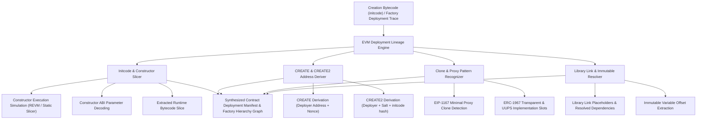

#### Technical Capabilities & Modules

1. **Initcode Disassembly & Constructor Parameter Extraction:**
   - Separate transient constructor bytecode from trailing ABI-encoded constructor parameters.
   - Decompile constructor logic: initialization assignments, ownership setup, and storage initializations.
   - Extract the returned runtime bytecode slice defined by the terminal `CODECOPY` / `RETURN` opcodes.

2. **CREATE & CREATE2 Address Verification:**
   - Reconstruct `CREATE` addresses from deployer address and deployment transaction nonces (RLP encoding).
   - Reconstruct `CREATE2` addresses: extract 32-byte salt parameters, compute `keccak256(initcode)`, and verify counterfactual deployment addresses.

3. **Proxy Clone Family Detection:**
   - Recognize standardized clone bytecode templates:
     - EIP-1167 Minimal Proxy: extract target master implementation address from byte offsets 10..30.
     - ERC-3448 MetaProxy: extract trailing metadata payloads.
     - ERC-1967 Implementation and Admin storage slots (`0x360894a13ba1a3210667c828492db98dca3e2076cc3735a920a3ca505d382bbc`).

4. **External Library Link Resolution:**
   - Scan for unresolved library placeholder patterns in compiled artifacts (`__$name$__` or 20-byte zero placeholders).
   - Match linked addresses against deployed external utility libraries (e.g. OpenZeppelin `SafeCast`, `Strings`).

5. **Factory Deployment Lineage Graph:**
   - Given a factory contract (e.g. AMM Pool Factory, Token Factory), trace all deployed child contracts.
   - Reconstruct the deployment dependency tree showing parent factories, deployed instances, and implementation upgrades.

#### Acceptance Criteria

- [ ] Automated separation of initcode into constructor logic, runtime bytecode, and constructor parameters.
- [ ] Accurate calculation and validation of both `CREATE` and `CREATE2` deployment addresses.
- [ ] Detection and target address extraction for EIP-1167 minimal clones and ERC-1967 proxies.
- [ ] Extraction of constructor arguments and matching against candidate Solidity ABI definitions.
- [ ] Generation of an interactive factory-to-instance deployment lineage diagram.

#### Related Issues & Dependencies

- Complements #972 (Solidity/EVM reverse engineering)
- Complements #2389 (EVM Standard JSON and compiler metadata)
- Complements #2393 (EVM storage layout and proxy detection)
- Complements #2396 (EVM bytecode comparison and semantic diffing)


### #3733 [Feature] ERC-4337 / EIP-7702 account-abstraction reverse engineering: UserOperations, EntryPoint, paymasters, factories and delegated-code graphs

*matbrgz, open, https://github.com/morluto/rea/issues/3733*

#### Problem Statement & Context

Account Abstraction is fundamentally reshaping how Ethereum and EVM-compatible chains handle identity, transaction sponsorship, and smart contract wallets:
1. **ERC-4337 (Off-Chain Alternative Mempool)**: User transactions packaged as `UserOperation` structs instead of raw Ethereum transactions, processed through an authoritative `EntryPoint` contract (`0x0000000071727De22E5E9d8BAf0edAc6f37da032` or v0.7 `0x0000000071727De22E5E9d8BAf0edAc6f37da032`).
2. **UserOperation Structure**: Sender account, nonce, `initCode` (account creation code), `callData` (target action), execution gas limits, paymaster verification limits, pre-verification gas, max fee, and signature.
3. **Paymasters & Gas Sponsorship**: Specialized smart contracts validating and sponsoring gas payments (`validatePaymasterUserOp`, `postOp`), often utilizing off-chain sponsor signatures.
4. **Smart Account Factories & Bundlers**: Deterministic account deployment via `initCode` using factories (e.g. SimpleAccountFactory, Safe4337Factory) and batched bundling via `handleOps`.
5. **EIP-7702 (EOA Code Delegation)**: Ephemeral delegation allowing standard Externally Owned Accounts (EOAs) to set a contract code pointer (`0xef0100 || contract_address`) for the duration of a transaction, temporarily granting smart account capabilities to regular wallets.

Currently, reverse engineering an EVM transaction involving account abstraction produces confusing, deeply nested call trees where the origin sender appears as the bundler instead of the user. REA needs an account-abstraction semantic engine capable of decoding UserOperations, identifying paymasters, modeling account creation, and unraveling EIP-7702 delegation graphs.

#### Proposed Architecture

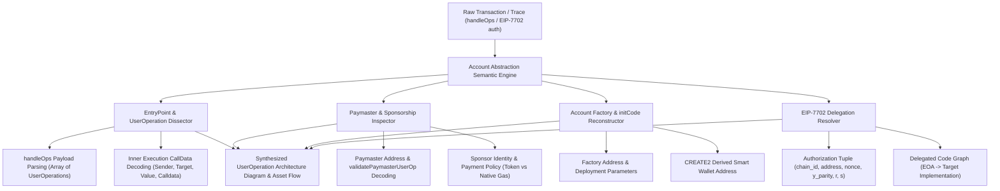

#### Technical Capabilities & Modules

1. **UserOperation Slicing & Deserialization:**
   - Detect calls to `EntryPoint.handleOps` (versions v0.6 and v0.7).
   - Unpack packed `UserOperation` structs: `sender`, `nonce`, `initCode`, `callData`, `accountGasLimits`, `preVerificationGas`, `gasFees`, `paymasterAndData`, `signature`.
   - Decode inner target transactions from `callData` (e.g. `execute`, `executeBatch`).

2. **Paymaster & Sponsorship Policy Reconstruction:**
   - Extract paymaster contract addresses from `paymasterAndData`.
   - Identify sponsorship models: free sponsorship, ERC-20 token payment, subscription-based allowance.
   - Decode paymaster verification signatures and post-operation accounting logic.

3. **Smart Account Factory & Creation Modeling:**
   - Parse `initCode`: separate factory address (first 20 bytes) from factory calldata (remaining bytes).
   - Calculate deterministic derived counterfactual contract addresses (`CREATE2`).
   - Map initialization ownership parameters (owners, signers, recovery guardians).

4. **EIP-7702 Code Delegation Analysis:**
   - Parse EIP-7702 transaction envelopes: authorization lists, delegated contract implementation addresses, and nonces.
   - Map execution boundaries: trace how an EOA's temporary code pointer behaves during multi-step contract calls.

5. **Semantic Identity & Flow Reconstruction:**
   - Reconstruct true user attribution: re-anchor transaction causality from the bundler relayer to the actual `UserOp.sender`.
   - Build an asset flow diagram showing token movements, gas reimbursements, and state changes.

#### Acceptance Criteria

- [ ] Automated decoding of ERC-4337 v0.6 and v0.7 `UserOperation` arrays from transaction traces.
- [ ] Accurate extraction and separation of inner execution calldata and target contracts.
- [ ] Attribution of paymaster sponsors and gas payment mechanisms.
- [ ] Parsing of `initCode` to identify account factory parameters and derived wallet addresses.
- [ ] Decoding of EIP-7702 authorization lists and delegated implementation contracts.

#### Related Issues & Dependencies

- Complements #972 (Solidity/EVM reverse engineering)
- Complements #2391 (EVM calldata and execution trace analysis)
- Complements #2394 (EVM transaction simulation and state diffs)


### #3736 [Feature] EVM pseudocode decompilation: stack-to-SSA IR, expressions and Solidity-like control/data-flow reconstruction

*matbrgz, open, https://github.com/morluto/rea/issues/3736*

#### Problem Statement & Context

In REA's existing EVM architecture, issue #2395 provides essential bytecode disassembly and basic block control flow graph (CFG) generation. However, analyzing raw EVM opcodes (`SWAP4`, `DUP2`, `JUMPI`, `MLOAD`, `ADD`) requires mental emulation of the 1024-element 256-bit EVM stack.

To elevate REA from an opcode viewer to a true high-level reverse engineering suite, an intermediate decompilation pipeline is required:
1. **Stack-to-SSA IR Lift**: Convert 256-bit stack operations into Static Single Assignment (SSA) virtual variables ($v_0, v_1, v_2$), tracking stack depth and resolving `SWAP` and `DUP` permutations.
2. **Expression Tree Reconstruction**: Collapse linear SSA statements into composite arithmetic and logical expressions (e.g. converting `AND(SHR(224, calldataload(0)), 0xffffffff)` into `msg.sig`).
3. **Control Flow De-Sugaring**: Reconstruct high-level control structures (`if/else`, `while`, `for`, `revert(reason)`) from raw `JUMP` and conditional `JUMPI` branches.
4. **Memory & Storage Pattern Recognition**: Detect compiler idioms: ABI decoding loops, dynamic array allocations, mapping slot calculations (`keccak256(key ++ slot)`), and packed storage variable packing/unpacking.
5. **Solidity-Like Pseudocode Generation**: Emit clean, human-readable pseudocode closely resembling high-level Solidity/Yul code with inferred variable types and function signatures.

REA needs a native decompiler pipeline (conceptually inspired by Heimdall-rs / Panoramix / Slither) that translates raw EVM bytecode into readable pseudocode.

#### Proposed Architecture

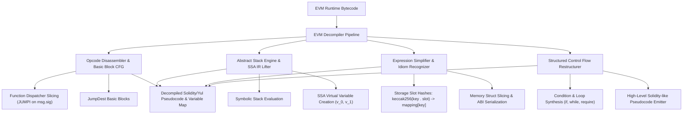

#### Technical Capabilities & Modules

1. **Symbolic Stack-to-SSA Transformation:**
   - Execute an abstract interpreter over each basic block, maintaining a symbolic stack of AST nodes.
   - Replace physical stack push/pop/swap/dup operations with immutable SSA assignments ($v_n = 	ext{op}(v_a, v_b)$).
   - Insert phi-nodes at control flow join points.

2. **Dispatcher & Function Slicing:**
   - Identify the contract function selector dispatcher tree (`PUSH4 selector, DUP2, EQ, PUSH2 dest, JUMPI`).
   - Extract 4-byte function selectors and isolate independent function subgraphs.
   - Correlate selectors with candidate human-readable signatures (via 4byte / OpenChain directories or EVMole).

3. **Storage & Memory Idiom Desugaring:**
   - Identify mapping slot computations: recognize `keccak256(abi.encode(key, slot))` patterns and rewrite as `mapping_X[key]`.
   - Identify dynamic array indexing: `keccak256(slot) + index`.
   - Identify memory string copying and revert reason extraction (`revert("Error string")`).

4. **Structured Control Flow Reconstruction:**
   - Perform dominator tree analysis to reconstruct conditional statements (`if-then-else`).
   - Detect natural loops and classify loop induction variables, loop conditions, and break statements.
   - Transform `ISZERO, JUMPI, PUSH 0, DUP1, REVERT` patterns into clean `require(condition)` assertions.

5. **Solidity-Like Pseudocode Formatting:**
   - Generate well-formatted, indented pseudocode matching modern Solidity syntax conventions.
   - Type-infer variables (address, uint256, bool, bytes32) based on operator contexts (e.g. `EXTCODESIZE` implies address, `SLT` implies signed integer).

#### Acceptance Criteria

- [ ] Successful conversion of raw EVM bytecode to SSA intermediate representation.
- [ ] De-sugaring of mapping and array storage access patterns into readable accessor syntax.
- [ ] Structural recovery of `if`, `else`, and loop statements from raw `JUMP`/`JUMPI` opcodes.
- [ ] Transformation of revert blocks into `require(condition, "reason")` expressions.
- [ ] Output of readable, syntactically coherent Solidity-like pseudocode.

#### Related Issues & Dependencies

- Complements #972 (Solidity/EVM reverse engineering)
- Complements #2395 (EVM disassembly and CFG generation)
- Complements #3716 (Common Bytecode and VM Framework)


### #2388 [Feature] Solidity: inspect bytecode CBOR metadata losslessly and bind supplied metadata files

*matbrgz, open, https://github.com/morluto/rea/issues/2388*

#### Analyst question and current gap

REA retains EVMole-reported terminal metadata in raw_result, but its JS binding leaves integer precision and non-text-key coverage unknown. A Solidity analyst needs a lossless account of the actual trailer and whether a supplied metadata JSON belongs to it.

#### Proposed outcome

- Parse the terminal length and bounded CBOR region from exact selected bytecode; retain decoded-byte offsets, raw bytes and carrier identity.
- Preserve integer precision, byte strings, unknown keys and unsupported CBOR values without converting them into guessed text. Report malformed, absent and ambiguous trailers distinctly.
- Decode admitted solc version representations, retaining release versus prerelease/unknown forms and raw values.
- Optionally bind a caller-selected local metadata JSON to the bytecode metadata commitment using the exact admitted content-addressing algorithm. Preserve unavailable or mismatched associations.
- Treat source URLs/hashes as metadata; do not retrieve IPFS/Swarm/source content implicitly or call inferred metadata verified original source.

#### Acceptance and verification

- [ ] Compiler-pinned owned fixtures cover metadata present, appendCBOR=false and bytecodeHash=none.
- [ ] Synthetic trailers cover reordered/unknown/non-text keys, large integers, truncated CBOR and invalid terminal lengths.
- [ ] Wrong supplied metadata and unknown commitment schemes stay mismatched/unverified.
- [ ] CLI/MCP retain the same fields and source ranges; parsing bounds, cancellation and legacy EVM results remain intact.
- [ ] Define one feature specification, one implementation plan and incremental tasks under docs/specs/solidity/cbor-metadata/ before implementation.

#### Scope and relationships

Offline caller-selected artifact inspection. Existing EVM interface recovery (PR #1051), retained delivery (PR #2308) and roadmap #972 are the foundations; this feature is independently scoped and does not reopen the entire roadmap. Parent language tracker: #2383. Use self-owned compiler fixtures and preserve provider/version provenance. New provider choices, if needed, follow CONTRIBUTING.md before substantial integration work.

#### Primary references

- [Solidity contract metadata](https://docs.soliditylang.org/en/latest/metadata.html)


#### Comment by matbrgz (2026-10-12) on #2388

#### Implementation & Triage Status Update

**Summary (ELI5):**
Extract and verify Solidity compiler metadata appended at the end of runtime/creation bytecode via CBOR encoding without data loss or heuristics.

**Current State & Validation:**
1. Branch `feat/solidity-cbor-metadata` contains:
   - Lossless CBOR decoder parsing compiler-embedded payloads (`ipfs`, `bzzr0`, `bzzr1`, `solc`).
   - Unit test suite (`src/evm/SolidityMetadata.test.ts`) verifying CBOR boundary lengths, version extraction across legacy (0.4.x - 0.5.x) and modern (0.8.x+) bytecodes.
   - Exact offset isolation to prevent trailing swarm hashes from distorting opcode disassembly or instructions coverage.
2. Next Step:
   - Format canonical spec under `docs/specs/evm/cbor-metadata/{spec.md,plan.md,tasks.md}` and submit the formal PR.


### #2389 [Feature] Solidity: select exact solc Standard JSON contract artifacts and bytecode kinds

*matbrgz, open, https://github.com/morluto/rea/issues/2389*

#### Analyst question and current gap

inspect_evm_interface accepts only explicit raw/hex carriers and leaves init/runtime kind unknown. A compiler output can contain several source files/contracts, creation and deployed objects, unlinked libraries, immutable references and diagnostics; it cannot be treated as one runtime hex string.

#### Proposed outcome

- Inspect caller-selected existing solc Standard JSON output without running a compiler; select an exact source-unit/contract and creation or deployed bytecode field.
- Preserve file digest, JSON source coordinates, selected object identity, recorded compiler/settings and diagnostics. Output errors must remain visible even if an external compiler exited successfully.
- Keep unresolved link placeholders, linkReferences and immutableReferences as distinct facts. Do not invent addresses or silently rewrite the input.
- Feed admitted concrete selected bytes to the existing EVM interface operation with explicit selection provenance; bytecode kind is a supplied compiler-artifact fact, not proof of deployment.
- Report absent outputs, malformed objects, conflicting contract names and compiler-version-dependent facets precisely.

#### Acceptance and verification

- [ ] An owned multi-contract solc fixture selects creation/deployed objects independently and preserves compiler diagnostics.
- [ ] Unlinked library placeholders are reported without being interpreted as hexadecimal bytes.
- [ ] Missing contracts, ambiguous basename selectors and out-of-range reference spans fail or remain unavailable precisely.
- [ ] CLI/MCP preserve exact selected identities with bounded JSON parsing and cancellation.
- [ ] Define one feature specification, one implementation plan and incremental tasks under docs/specs/solidity/compiler-artifacts/ before implementation.

#### Scope and relationships

Offline caller-selected artifact inspection. Existing EVM interface recovery (PR #1051), retained delivery (PR #2308) and roadmap #972 are the foundations; this feature is independently scoped and does not reopen the entire roadmap. Parent language tracker: #2383. Use self-owned compiler fixtures and preserve provider/version provenance. New provider choices, if needed, follow CONTRIBUTING.md before substantial integration work.

#### Primary references

- [Solidity compiler Standard JSON](https://docs.soliditylang.org/en/latest/using-the-compiler.html)


#### Comment by matbrgz (2026-10-12) on #2389

#### Triage & Architectural Review Notes

**Objective (ELI5):**
Disambiguate contract artifacts produced by `solc` Standard JSON output (`bin` creation bytecode vs `bin-runtime` deployed bytecode) and preserve provenance across compilation targets.

**Design Alignment:**
- **Boundary Ownership:** Standard JSON schema parsing belongs in `src/domain/evm/`. The domain contract must expose explicit discriminant properties (`bytecodeKind: "creation" | "deployed"`) rather than inferring role from byte length or deployment context.
- **Fail-Closed Validation:** Missing link references or unresolved library addresses (`__$30...$__`) must be retained as unresolved linkage evidence rather than zeroed or stripped.
- **Spec Target:** `docs/specs/evm/standard-json-artifacts/`


#### Comment by fangkangmi (2026-10-12) on #2389

I'd like to take this issue, working on it


### #2390 [Feature] Solidity: map EVM byte PCs to original and generated source spans

*matbrgz, open, https://github.com/morluto/rea/issues/2390*

#### Analyst question and current gap

EVM interface results retain byte offsets but do not interpret Solidity source maps. Source-map entries index instructions, while PUSH immediates change byte PCs; direct index-to-PC substitution would produce incorrect debugging locations.

#### Proposed outcome

- Consume caller-selected bytecode, source-map and source-ID facts from a selected compiler artifact, with explicit binding evidence.
- Decode compressed mapping inheritance and instruction ordinals into byte PC ranges using the admitted bytecode profile.
- Preserve original versus compiler-generated source identity, byte-based source spans, jump information and modifier depth when available.
- Return unmapped/generated/invalid/unknown associations explicitly; validate source spans against caller-supplied source bytes before presenting snippets.
- Keep compiler-attributed source positions distinct from reconstructed pseudocode and runtime observations. Do not read paths or fetch source URLs implicitly.

#### Acceptance and verification

- [ ] Pinned owned fixtures cover PUSH1/PUSH32, omitted mapping fields, generated Yul sources, modifier nesting and UTF-8 source text.
- [ ] Nonexistent source IDs, out-of-range spans, truncated instructions and wrong artifact associations never produce verified snippets.
- [ ] Creation and deployed maps cannot be joined interchangeably.
- [ ] CLI/MCP map exact selected PCs and retain coverage, bounds and cancellation.
- [ ] Define one feature specification, one implementation plan and incremental tasks under docs/specs/solidity/source-mappings/ before implementation.

#### Scope and relationships

Offline caller-selected artifact inspection. Existing EVM interface recovery (PR #1051), retained delivery (PR #2308) and roadmap #972 are the foundations; this feature is independently scoped and does not reopen the entire roadmap. Parent language tracker: #2383. Use self-owned compiler fixtures and preserve provider/version provenance. New provider choices, if needed, follow CONTRIBUTING.md before substantial integration work.

#### Primary references

- [Solidity source mapping semantics](https://docs.soliditylang.org/en/latest/internals/source_mappings.html)


#### Comment by matbrgz (2026-10-12) on #2390

#### Triage & Architectural Review Notes

**Objective (ELI5):**
Map EVM program counters (PC byte offsets) back to exact source code spans (file, line, column, length) using compiler `srcmap` / `srcmap-runtime`.

**Critical Considerations:**
1. **Compiler-Generated Code:** In Solidity 0.8.x and Yul IR pipelines, certain opcodes originate from compiler internal routines (utility functions, panic reverts). These carry source index `-1` or out-of-bounds spans. They must be explicitly classified as `compiler-generated` evidence rather than missing or faulty source files.
2. **PC-to-Instruction Offset:** EVM instruction byte offsets deviate from instruction indices due to variable-length `PUSH<N>` data bytes. The PC mapping table must index by exact byte PC.
3. **Spec Target:** `docs/specs/evm/source-mappings/`


### #2391 [Feature] Solidity: decode supplied ABI calldata, logs and revert payloads with explicit ambiguity

*matbrgz, open, https://github.com/morluto/rea/issues/2391*

#### Analyst question and current gap

REA currently infers dispatch selectors and argument/mutability strings from bytecode. Those candidates do not provide verified function names or an ABI-aware interpretation of caller-selected calldata, event logs and revert bytes.

#### Proposed outcome

- Accept a caller-selected ABI plus a separately identified local payload and its role: calldata, return data, event log or revert data.
- Compute canonical signatures/selectors/event identifiers using Ethereum Keccak and preserve all matching candidates. Distinguish caller-supplied ABI facts from bytecode inference.
- Decode admitted tuples/arrays/dynamic types with lossless integer and byte values; retain raw payload and byte ranges.
- Preserve unknown custom errors/selectors, malformed offsets, trailing bytes and ambiguous matches instead of selecting a guessed signature.
- Keep indexed dynamic event values as hashes rather than claiming to recover their original contents. No signature database, RPC, wallet or transaction action is implied.

#### Acceptance and verification

- [ ] Owned contract fixtures cover overloads, nested dynamic tuples/arrays, custom errors, Error/Panic payloads, anonymous events and indexed dynamic fields.
- [ ] Synthetic malformed offsets/lengths and adversarial size expansion are rejected before allocation.
- [ ] Conflicting ABI candidates remain distinct; every uint256/int256 stays lossless through JSON.
- [ ] CLI/MCP provide equivalent decoded facts, raw evidence and unavailable facets.
- [ ] Define one feature specification, one implementation plan and incremental tasks under docs/specs/solidity/abi-decoding/ before implementation.

#### Scope and relationships

Offline caller-selected artifact inspection. Existing EVM interface recovery (PR #1051), retained delivery (PR #2308) and roadmap #972 are the foundations; this feature is independently scoped and does not reopen the entire roadmap. Parent language tracker: #2383. Use self-owned compiler fixtures and preserve provider/version provenance. New provider choices, if needed, follow CONTRIBUTING.md before substantial integration work.

#### Primary references

- [Solidity ABI specification](https://docs.soliditylang.org/en/latest/abi-spec.html)


#### Comment by matbrgz (2026-10-12) on #2391

#### Triage & Architectural Review Notes

**Objective (ELI5):**
Decode ABI calldata, emitted event topics/data, and revert reasons into structured parameters while explicitly signaling ambiguities (e.g. 4-byte selector collisions).

**Core Invariants:**
1. **Ambiguity Preservation:** When a 4-byte function selector matches multiple ABI definitions, the tool must not guess. It must return all candidate matches marked with `ambiguous: true` and their respective parameter decodings.
2. **Modern Error Support:** Must natively decode standard `Error(string)` (`0x08c379a0`), `Panic(uint256)` (`0x4e487b71`), and arbitrary custom errors from the contract's ABI. Unknown error selectors should remain raw bytes with `unmatched_custom_error` diagnostics.


### #2392 [Feature] Solidity: inspect and compare compiler storage layouts without inferring live state

*matbrgz, open, https://github.com/morluto/rea/issues/2392*

#### Analyst question and current gap

The current EVM interface profile does not expose Solidity storage layouts. An analyst comparing two builds needs typed slot/offset facts and specific layout changes without treating them as observed chain state or a proven safe upgrade.

#### Proposed outcome

- Consume caller-selected compiler storageLayout and transientStorageLayout artifacts, retaining source/contract/build identity and unsupported schema versions.
- Preserve arbitrary-width slots, packed byte offsets, type references, inherited declarations, struct fields, array/mapping structure and recursive references.
- Compare explicitly paired layouts with explanations for moved, removed, added and type-changed fields; do not infer semantic upgrade safety from equal slot coordinates.
- Keep persistent versus transient storage distinct. Report partial/unknown type coverage and unresolved build association.
- Provide focused CLI/MCP inventory and comparison with bounded traversal and stable paging.

#### Acceptance and verification

- [ ] Own compiler-pinned fixtures cover packing, inheritance, structs, mappings, dynamic arrays and admitted transient-layout output.
- [ ] Malformed type graphs, cycles, oversized slot values and missing type references remain bounded and lossless.
- [ ] A changed packed field, inheritance order and storage type produce specific deltas.
- [ ] No RPC or storage-value acquisition occurs; same layout does not produce a claim of equivalent execution.
- [ ] Record one feature specification, one implementation plan and incremental tasks under docs/specs/solidity/storage-layout/ before code.

#### Scope and relationships

Independently scoped follow-up to roadmap #972 and existing EVM interface PR #1051; parent TIOBE language tracker #2383. Initial analysis uses caller-selected local evidence and owned fixtures. New provider choices require the explicit CONTRIBUTING.md maintainer decision before substantial implementation for integration. Runtime acquisition, local execution and blockchain mutation are not implicit parts of this feature.

#### Primary references

- [Solidity storage-layout semantics](https://docs.soliditylang.org/en/latest/internals/layout_in_storage.html)


#### Comment by matbrgz (2026-10-12) on #2392

#### Triage & Architectural Review Notes

**Objective (ELI5):**
Parse and visualize EVM contract storage layouts (`storageLayout` from solc) without connecting to a live blockchain network or querying live RPC state.

**Key Requirements:**
1. **Packing & Offsets:** Correctly model continuous 32-byte slot assignments and byte offsets (`offset: 0..31`) for packed elementary types (`uint128`, `bool`, `address`).
2. **Dynamic Structures:** Represent mappings and dynamic arrays by their hashing derivations (`keccak256(p . s)`) as structural recipes rather than attempting runtime key enumeration.


### #2393 [Feature] Solidity: inspect offline proxy patterns and supplied implementation-slot evidence

*matbrgz, open, https://github.com/morluto/rea/issues/2393*

#### Analyst question and current gap

Interface inference on proxy bytecode can hide the distinction between proxy dispatch and implementation behavior. REA needs explicitly attributed offline proxy relationships rather than automatic network resolution or guessed deployed identities.

#### Proposed outcome

- Recognize admitted ERC-1167 runtime patterns from exact local bytecode and retain the embedded implementation address with byte-range evidence.
- Interpret explicitly supplied recorded ERC-1967 implementation/beacon/admin slots with snapshot identity, availability and precision.
- Separate observed slot values, bytecode-pattern classification and inferred delegation edges. Missing storage differs from observed zero.
- Preserve code address and storage/execution context separately for delegatecall; retain unresolved beacon relationships instead of executing implementation() implicitly.
- Keep proxy-chain cycles, modified/unknown patterns and unmatched implementation bytecode explicit. No RPC lookup, wallet or deployment action is implied.

#### Acceptance and verification

- [ ] Own/synthetic fixtures cover exact minimal proxies, altered patterns, implementation/beacon alternatives and observed zero versus unavailable slots.
- [ ] Wrong snapshot/chain/block associations cannot become verified implementation relationships.
- [ ] Cycles and missing implementation artifacts terminate with explicit unresolved edges.
- [ ] CLI/MCP preserve raw bytes/slots and distinguish pattern evidence from actual runtime calls.
- [ ] Record one feature specification, one implementation plan and incremental tasks under docs/specs/solidity/proxy-evidence/ before code.

#### Scope and relationships

Independently scoped follow-up to roadmap #972 and existing EVM interface PR #1051; parent TIOBE language tracker #2383. Initial analysis uses caller-selected local evidence and owned fixtures. New provider choices require the explicit CONTRIBUTING.md maintainer decision before substantial implementation for integration. Runtime acquisition, local execution and blockchain mutation are not implicit parts of this feature.

#### Primary references

- [ERC-1167 minimal proxy](https://eips.ethereum.org/EIPS/eip-1167)
- [ERC-1967 proxy slots](https://eips.ethereum.org/EIPS/eip-1967)


#### Comment by matbrgz (2026-10-12) on #2393

#### Triage & Architectural Review Notes

**Objective (ELI5):**
Identify upgradeable proxy patterns (ERC-1967, ERC-1822 UUPS, Diamond Multi-Facet ERC-2535) and trace static implementation slots entirely offline.

**Implementation Invariants:**
- Verify canonical storage slots directly:
  - ERC-1967 Implementation: `0x360894a13ba1a3210667c828492db98dca3e2076cc3735a920a3ca505d382bbc`
  - ERC-1967 Admin: `0xb53127684a568b3173ae13b9f8a6016e243e63b6e8ee1178d6a717850b5d6103`
  - ERC-1967 Beacon: `0xa3f0ad74e5423aebfd80d3ef4346578335a9a72aeaee59ff6cb3582b35133d50`
- If an implementation address cannot be resolved from supplied artifacts or recorded storage diffs, report `implementation: unknown` instead of executing remote eth_call heuristics.


### #2394 [Feature] Solidity: inspect recorded EVM opcode/call traces and attribute debugging locations

*matbrgz, open, https://github.com/morluto/rea/issues/2394*

#### Analyst question and current gap

Static selectors do not show which call, revert or source location ran. REA can add a recorded-debugging lane without starting a node, executing contracts or retrieving transactions.

#### Proposed outcome

- Import explicitly selected local captures for separately admitted Geth struct/opcode-log and callTracer profiles; record capture digest, producer/version/configuration and available transaction/block/fork context.
- Retain exact PCs, depth, call type, stack/memory/storage availability, return/revert payloads and code versus storage context when established.
- Link known bytecode/source-map/ABI evidence without inventing identity from addresses or treating missing trace facets as empty state.
- Expose bounded step/call selections and source-attributed observations through CLI/MCP. Record truncation and unverified capture claims.
- Keep original recorded observations separate from any later replay-derived results; importing a trace performs no RPC, wallet action or contract execution.

#### Acceptance and verification

- [ ] Owned local test contracts produce nested calls, delegatecall, reverts, logs and persistent/transient storage activity outside the import operation.
- [ ] Real captured formats establish each advertised producer profile; synthetic JSON alone is insufficient.
- [ ] Truncated captures, disabled memory/stack/storage, unknown code and wrong source-map associations preserve partial facets.
- [ ] Large captures page/bound records and cancel without reading source URLs or launching a node.
- [ ] Record one feature specification, one implementation plan and incremental tasks under docs/specs/solidity/recorded-traces/ before code.

#### Scope and relationships

Independently scoped follow-up to roadmap #972 and existing EVM interface PR #1051; parent TIOBE language tracker #2383. Initial analysis uses caller-selected local evidence and owned fixtures. New provider choices require the explicit CONTRIBUTING.md maintainer decision before substantial implementation for integration. Runtime acquisition, local execution and blockchain mutation are not implicit parts of this feature.

#### Primary references

- [Geth built-in trace profiles](https://geth.ethereum.org/docs/developers/evm-tracing/built-in-tracers)


#### Comment by matbrgz (2026-10-12) on #2394

#### Triage & Architectural Review Notes

**Objective (ELI5):**
Reconstruct recorded execution paths (EVM opcode execution traces and call tree frames) offline and map steps back to source coordinates.

**Boundary Contract:**
- Consume standard debug traces (`debug_traceTransaction` / `structLogs` or Foundry/Anvil call traces).
- Frame hierarchy must preserve child calls (`DELEGATECALL`, `STATICCALL`, `CALL`, `CREATE2`), gas consumption delta, and retained return/revert memory slices.
- Trace step PC numbers must look up directly into the verified source mapping provider (#2390).


### #2395 [Design] Solidity: expose fork-profiled EVM disassembly and bounded control-flow evidence

*matbrgz, open, https://github.com/morluto/rea/issues/2395*

#### Analyst question and current gap

REA's interface-only EVMole adapter explicitly excludes disassembly/basic-block/CFG facets and leaves hardfork unknown. Selector inference cannot explain branches or establish the semantics of later-fork instructions.

#### Proposed outcome

- Evaluate an existing engine behind a separately scoped static instruction/CFG contract, with actual adapter/engine version and admitted fork profile.
- Retain byte PCs, opcode bytes, PUSH immediate spans, block boundaries and direct/unresolved jump edges; immediate data is not executable code.
- Distinguish unknown/unavailable dynamic jump targets from exhaustively resolved edges; bound graph/result growth.
- Report unsupported fork/opcode/container profiles precisely. Legacy flat bytecode admission does not imply EOF or every L2 variant.
- Label reconstructed expressions/pseudocode as derivations/inferences if proposed later; this first contract does not execute code or silently reuse an engine's Latest default.

#### Acceptance and verification

- [ ] Owned compiler fixtures span documented optimizer/viaIR settings and representative admitted fork targets.
- [ ] Tests distinguish PUSH immediates containing JUMPDEST-like bytes, truncated PUSH data, dynamic jumps, PUSH0 and admitted transient-storage opcodes.
- [ ] Unknown fork and EOF-style inputs preserve explicit unsupported profiles.
- [ ] CLI/MCP retain identity, unresolved edges, bounds and cancellation; actual engine runs verify every supported profile.
- [ ] Record one feature specification, one implementation plan and incremental tasks under docs/specs/solidity/fork-cfg/ before code.

#### Scope and relationships

Independently scoped follow-up to roadmap #972 and existing EVM interface PR #1051; parent TIOBE language tracker #2383. Initial analysis uses caller-selected local evidence and owned fixtures. New provider choices require the explicit CONTRIBUTING.md maintainer decision before substantial implementation for integration. Runtime acquisition, local execution and blockchain mutation are not implicit parts of this feature.

#### Primary references

- [EIP-3855 PUSH0](https://eips.ethereum.org/EIPS/eip-3855)
- [EIP-1153 transient storage](https://eips.ethereum.org/EIPS/eip-1153)


#### Comment by matbrgz (2026-10-12) on #2395

#### Triage & Architectural Review Notes

**Objective (ELI5):**
Provide fork-aware EVM disassembly and bounded basic-block control flow graphs (CFGs) without infinite expansion risk.

**Technical Constraints:**
- **Fork Profiles:** Explicitly account for opcode introducers across EVM hardforks:
  - Shanghai (`PUSH0` `0x5f`)
  - Cancun (`TLOAD` `0x5c`, `TSTORE` `0x5d`, `MCOPY` `0x5e`)
  - Prague / Osaka future opcodes.
- **CFG Bounds:** Jump destinations (`JUMPDEST` `0x5b`) linked via static `PUSH<N>` analysis must enforce bounded exploration depth and block count to guard against maliciously tangled jump tables or decompiler traps.


### #2396 [Feature] Solidity: compare exact bytecode with separately explained compiler patch spans

*matbrgz, open, https://github.com/morluto/rea/issues/2396*

#### Analyst question and current gap

Two Solidity builds can differ in metadata, library links or immutable patch values. A useful comparison must show those differences while preserving exact byte inequality and avoiding a false behavioral-equivalence claim.

#### Proposed outcome

- Compare separately selected concrete bytecodes with original carrier and decoded identities, byte lengths and exact changed ranges.
- Optionally consume explicitly bound compiler metadata/link/immutable ranges; report an additional comparison view with each explained span and original values.
- Do not normalize arbitrary suffixes, guessed addresses or unexplained differences. Reject overlapping/out-of-range or incorrectly associated patch spans.
- Preserve creation versus deployed selection and unknown association; compiler artifact facts are not proof of deployment.
- Keep exact equality, equality under stated span exclusions and semantic equivalence as distinct conclusions. Metadata/data can be observable to executing code; excluded spans do not establish behavior equality.

#### Acceptance and verification

- [ ] Pinned own fixtures cover metadata-only changes, linked libraries, constructor-patched immutables and actual executable differences.
- [ ] Wrong reference ranges, overlapping masks and unbound artifacts never produce an explained equality result.
- [ ] Raw versus differently formatted hex carriers retain distinct carrier identities and equal decoded bytes when appropriate.
- [ ] CLI/MCP retain both complete byte identities, changed/excluded ranges, cancellation and bounded output.
- [ ] Record one feature specification, one implementation plan and incremental tasks under docs/specs/solidity/bytecode-comparison/ before code.

#### Scope and relationships

Independently scoped follow-up to roadmap #972 and existing EVM interface PR #1051; parent TIOBE language tracker #2383. Initial analysis uses caller-selected local evidence and owned fixtures. New provider choices require the explicit CONTRIBUTING.md maintainer decision before substantial implementation for integration. Runtime acquisition, local execution and blockchain mutation are not implicit parts of this feature.

#### Primary references

- [Compiler bytecode and patch-reference outputs](https://docs.soliditylang.org/en/latest/using-the-compiler.html)
- [Solidity metadata bytecode effects](https://docs.soliditylang.org/en/latest/metadata.html)


#### Comment by matbrgz (2026-10-12) on #2396

#### Triage & Architectural Review Notes

**Objective (ELI5):**
Compare deployed on-chain bytecode against locally recompiled bytecode, isolating and explaining legitimate compiler variances (link references, immutable values, metadata hashes).

**Diff Taxonomy:**
1. **CBOR Metadata Suffix (#2388):** Highlighted separately as non-executable provenance differences (compiler version, hash type).
2. **Linker Placeholders:** Explaining 20-byte library address patch spans (`__$30...$__`).
3. **Immutable Slots:** Recognizing constructor assignments replaced into deployed code as data slots rather than code logic alterations.
4. If code outside these allowed patch spans differs, mark the comparison as `mismatch`.


## Tier 2: non-EVM VMs and UTXO chains


### #3730 [Feature] Bitcoin reverse engineering: raw transactions, PSBT, Script/Tapscript, descriptors, Miniscript and UTXO-flow reconstruction

*matbrgz, open, https://github.com/morluto/rea/issues/3730*

#### Problem Statement & Context

Bitcoin represents the foundational UTXO (Unspent Transaction Output) blockchain architecture. Modern Bitcoin development has evolved significantly beyond legacy P2PKH/P2SH scripts into complex multi-sig policies, smart custody setups, and privacy protocols:
1. **Raw Transaction & Serialization Formats**: Legacy, Segregated Witness (SegWit / BIP141), and Taproot (BIP341/342) transaction serializations, parsing inputs, outputs, locktimes, sequence numbers, and witness stacks.
2. **Partially Signed Bitcoin Transactions (PSBT v0 & v2 / BIP174, BIP370)**: Key-value binary maps containing global, input, and output maps. Tracks BIP32 derivation paths, non-witness and witness UTXOs, sighash types, partial signatures, Taproot key/script spend trees, and MuSig2 aggregation metadata.
3. **Script, Tapscript & Execution Engine**: Forth-like stack-based bytecode (`OP_CHECKSIG`, `OP_CHECKMULTISIG`, `OP_CHECKLOCKTIMEVERIFY`, `OP_CHECKSEQUENCEVERIFY`, `OP_CHECKSIGADD`).
4. **Output Descriptors & Miniscript**: Standardized human-readable and machine-analyzable spending policies (`wpkh()`, `wsh()`, `tr()`, Miniscript Boolean expressions modeling `and`, `or`, `thresh`, `older`, `after`).
5. **UTXO Graph & Transaction Lineage**: Graphing spending chains, change detection heuristics, and multi-input clustering across analyst-provided transaction datasets.

REA currently lacks a dedicated Bitcoin engine capable of parsing raw transactions, inspecting PSBT signing states, disassembling Taproot trees, and modeling Miniscript policies offline.

#### Proposed Architecture

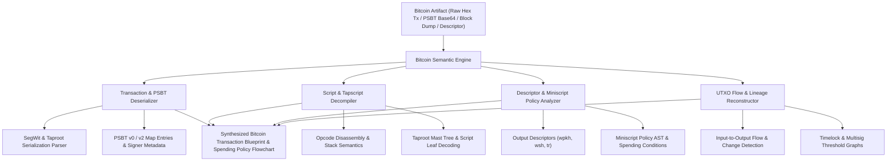

#### Technical Capabilities & Modules

1. **Raw Transaction & Block Parsing:**
   - Deserialize raw transaction byte streams supporting legacy, SegWit (marker `0x00`, flag `0x01`), and Taproot formats.
   - Decode input outpoints (TxID + Vout), scriptSig, nSequence (BIP68 relative timelocks), outputs (value in satoshis + scriptPubKey), and nLockTime (BIP65 absolute timelocks).

2. **PSBT v0 and v2 Inspection:**
   - Parse binary PSBT maps: Global, Inputs, and Outputs.
   - Extract BIP32 key derivations (fingerprints + paths), proprietary fields, sighash types, and partial signatures.
   - Decode Taproot PSBT fields: internal keys, Taproot output keys, leaf hashes, script trees, and MuSig2 participant states without signing.

3. **Script & Tapscript Disassembly:**
   - Disassemble Bitcoin Script opcodes into clean symbolic representations.
   - Trace execution semantics on an abstract stack to determine satisfiability conditions.
   - Reconstruct Taproot MAST (Merkelized Alternative Script Tree) hierarchies: internal key, leaf scripts, leaf versions, and parity bits.

4. **Output Descriptors & Miniscript Analysis:**
   - Parse standard output script descriptors: `pk()`, `pkh()`, `wpkh()`, `sh()`, `wsh()`, `tr()`.
   - Parse Miniscript expressions: compile spending policies into logical trees detailing required signatures, time delays (`older()`, `after()`), and hash preimages (`sha256()`, `ripemd160()`).
   - Audit spending policies for malleability risks or unreachable spending branches.

5. **UTXO Lineage & Spending Graph:**
   - Build a directed acyclic graph (DAG) tracing transaction inputs back to parent UTXOs across provided transaction batches.
   - Apply standard change output heuristics (round values, script type matching) to model economic transfer flows.

#### Acceptance Criteria

- [ ] Static decoding of raw Bitcoin transactions across Legacy, SegWit, and Taproot.
- [ ] Complete parsing and auditing of PSBT v0 and v2 packages, detailing missing signatures and required keys.
- [ ] Disassembly of Tapscript leaves and visualization of Taproot script trees.
- [ ] Parsing and AST validation of Miniscript spending policies.
- [ ] Generation of an interactive UTXO flow graph depicting inputs, outputs, and locktime constraints.

#### Related Issues & Dependencies

- Complements #3621 (Unknown binary file-format inference)
- Complements #3698 (Interactive entertainment and asset reverse engineering tracker)


### #3731 [Feature] Move VM reverse engineering: bytecode modules, abilities, resources, types and call graphs

*matbrgz, open, https://github.com/morluto/rea/issues/3731*

#### Problem Statement & Context

The Move programming language and MoveVM represent a modern smart contract execution model designed around linear types, first-class resources, and formal verifiability. Move powers major high-throughput Layer 1 blockchains, primarily **Aptos** and **Sui**, each featuring unique architectural extensions:
- **Core MoveVM Bytecode**: Bytecode modules (`.mv`) composed of 16-bit table headers, constant pools, address/module handles, struct definitions, function signatures, field handles, and register-less stack-based opcodes (`MoveLoc`, `CopyLoc`, `BorrowField`, `Pack`, `Unpack`).
- **First-Class Resources & Abilities**: Struct abilities (`copy`, `drop`, `store`, `key`) strictly enforcing ownership semantics (resources cannot be copied or dropped unless explicitly permitted).
- **Aptos Move**: Global storage partitioned by user account addresses (`0x1::coin::CoinStore<AptosCoin>`), resource groups, and module table changesets.
- **Sui Move**: Object-centric architecture where state is stored in discrete, typed objects (UID, version, owner: address/shared/immutable), package linkage tables, type-origin records, and programmable transaction blocks (PTB).

Reverse engineering a compiled Move package currently requires disparate command-line tools. REA needs a unified MoveVM reverse engineering engine capable of disassembling Move bytecode, analyzing struct abilities, and reconstructing cross-module call graphs for both Aptos and Sui targets.

#### Proposed Architecture

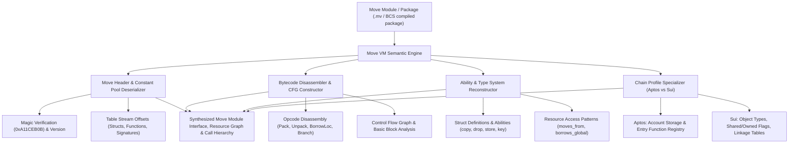

#### Technical Capabilities & Modules

1. **Move Bytecode Deserialization (`.mv`):**
   - Parse Move binary header: magic bytes (`0xA11CEB0B`), bytecode version, and table count.
   - Deserialize internal table streams: `ModuleHandle`, `StructHandle`, `FunctionHandle`, `FieldHandle`, `TypeSignature`, `ConstantPool`.
   - Support both module binaries and Move script binaries.

2. **Opcode Disassembly & Control Flow Reconstruction:**
   - Disassemble all standard MoveVM instructions: local variable operations, reference operations, struct operations (`Pack`, `Unpack`, `BorrowField`), and arithmetic/comparison opcodes.
   - Reconstruct basic blocks and control flow graphs from relative jump targets.

3. **Abilities & Resource Safety Verification:**
   - Extract declared abilities for every struct definition:
     - `copy`: Can be cloned.
     - `drop`: Can be popped or discarded.
     - `store`: Can be stored inside other structs.
     - `key`: Can serve as a global storage resource key or Sui object root.
   - Detect operations interacting with global storage (`move_to`, `move_from`, `borrow_global`, `borrow_global_mut`).

4. **Sui Object & Package Linkage Reconstruction:**
   - Parse Sui-specific package metadata:
     - Linkage table mapping original package IDs to upgraded package addresses.
     - Type origin table tracking struct provenance across package versions.
   - Reconstruct programmable transaction block entrypoints (`public entry fun`) and object parameters (owned vs shared vs immutable references).

5. **Aptos Resource & Changeset Modeling:**
   - Map entry functions, initialization functions, and view functions.
   - Model resource group definitions and account storage layouts.

#### Acceptance Criteria

- [ ] Automated detection and parsing of Move bytecode binaries (`.mv`) across Aptos and Sui format revisions.
- [ ] Disassembly of MoveVM bytecode opcodes into structured instructions with typed operand references.
- [ ] Accurate extraction of struct definitions, field types, and declared abilities (`copy`, `drop`, `store`, `key`).
- [ ] Reconstruction of cross-module dependencies and function call hierarchies.
- [ ] Generation of an interactive resource and object interaction diagram.

#### Related Issues & Dependencies

- Complements #3621 (Unknown binary file-format inference)
- Complements #3716 (Common Bytecode and VM Framework)


### #3732 [Feature] Starknet reverse engineering: Cairo, Sierra/CASM, class hashes, entrypoints and storage graphs

*matbrgz, open, https://github.com/morluto/rea/issues/3732*

#### Problem Statement & Context

Starknet is the leading validity rollup (zk-STARK Layer 2) on Ethereum, executing provable smart contracts compiled via the Cairo programming language.

Unlike standard register or stack virtual machines, Starknet smart contracts operate through a unique two-stage intermediate compilation architecture:
1. **Cairo Assembly (CASM)**: Low-level algebraic assembly executed on the Cairo CPU, operating over field elements in the Stark prime field ($P = 2^{251} + 17 \cdot 2^{192} + 1$). Instructions manipulate memory cells (`[fp + N]`, `[ap + M]`) ensuring all operations satisfy polynomial algebraic constraints.
2. **Sierra (Safe Intermediate Execution Representation)**: An intermediate representation that guarantees every program execution is provable (preventing non-halting loops and out-of-gas reverts from evading proof generation). Sierra code consists of strongly-typed libfunc calls (`branch_align`, `array_new`, `felt252_add`, `u256_sub`).
3. **Contract Class Artifacts (`contract_class.json`)**: Compiled contract artifacts declaring ABI, Sierra program bytecode, entrypoint selectors (External, L1 Handler, Constructor), and Cairo compiler versions.
4. **Class Hash & Identity**: Unique Pedersen or Poseidon cryptographic hash over the contract class definition uniquely identifying code on-chain.
5. **Storage Layout & State Mapping**: Storage variables addressed via Poseidon hashes of variable names and key mappings.

Reverse engineering a deployed Starknet contract requires decompiling Sierra and CASM bytecode, mapping entrypoints to function selectors, and modeling contract storage layouts.

#### Proposed Architecture

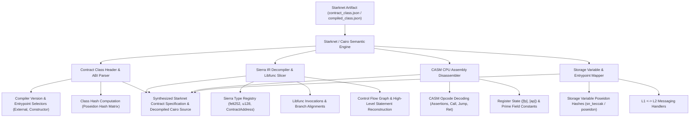

#### Technical Capabilities & Modules

1. **Starknet Contract Class Deserialization:**
   - Ingest modern Cairo 1.x / 2.x `contract_class.json` and compiled CASM classes.
   - Parse ABI descriptors: function signatures, event definitions, struct definitions, and custom enum types.
   - Verify Starknet class hash calculation (Poseidon hash of contract class components).

2. **Sierra IR Decompilation & Libfunc Analysis:**
   - Parse Sierra type declarations and libfunc declarations (`core::integer`, `core::array`, `core::starknet`).
   - Disassemble Sierra statement lists into basic blocks.
   - Reconstruct high-level control flow: match expressions, loops, and conditional branches.

3. **CASM (Cairo Assembly) Disassembly:**
   - Disassemble raw CASM instructions into mnemonic statements: `[ap] = [fp + 1] + [fp + 2]`, `jmp rel X if [fp] != 0`, `call rel Y`.
   - Validate prime field arithmetic constants ($P = 2^{251} + 17 \cdot 2^{192} + 1$).
   - Correlate compiled CASM byte offsets with corresponding Sierra statement indices.

4. **Storage Layout & Entrypoint Selector Resolution:**
   - Map entrypoint selectors (250-bit hashes of function names via `sn_keccak`) to corresponding Sierra functions.
   - Reconstruct storage variable names and calculate their base storage address slots.

5. **L1 ↔ L2 Messaging Handler Reconstruction:**
   - Map L1 Handler entrypoints (`#[l1_handler]`) receiving messages from Ethereum Layer 1 contracts.
   - Model outgoing `send_message_to_l1` call signatures.

#### Acceptance Criteria

- [ ] Parsing and structural validation of Cairo contract class artifacts (`contract_class.json`).
- [ ] Disassembly and control flow graph generation for Sierra program bytecodes.
- [ ] Disassembly of CASM algebraic instructions with register offset resolution.
- [ ] Accurate resolution of entrypoint selectors to public functions.
- [ ] Reconstruction of contract storage variables and L1 handler entrypoints.

#### Related Issues & Dependencies

- Complements #3621 (Unknown binary file-format inference)
- Complements #3716 (Common Bytecode and VM Framework)


### #3738 [Feature] Polkadot/Substrate reverse engineering: SCALE metadata, runtime Wasm, pallets, extrinsics and runtime-upgrade diffs

*matbrgz, open, https://github.com/morluto/rea/issues/3738*

#### Problem Statement & Context

Polkadot and Substrate-based blockchains employ a unique runtime architecture: the entire blockchain state transition logic is compiled into a WebAssembly binary (`runtime.wasm`) stored directly within the on-chain storage. When a blockchain upgrade occurs, the runtime Wasm is overwritten on-chain (forkless runtime upgrade), fundamentally altering pallets, storage structures, extrinsics, and dispatch calls.

Reverse engineering a Substrate chain, node snapshot, or transaction requires decoding:
1. **SCALE Codec (Simple Concatenated Aggregate Little-Endian)**: Compact binary serialization format used across Substrate for types, storage entries, and network packets.
2. **SCALE Runtime Metadata (V14 & V15)**: Self-describing type registry (`PortableRegistry`) and pallet manifests embedded in the runtime. Defines every pallet, call function (`Call`), storage entry, event, custom error, and constant.
3. **Runtime Wasm Blob (`:code`)**: Compressed or uncompressed WebAssembly module implementing runtime API entrypoints (`Core_version`, `Metadata_metadata`, `BlockBuilder_apply_extrinsic`).
4. **Pallet Architecture & Extrinsics**: Modularity decomposed into individual pallets (`System`, `Balances`, `Staking`, `Governance`). Extrinsics (transactions) encoded as pallet index + call index + arguments.
5. **Runtime Upgrade Diffing**: Comparing Metadata V14/V15 and Wasm binaries between Block $N$ and Block $N+1$ to determine what pallets were added, storage layouts migrated, or call signatures modified.

REA needs a dedicated Substrate engine capable of parsing SCALE metadata, disassembling runtime Wasm entrypoints, decoding extrinsics, and performing semantic diffs across runtime upgrades.

#### Proposed Architecture

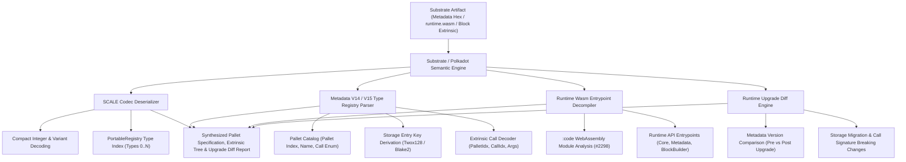

#### Technical Capabilities & Modules

1. **SCALE Codec & PortableRegistry Parser:**
   - Decode SCALE primitive types (Compact integers, booleans, fixed arrays, vectors, options, results).
   - Parse Metadata V14 and V15 `PortableRegistry`: reconstruct user-defined structs, enums, tuples, and bit sequences.

2. **Pallet Catalog & Storage Key Derivation:**
   - Enumerate all pallets registered in the runtime: name, index, calls, storage, events, errors, constants.
   - Calculate Substrate storage keys: apply hasher algorithms (`Twox128(PalletName) ++ Twox128(StorageName) ++ Hasher(Key)` using Blake2_128Concat, Twox64Concat, Identity).

3. **Extrinsic (Transaction) Dissection:**
   - Parse signed and unsigned extrinsic payloads: version header, signature, nonce, tip, era (mortality), and call data.
   - Resolve pallet index and call index into human-readable function names and typed parameter values.

4. **Runtime Wasm Introspection:**
   - Ingest runtime WebAssembly blobs (`:code`) utilizing REA's WASM engine (#2298, #2350).
   - Trace exported Substrate runtime API functions: `Core_version`, `Metadata_metadata`, `TaggedTransactionQueue_validate_transaction`.

5. **Semantic Runtime Upgrade Diffing:**
   - Compare two metadata snapshots across runtime upgrades.
   - Identify added/removed/renamed pallets.
   - Detect breaking changes in storage item types and extrinsic call parameter schemas.

#### Acceptance Criteria

- [ ] Automated parsing and decoding of Substrate SCALE Metadata V14 and V15 payloads.
- [ ] Complete reconstruction of pallet catalogs, call functions, and storage item keys.
- [ ] Accurate decoding of raw extrinsics into human-readable JSON call trees.
- [ ] Introspection of runtime Wasm modules and export of runtime API signatures.
- [ ] Semantic diff reporting structural changes between consecutive runtime versions.

#### Related Issues & Dependencies

- Complements #2350 (Inspect WebAssembly binaries)
- Complements #2298 (Decompile WebAssembly modules)
- Complements #3621 (Unknown binary file-format inference)


### #3739 [Feature] CosmWasm and IBC reverse engineering: Wasm contracts, schemas, packet lifecycles and cross-chain state machines

*matbrgz, open, https://github.com/morluto/rea/issues/3739*

#### Problem Statement & Context

The Cosmos ecosystem and interchain network rely on two foundational smart contract and networking standards:
1. **CosmWasm (WebAssembly Smart Contracts)**: Rust-compiled WebAssembly binaries (`.wasm`) tailored for the Cosmos SDK, exporting deterministic actor entrypoints: `instantiate`, `execute`, `query`, `sudo`, `migrate`, `reply`. Uses JSON message passing over raw memory pointers.
2. **CosmWasm JSON Schemas (`schema/*.json`)**: JSON Schema definitions declaring message variants (`ExecuteMsg`, `QueryMsg`, `InstantiateMsg`), state models, and response formats generated via `cosmwasm-schema`.
3. **Storage Namespaces**: Key-value storage partitioned by length-prefixed ASCII prefixes (e.g. `^Fconfig`, `^Gbalance<address>`).
4. **Inter-Blockchain Communication (IBC / ICS)**: Trust-minimized cross-chain communication protocol:
   - Client: Light client tracking consensus state of a counterparty chain (e.g. Tendermint light client).
   - Connection: Cryptographic connection handshake across clients.
   - Channel: Ordered or unordered communication pipe between contract ports (`ics20-1` token transfer, custom CosmWasm contract ports).
   - Packet Lifecycle: `SendPacket` -> `RecvPacket` -> `WriteAcknowledgement` -> `AcknowledgePacket` / `TimeoutPacket`.

REA needs a CosmWasm and IBC reverse engineering engine capable of decompiling CosmWasm Wasm bytecode, extracting message schemas, and modeling IBC packet transmission state machines across chains.

#### Proposed Architecture

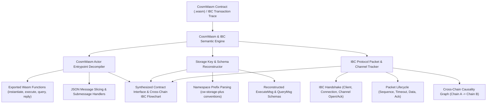

#### Technical Capabilities & Modules

1. **CosmWasm Wasm Binary Decompilation:**
   - Ingest CosmWasm `.wasm` binaries using REA's Wasm framework (#2298).
   - Identify standard CosmWasm export signatures: `instantiate`, `execute`, `query`, `sudo`, `migrate`, `reply`.
   - Trace JSON deserialization logic (`serde_json_wasm`) to reconstruct expected message fields.

2. **Storage Layout & Key Prefix Mapping:**
   - Detect `cw-storage-plus` conventions: `Item<T>`, `Map<K, V>`, `IndexedMap`.
   - Decode composite storage keys (length prefixes, namespace prefixes, byte-encoded keys).

3. **Submessage & Reply Handling:**
   - Trace `SubMsg` dispatches and map `reply` handlers (`ReplyOn::Success`, `ReplyOn::Error`, `ReplyOn::Always`).
   - Reconstruct intra-contract and cross-contract call graphs.

4. **IBC Handshake & Packet Dissection:**
   - Dissect IBC message types in Cosmos transactions:
     - `MsgCreateClient`, `MsgUpdateClient`.
     - `MsgConnectionOpenInit`, `MsgConnectionOpenTry`, `MsgConnectionOpenAck`, `MsgConnectionOpenConfirm`.
     - `MsgChannelOpenInit`, `MsgChannelOpenTry`, `MsgChannelOpenAck`, `MsgChannelOpenConfirm`.
     - `MsgRecvPacket`, `MsgAcknowledgement`, `MsgTimeout`.
   - Decode ICS-20 fungible token transfer payloads and custom contract IBC packets.

5. **Cross-Chain State Machine Reconstruction:**
   - Reconstruct complete packet lifecycles from recorded chain transactions: track a packet from issuance on Chain A, receipt on Chain B, to final acknowledgement on Chain A.

#### Acceptance Criteria

- [ ] Automated detection and entrypoint classification of CosmWasm `.wasm` binaries.
- [ ] Reconstruction of `ExecuteMsg` and `QueryMsg` JSON schemas from bytecode or accompanying schema artifacts.
- [ ] Decoding of storage namespaces and key access patterns.
- [ ] Dissection of IBC transaction messages and channel handshakes.
- [ ] Generation of an interactive cross-chain packet lifecycle diagram.

#### Related Issues & Dependencies

- Complements #2350 (Inspect WebAssembly binaries)
- Complements #2298 (Decompile WebAssembly modules)
- Complements #3621 (Unknown binary file-format inference)


### #3747 [Feature] Solana transaction reverse engineering: instructions, CPIs, account roles, logs and state-change graphs

*matbrgz, open, https://github.com/morluto/rea/issues/3747*

#### Problem Statement & Context

Solana executes smart contracts through high-performance SeaLevel runtime running Solana Bytecode Format (sBPF). While REA issue #2003 addresses static disassembly of standalone sBPF binaries and Anchor IDL introspection, analyzing a recorded Solana transaction on-chain requires a distinct runtime reverse engineering approach:
1. **Transaction Wire Format**: Signatures array, message header (num_required_signatures, num_readonly_signed_accounts, num_readonly_unsigned_accounts), account keys array, recent blockhash, instructions array, and Address Lookup Tables (ALT / v0 transactions).
2. **Instruction & Inner Instruction (CPI) Hierarchy**: Top-level instructions invoking programs, which in turn spawn nested Cross-Program Invocations (CPI) recorded as inner instructions in execution metadata.
3. **Account Metas & Roles**: Explicit account declarations (Signer, Writable, Read-Only, Program ID) determining parallel execution scheduling.
4. **Program Log Traces**: Execution logs emitting `Program <id> invoke [depth]`, `Program log: ...`, `Program data: ...`, and `Program <id> success/failed`.
5. **Pre/Post State Balances & Token Balances**: Pre-execution vs post-execution SOL balances and SPL Token account balances (`preTokenBalances`, `postTokenBalances`) used to reconstruct asset transfers.

REA needs a Solana transaction semantic engine capable of ingesting raw transaction wire formats or JSON-RPC trace responses, resolving Address Lookup Tables, untangling nested CPI call trees, and reconstructing the asset flow and state mutation graph.

#### Proposed Architecture

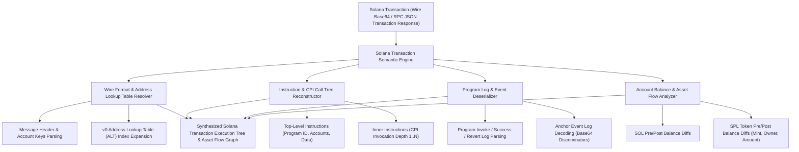

#### Technical Capabilities & Modules

1. **Transaction Wire Format Deserialization:**
   - Parse compact-u16 encoded signatures array and transaction message.
   - Support both Legacy and Versioned (v0) transaction formats.
   - Resolve Address Lookup Table (ALT) indices (`loadedAddresses.writable`, `loadedAddresses.readonly`) to reconstitute the complete runtime account address array.

2. **Hierarchical Instruction & CPI Reconstruction:**
   - Map instruction accounts from local index arrays to resolved public keys.
   - Reconstruct the nested execution call tree by correlating top-level instructions with `meta.innerInstructions` (tracking invocation depth).
   - Identify well-known programs: System Program, Token Program, Associated Token Account Program, Compute Budget Program, BPF Loader.

3. **Instruction Data & Discriminator Decoding:**
   - Ingest Anchor IDLs or known program schemas (#2003) to decode 8-byte instruction discriminators (e.g. `sha256("global:instruction_name")[..8]`).
   - Decode instruction parameters (amounts, public keys, options).

4. **Program Log Stream Slicing:**
   - Parse execution log messages to track stack frames:
     - `Program <pubkey> invoke [depth]` -> Push call frame.
     - `Program <pubkey> success` -> Pop call frame.
     - `Program <pubkey> failed: <error>` -> Flag failure site.
   - Decode Anchor base64 event logs (`Program data: <base64>`).

5. **Asset Flow & Balance Diff Reconstruction:**
   - Calculate exact net SOL balance changes across all involved accounts.
   - Parse `preTokenBalances` and `postTokenBalances` to model SPL token transfers, mints, and burns.
   - Generate an asset flow diagram showing token movements between sender, recipient, and pool accounts.

#### Acceptance Criteria

- [ ] Automated decoding of raw Solana transactions (Legacy and v0) from base64 wire bytes.
- [ ] Resolution of Address Lookup Table (ALT) account keys.
- [ ] Reconstruction of nested Cross-Program Invocation (CPI) call trees.
- [ ] Decoding of instruction data for standard programs (Token, System, ComputeBudget) and Anchor-based programs.
- [ ] Generation of an interactive execution trace and token flow diagram.

#### Related Issues & Dependencies

- Complements #2003 (Solana sBPF/Anchor reverse engineering)
- Complements #3621 (Unknown binary file-format inference)


### #2003 [Feature] Offline Solana sBPF program interface recovery

*trenbonole, open, https://github.com/morluto/rea/issues/2003*

#### Before submitting

- [x] I searched the open and closed issues and pull requests for a related proposal.
- [x] I removed credentials, tokens, private paths, and sensitive target data.

#### Area

Other — Solana sBPF program analysis

#### Current limitation

REA has no Solana program support. Its offline bytecode coverage is JVM/Python and, since #1051, EVM runtime bytecode through `inspect_evm_interface`. Solana programs are ELF files for the sBPF virtual machine, and native providers do not establish sBPF interface semantics.

An agent holding a program today (from `solana program dump`, a build directory, or a CTF archive) has to combine a separate disassembler, an Anchor IDL fetch that fails for programs that never published one or returns a stale one, and hand-computed discriminators. Nothing ties a claimed instruction name back to the bytes that justify it.

#### Use cases

- List the instructions of an unverified or closed-source program before signing a transaction against it.
- Check a published IDL against the deployed binary: missing or extra instructions, mismatched discriminators.
- Find the account types a program validates, including other programs' types. Example below: pump.fun's bonding-curve program checks pump AMM's `GlobalConfig` and `Pool`, which its own IDL does not list.
- Triage audit and CTF targets: sBPF version, entrypoint, syscalls and their call sites.

As in #972, Web3 and CTF are showcases. The capability is reusable artifact inspection and interface recovery.

#### Desired outcome and success criteria

A first increment shaped like `inspect_evm_interface`: `inspect_sbpf_interface` / `inspect-sbpf-interface` over one explicitly selected local sBPF ELF, either a raw `.so` or a program-data dump with its trailing zero padding.

**Observations**, each with file offsets:

- `e_machine`, `e_flags` and the sBPF version as the Solana loader maps `e_flags` (v0 to v4, reserved)
- entrypoint and sections
- named call targets with every call site, flagged as registered syscalls or not

**Inferences**, labelled as inferences, each with the evidence behind it:

- Anchor instructions: handler name, logged name, `sha256("global:" + name)[..8]`, log-string offsets, and where the discriminator occurs (`lddw` immediate, `mov32` + `hor64` immediate on sBPF v2+, or data bytes). Each is marked `implemented` when the code compares the discriminator right after loading it, as dispatch does, or `referenced` when it is only written to memory, as when building a call to another program
- Anchor's IDL-management instructions, reported as framework instructions
- account and event types with their `account:` / `event:` discriminators

A name is reported only when its discriminator occurs in the binary, so a string that looks like a name is never promoted to one.

**Unknowns**, stated explicitly:

- event names absent from the binary
- programs without Anchor's instruction log strings
- instruction arguments, account lists and constraints
- deployment identity, upgrade authority and verified-build status

Malformed input and non-sBPF targets return errors distinct from provider failure.

Acceptance as in #972: source-owned Anchor and native fixtures built with a pinned toolchain, a real upstream run, packaged CLI/MCP examples, final schema validation, malformed input, and cancellation, bounds and owned-process cleanup matching the EVM worker.

#### Authority boundaries and non-goals

- Offline only. No program execution, RPC, explorer lookup or other network request.
- Fetching a program by address, reading its upgrade authority and checking verified builds stay out of this increment. They would come later as explicit operations recording slot and source.
- Recovered names are inferences, not a recovered IDL. Discriminator matches establish that a name's hash occurs in the binary, not how the program uses it.
- No decompilation in this increment.

#### Alternatives considered

| Tool | License | Fit |
|---|---|---|
| FuzzingLabs/sol-azy | SSPL | Cannot be bundled. A separate `solazy-mcp` server exists in FuzzingLabs' mcp-security-hub. |
| sec3-service/IDLGuesser | GPL-3.0 | Bring-your-own at most. Its published method originated recovering instruction names from Anchor's log strings, which sbpf-inspect also uses and credits; sbpf-inspect shares no code with it. |
| exreve/sol-bytecode-decompiler | none | No license, so not reusable. |
| otter-sec/bn-ebpf-solana | MIT | Needs Binary Ninja, which is not a REA provider. |
| Ghidra sBPF processor modules | LGPL-3.0 or none, mostly stale | Possible later path to decompilation through the Ghidra provider, not to interface recovery. |
| blueshift-gg/sbpf crates | MIT | Permissive, maintained, ships a WebAssembly binding. Used below. |
| anza-xyz/sbpf (`solana-sbpf`) | Apache-2.0 | The official VM. Compiles to wasm32 with its JIT feature off. Candidate for a later control-flow increment. |

#### Possible direction

Mirror #1051, which adapts an unchanged, pinned EVMole. The engine would be `sbpf-inspect` (https://github.com/trenbonole/sbpf-inspect, MIT OR Apache-2.0), a Rust crate on Blueshift's MIT `sbpf-disassembler`. It is shipped as a 178 KB WebAssembly module for Node, and its native and WebAssembly builds produce byte-identical reports on every program tested.

The layout would follow `src/evm`:

- an `src/sbpf` provider and worker with the same resource limits
- domain, contracts, application, server and CLI entries
- `docs/sbpf-programs.md`
- `third_party/sbpf-inspect` with its license

Later increments, each reviewable on its own:

1. Per-function disassembly and control flow through `solana-sbpf` static analysis.
2. Relating a supplied IDL to the binary, and decoding imported transaction instruction data against it.
3. Explicit RPC acquisition at a recorded slot, with upgrade authority.

I can implement the first increment if the direction fits.

#### References

Measured with sbpf-inspect 0.1.0. Each program is graded against an answer key the engine never sees. pump.fun program data was dumped on 2026-10-08 near mainnet slot 454,696,749; the others were measured on 2026-10-12.

| Program | Instructions | Account types | Wrong names | Time (WebAssembly) |
|---|---|---|---|---|
| pump.fun bonding curve `6EF8rrecthR5Dkzon8Nwu78hRvfCKubJ14M5uBEwF6P` | 56 of 56 | 7 of 7, plus pump AMM's `GlobalConfig` and `Pool` | 0 | 64 ms |
| pump.fun AMM `pAMMBay6oceH9fJKBRHGP5D4bD4sWpmSwMn52FMfXEA` | 38 of 38 | 7 of 7 | 0 | 55 ms |
| Bordrless companion `6ZUM1gWBH9hBBNoJoaVAGwSftyZ6CUda6vUZTW9MsJuo`, sBPF v3, graded against its public source | 27 of 27, plus 2 outgoing calls reported as `referenced` | 3 of 6 | 0 | 14 ms |
| Closed-source launchpad `BohF4FAftBwEBoa23sUgM8Vr5HL2nAHLx5s7b1iBK56f`, deleted by its owner, graded against its own runtime logs | 23 of 23 instructions it was ever called with | 11 found, no key | 0 | 76 ms native |

Every recovered discriminator matches the published IDL byte for byte. The two extra types' discriminators match pump AMM's IDL; the bonding curve checks them in `migrate`.

The deleted launchpad had no file to inspect. Its binary was rebuilt byte for byte from the upload transactions of its final deployment. The answer key pairs the first 8 bytes of each of its 2,263 calls with the `Instruction: <Name>` line it logged. The engine also reports 30 handlers never called on mainnet, which nothing outside the binary can grade. Both scripts ship in the repository. Event names are recovered only when they appear in the binary, which happened once across these programs.

To reproduce:

```sh
solana program dump -u mainnet-beta 6EF8rrecthR5Dkzon8Nwu78hRvfCKubJ14M5uBEwF6P pump.so
curl -sLO https://raw.githubusercontent.com/pump-fun/pump-public-docs/main/idl/pump.json
sbpf-inspect pump.so > pump.report.json
node scripts/grade-against-idl.mjs pump.report.json pump.json
```

- #972, #1051 (EVM increment and its adapter pattern), #740 (capability modularization)
- Loader version mapping: [`get_sbpf_version` in anza-xyz/sbpf](https://github.com/anza-xyz/sbpf/blob/main/src/elf.rs)
- [blueshift-gg/sbpf](https://github.com/blueshift-gg/sbpf)


#### Comment by trenbonole (2026-10-12) on #2003

Small update since I posted this. sbpf-inspect 0.2.0 now recovers each instruction's account list (order plus writable/signer), which the proposal above lists under unknowns.

Short version of how: it finds the `try_accounts` function Anchor generates for each instruction and follows the accounts slice through it. The names and flags come off the error paths (ConstraintMut, ConstraintSigner, AccountNotSigner). Every account comes with the offset where it's loaded and the error codes behind its flags, so it stays tied to bytes in the file like the rest of the report.

I wanted an honest number, so I ran it once without any tuning on 20 mainnet Anchor programs I hadn't touched while building it: Mango v4, Zeta, marginfi, Jupiter Perps and DCA, a bunch of Meteora and Kamino programs, Tensor, Bubblegum, and others. I graded against their on-chain IDLs:

- 652 of 677 instructions found
- 567 of 650 account lists exactly right (names, order, both flags)
- writable agrees on 5,373 of 5,385 accounts, signer on 5,368

Three times it marked an account writable and the IDL didn't. Each time the program really does check `mut` there (marginfi's source has it, and Zeta's binary raises ConstraintMut on that account), so those IDLs are just out of date. Some of the misses are stale IDLs too: Tensor renamed fields after publishing its IDL. The per-program table is here: https://github.com/trenbonole/sbpf-inspect#account-lists

I also found a gap I hadn't noticed. Older Anchor versions compile dispatch into byte-by-byte compares, so Marinade, OpenBook v2 and Squads v4 were coming back with zero instruction names. They now get all of them.

This doesn't change what I'd suggest for a first increment; account lists could land as a follow-up. Still happy to do the work if the direction fits.


#### Comment by trenbonole (2026-10-14) on #2003

Another update since 0.2.0. A few more of the things this proposal lists under unknowns now work, so I'll note them here.

**Instruction arguments.** It recovers each instruction's argument layout — the offset and size of every fixed field after the discriminator — by following the handler's own reads of the instruction data. On the same 9 mainnet programs I held out while building this, 201 of 227 instructions come back exactly right, and of the layouts that do report fields, 96% put every field edge on a real boundary. It stops at the first variable-length value (a string or vec) and says so instead of guessing past it.

**Programs without log strings.** Two parts:

- It can now find an instruction that has no logged name at all, by its 8-byte discriminator. It runs the program's own entrypoint on a made-up input to see where the instruction data ends up, then confirms a discriminator by walking from there and checking the code really compares all 8 bytes. To make sure it isn't inventing them, I ran it over 45 programs with name-matching turned off and let it re-find the instructions the logs already name — it got all 1,524, and the one thing it reported that wasn't in an IDL turned out to be a real instruction the IDL had left out. It also flags when a deployed program is smaller than its published IDL: Drift's binary only dispatches 3 of the 241 instructions the IDL lists, and Tensor Swap and Switchboard are the same.
- Native (non-Anchor) programs get their instruction dispatch too — the one-byte tag switch and each handler's offset.

It also pulls out the program's own error and log messages. Those are in the binary even when the field names aren't, and they usually say what the arguments are for ("Name is empty or longer than 32 characters", that kind of thing).

One cleanup worth mentioning if you ever embed it: it no longer uses a third-party disassembler. The ELF reader, decoder and loader are its own now, so the whole analysis path is one MIT/Apache crate.

None of this changes the first increment I suggested — it's all follow-on. Numbers and per-program tables are in the readme: https://github.com/trenbonole/sbpf-inspect. Still glad to do the work if the direction fits.


#### Comment by bornsl0ppy (2026-10-15) on #2003

+1 from a downstream user. We'd use this through REA, mostly on native (non-Anchor) programs, so the native dispatch recovery in sbpf-inspect is the part we'd lean on. Nice work on the recent updates, @trenbonole.

Happy to help test and review if the direction fits. A maintainer call on scope, even "not now", would unblock it.


## Tier 3: rollups and cross-chain


### #3745 [Feature] Cross-chain bridge reverse engineering: message envelopes, nonces, proofs, relayers and source-to-destination state machines

*matbrgz, open, https://github.com/morluto/rea/issues/3745*

#### Problem Statement & Context

Cross-chain bridges (e.g. Wormhole, LayerZero, Chainlink CCIP, Axelar, canonical rollup bridges) connect isolated blockchains, enabling cross-chain token transfers, governance relaying, and arbitrary contract calls.

Because cross-chain bridges move billions of dollars across asynchronous execution environments, they are the most critical attack surface in the blockchain ecosystem (historically suffering catastrophic exploits: Wormhole $320M, Nomad $190M, Ronin $620M). Reverse engineering a cross-chain transaction requires understanding multi-chain causality:
1. **Message Envelopes & Serialization**: Standardized payload headers packing source chain ID, emitter contract address, destination chain ID, recipient contract address, sequential sequence/nonce, payload type, and arbitrary execution calldata.
2. **Proof & Attestation Formats**:
   - Multi-Signature Attestations: Wormhole Verified Action Approvals (VAA) signed by 19 Guardian nodes.
   - Oracle / Relayer Pairs: LayerZero v1/v2 Packet payloads verified via Decentralized Verifier Networks (DVN) and Executing Relayers.
   - Merkle Storage Proofs: Canonical rollup state roots verified via light clients.
3. **Execution Relaying & Replay Protection**: Nonce verification, bitmask replay tables, and gas payment reimbursement contracts.
4. **Source-to-Destination Causality**: Connecting the origin transaction on Chain A, through the off-chain relayer packet, to the destination execution transaction on Chain B.

REA needs a cross-chain bridge reverse engineering engine capable of decoding bridge envelopes, verifying attestation proofs, and graphing cross-chain message propagation.

#### Proposed Architecture

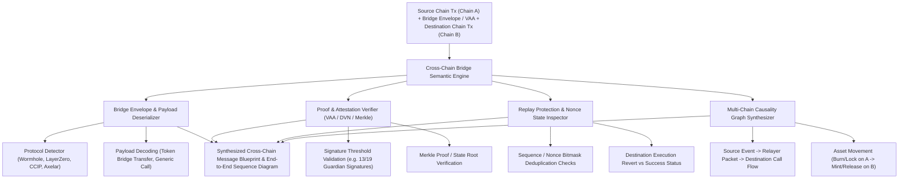

#### Technical Capabilities & Modules

1. **Universal Bridge Protocol Signature Detection:**
   - Detect signatures of major bridge protocols in transaction event logs and calldata:
     - Wormhole: `LogMessagePublished` events, VAA binary payloads (Version, Guardian Set Index, Signatures, Header, Payload).
     - LayerZero (v1 & v2): `Packet` structs, Endpoint calls, EndpointV2 `send` / `lzReceive`.
     - Chainlink CCIP: `CCIPSend` / `CCIPReceive` messages, Merkle root commitments.
     - Axelar: Gateway message approval hashes and GMP (General Message Passing) payloads.

2. **Binary VAA & Packet Deserialization:**
   - Parse Wormhole VAA binary format: 6-byte header, array of 66-byte guardian signatures ($r, s, v$), emitter chain, emitter address, sequence, consistency level, and payload.
   - Decode payload types: Token Bridge (`Transfer`, `TransferWithPayload`), NFT Bridge, or custom governance actions.

3. **LayerZero v2 Packet Dissection:**
   - Dissect LayerZero v2 packet byte streams: packet header (nonce, source EID, sender, destination EID, receiver), message GUID, and payload.
   - Map execution requirements: DVN verification threshold checks and gas executor parameters.

4. **Replay Protection & Nonce Tracking:**
   - Inspect destination contract replay protection logic: verify whether a message's sequence number has been marked as consumed in on-chain storage bitmasks (`consumedVAAs`, `inboundNonce`).
   - Detect replay vulnerabilities (e.g. missing hash verification or unconstrained message reuse).

5. **Cross-Chain Causality Reconstruction:**
   - Correlate the originating transaction on the source blockchain with the corresponding relay execution on the target blockchain.
   - Model asset state changes: lock-and-mint vs burn-and-release mechanisms.

#### Acceptance Criteria

- [ ] Automated parsing of binary Wormhole VAAs and LayerZero v1/v2 packet envelopes.
- [ ] Decoding of inner cross-chain payloads (token transfer amounts, target contracts, execution calldata).
- [ ] Verification of guardian signature thresholds and DVN verification proofs.
- [ ] Detection and verification of destination-chain replay protection states.
- [ ] Generation of an end-to-end multi-chain sequence diagram depicting message flow from Chain A to Chain B.

#### Related Issues & Dependencies

- Complements #972 (Solidity/EVM reverse engineering)
- Complements #2391 (EVM calldata and execution trace analysis)
- Complements #3621 (Unknown binary file-format inference)


### #3743 [Feature] OP Stack reverse engineering: L1 batches, deposits, withdrawals, derivation and fault-proof artifacts

*matbrgz, open, https://github.com/morluto/rea/issues/3743*

#### Problem Statement & Context

The OP Stack (powering OP Mainnet, Base, Zora, Mode, and the Superchain ecosystem) represents the most widely deployed Optimistic Rollup framework on Ethereum.

An OP Stack rollup is not an isolated blockchain; its canonical state is derived directly from Layer 1 Ethereum:
1. **L1 Batch Ingestion & Channel Derivation**: Sequencer transaction batches posted to L1 batch inbox addresses (e.g., as EIP-4844 blobs or calldata). Batches are framed into channels, compressed using Zlib, and decompressed into sequential L2 execution blocks.
2. **Deposit Transactions & System Config**: L1-to-L2 deposits initiated via `OptimismPortal` contracts, creating special `L1Attributes` transactions in each L2 block without cryptographic signatures (derived from L1 event logs).
3. **Withdrawal Provenance & Two-Step Finalization**: L2-to-L1 withdrawals initiated via `L2ToL1MessagePasser`, requiring an on-chain Merkle proof against the `L2OutputOracle` / `DisputeGameFactory`, followed by a 7-day challenge window and finalization call.
4. **Fault Proof Artifacts (Cannon / op-challenger)**: Interactive dispute games executing MIPS32 / 64-bit state transition programs inside a single-step fault-proof virtual machine to resolve disputed L2 state claims.

Reverse engineering an incident or transaction on an OP Stack rollup requires tracing derivation pipelines from L1 down to L2. REA needs a dedicated OP Stack analyzer capable of parsing L1 batch blobs, reconstructing channel frames, modeling deposit/withdrawal lifecycles, and inspecting fault-proof dispute artifacts.

#### Proposed Architecture

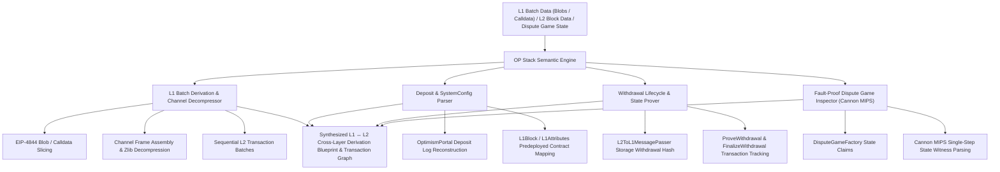

#### Technical Capabilities & Modules

1. **L1 Derivation Pipeline Slicing:**
   - Ingest raw L1 transactions targeting the batch inbox address (including EIP-4844 blob sidecars).
   - Parse channel framing: Channel ID, Frame Number, Is Last flag, Frame Data.
   - Assemble and decompress complete channel streams to recover canonical L2 block transactions.

2. **Deposit Transaction Reconstruction:**
   - Detect `TransactionDeposited` event logs emitted by `OptimismPortal` on L1.
   - Map how L1 deposits are translated into unsigned deposit transactions (Type `0x7E`) on L2.
   - Track `SystemConfig` updates: gas limits, basefee overhead, scalar parameters, and batcher address updates.

3. **Withdrawal Lifecycle & Proof Tracking:**
   - Trace L2-to-L1 withdrawals:
     - Step 1: L2 transaction calling `L2ToL1MessagePasser.initiateWithdrawal`.
     - Step 2: L1 transaction calling `OptimismPortal.proveWithdrawalTransaction` with storage proof.
     - Step 3: L1 transaction calling `OptimismPortal.finalizeWithdrawalTransaction` after challenge delay.
   - Model the complete multi-day state progression into a unified status graph.

4. **Fault-Proof & Dispute Game Analysis:**
   - Dissect dispute game contracts (`FaultDisputeGame`, `PermissionedDisputeGame`).
   - Parse claims, bisection tree positions, and claim clocks.
   - Inspect single-step fault proof traces executed under Cannon (MIPS32 machine state, memory reads/writes, preimage oracle lookups).

#### Acceptance Criteria

- [ ] Automated decoding of OP Stack batch frames from L1 calldata and EIP-4844 blobs.
- [ ] Decompression and extraction of L2 blocks and transactions from channel byte streams.
- [ ] End-to-end correlation linking L1 deposit events to L2 deposit transactions.
- [ ] Verification of three-step withdrawal lifecycles between L2 and L1.
- [ ] Inspection of fault proof dispute game bisection trees and claims.

#### Related Issues & Dependencies

- Complements #972 (Solidity/EVM reverse engineering)
- Complements #2391 (EVM calldata and execution trace analysis)
- Complements #3621 (Unknown binary file-format inference)


### #3744 [Feature] Arbitrum Nitro reverse engineering: Inbox batches, retryables, ArbOS calls and L1-to-L2 message reconstruction

*matbrgz, open, https://github.com/morluto/rea/issues/3744*

#### Problem Statement & Context

Arbitrum Nitro is the leading Optimistic Rollup platform by total value locked (TVL), executing Ethereum Layer 2 transactions through a custom architecture powered by **ArbOS** (Arbitrum Operating System) and WebAssembly:
1. **Inbox & Batch Posting**: Transactions posted by the Sequencer to the L1 `SequencerInbox` contract as compressed batches (utilizing Brotli compression).
2. **Delayed Inbox & Force-Inclusion**: Direct user transaction submissions via the L1 `Bridge` and `DelayedInbox`, providing censorship resistance by allowing L1 to force transaction inclusion after a grace period.
3. **Retryable Tickets (L1-to-L2 Messaging)**: Complex asynchronous messaging system: L1 transaction calls `Inbox.createRetryableTicket`, depositing gas fees into the `L2RetryableTicket` buffer; ticket auto-redeems on L2 or awaits manual redemption before the 7-day expiration.
4. **ArbOS Precompiles**: Specialized system contracts operating at address range `0x0000000000000000000000000000000000000064`–`0x0000000000000000000000000000000000000072` (e.g. `ArbSys`, `ArbGasInfo`, `ArbAddressTable`, `ArbOwner`), handling withdrawals, gas calculations, and address compression.
5. **WAVM (Wasm Virtual Machine) & Interactive Fraud Proofs**: State transition verification executing within an instrumented WebAssembly environment using bisection challenge protocols.

REA needs an Arbitrum Nitro semantic engine capable of decompressing Brotli Sequencer batches, resolving retryable ticket lifecycles, and decoding ArbOS precompile calls.

#### Proposed Architecture

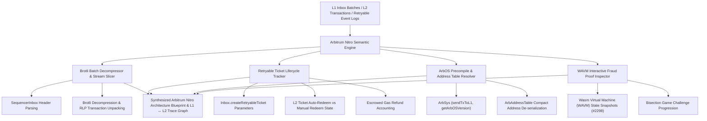

#### Technical Capabilities & Modules

1. **Sequencer Batch Ingestion & Brotli Decompression:**
   - Ingest raw transactions targeting the L1 `SequencerInbox`.
   - Parse Nitro batch headers: batch sequence number, previous accumulator, new accumulator.
   - Decompress multi-block Brotli-compressed streams to extract sequential L2 transaction arrays.

2. **Retryable Ticket Lifecycle Modeling:**
   - Trace L1 `createRetryableTicket` calls: extract destination, callvalue, deposit, maxSubmissionCost, excessFeeRefundAddress, callValueRefundAddress, gasLimit, maxFeePerGas, and calldata.
   - Calculate unique ticket ID (`keccak256(l1TxHash, ticketIndex)`).
   - Correlate with L2 execution logs: determine if the ticket auto-redeemed, failed due to insufficient gas, or was redeemed manually via `ArbRetryableTx.redeem(ticketId)`.

3. **ArbOS System Precompile Dissection:**
   - Decode calls to ArbOS system precompiles:
     - `ArbSys` (`0x0000000000000000000000000000000000000064`): `sendTxToL1` (L2-to-L1 exit calls), `arbBlockNumber`.
     - `ArbGasInfo` (`0x000000000000000000000000000000000000006c`): L1 and L2 gas pricing breakdowns.
     - `ArbAddressTable`: Address compression lookup table translating 4-byte indexes to 20-byte addresses.

4. **Delayed Inbox & Force-Inclusion Analysis:**
   - Map transactions submitted to the L1 `DelayedInbox` and track their inclusion into the canonical L2 sequence through Sequencer ingestion or force-inclusion timeouts.

5. **WAVM State Transition Audit:**
   - Parse WAVM execution state hashes generated during challenge games.
   - Correlate WAVM instructions with underlying ArbOS WebAssembly logic (#2298).

#### Acceptance Criteria

- [ ] Automated decompression of Arbitrum Brotli batch streams from L1 SequencerInbox calls.
- [ ] End-to-end tracking of Retryable Ticket lifecycles across L1 creation, L2 redeem, and refund transfers.
- [ ] Full parameter decoding for ArbOS precompile calls (`ArbSys`, `ArbGasInfo`).
- [ ] Address expansion for `ArbAddressTable` indexed lookups.
- [ ] Interactive visualization of cross-chain message flows and state transitions.

#### Related Issues & Dependencies

- Complements #972 (Solidity/EVM reverse engineering)
- Complements #2391 (EVM calldata and execution trace analysis)
- Complements #2298 (Decompile WebAssembly modules)


## Tier 4: zero knowledge


### #3740 [Feature] Zero-knowledge circuit reverse engineering: Circom/R1CS, PLONKish/Halo2 constraints and verifier graphs

*matbrgz, open, https://github.com/morluto/rea/issues/3740*

#### Problem Statement & Context

Zero-Knowledge Proofs (ZKPs) are the mathematical backbone of privacy protocols, validity rollups (zk-Rollups), and verifiable computation. ZK programs are authored in domain-specific languages (Circom, Noir, Leo) and compiled into mathematical constraint systems:
1. **Rank-1 Constraint Systems (R1CS)**: Binary representation of arithmetic circuits composed of constraints of the form $\langle A, s \rangle \cdot \langle B, s \rangle - \langle C, s \rangle = 0$, where $s$ is the witness vector. Stored in binary `.r1cs` containers (magic `r1cs`, version, field size, variable counts, linear combination matrices).
2. **PLONKish & Custom Gates (Halo2 / UltraPLONK)**: Constraint tables structured as columns (Advice, Fixed, Instance), selector polynomials, permutation arguments (copy constraints), and custom non-linear lookup gates (Plookup).
3. **Witness & Proving Artifacts (`.wtns`, `.zkey`)**: Binary witness vectors assigning concrete values to circuit variables, and proving keys packing evaluation domain polynomials, G1/G2 elliptic curve points (BN254 / BLS12-381), and lagrange bases.
4. **On-Chain Verifier Contracts**: Solidity smart contracts verifying Groth16 or PLONK proofs using EVM pairing precompiles (`ecPairing` at `0x08`, `ecAdd` at `0x06`, `ecMul` at `0x07`).

Currently, reverse engineering a ZK artifact is nearly impossible without specialized cryptographic tools. REA needs a dedicated ZK circuit engine capable of parsing `.r1cs` files, analyzing constraint graphs, extracting public/private input relationships, and correlating circuit artifacts with on-chain EVM verifier contracts.

#### Proposed Architecture

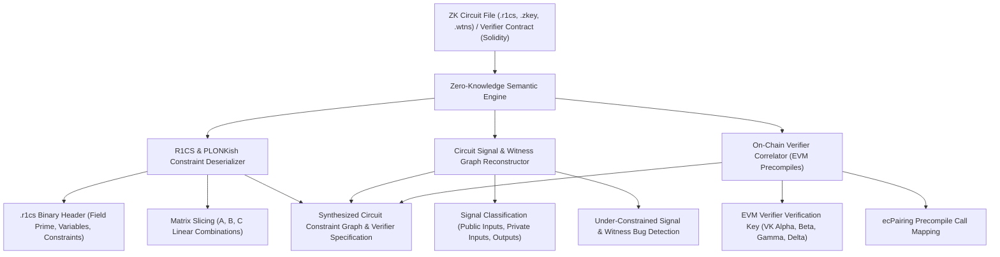

#### Technical Capabilities & Modules

1. **Binary R1CS Constraint Parsing (`.r1cs`):**
   - Parse R1CS binary container: magic header (`0x73633172`), version, section offsets.
   - Decode prime field modulus (e.g. BN254 scalar field $r = 21888242871839275222246405745257275088548364400416034343698204186575808495617$).
   - Extract variable counts: total variables, public inputs, public outputs, private inputs, number of constraints.
   - Decompress and parse sparse matrices $A$, $B$, $C$.

2. **Signal Hierarchy & Constraint Graph Reconstruction:**
   - Map symbolic variable names using symbol files (`.sym`).
   - Categorize signals: public inputs, private inputs (secrets), intermediate witness variables, and outputs.
   - Construct a directed constraint graph: trace data dependencies from inputs through intermediate constraints to final public assertions.

3. **Circuit Audit & Under-Constrained Signal Analysis:**
   - Detect under-constrained signals: identify private or intermediate variables that appear in linear combinations but lack quadratic locking constraints (a common source of critical ZK vulnerabilities).
   - Detect unused or dead signals that do not influence public outputs.

4. **Proving Key (`.zkey`) & Witness (`.wtns`) Deserialization:**
   - Parse `.zkey` files: extract verification key parameters, toxic waste powers of tau commitments, and Groth16 evaluation points.
   - Parse binary `.wtns` witness files and verify satisfiability against candidate R1CS constraints.

5. **On-Chain Verifier Contract Correlation:**
   - Disassemble EVM verifier contracts (e.g. Tornado Cash, Semaphore, zkSync verifiers).
   - Extract verification key constants hardcoded in bytecode: $IC$ vectors, $^Glpha_1$, $eta_2$, $\gamma_2$, $\delta_2$.
   - Match on-chain verifying keys with static `.zkey` circuit artifacts to prove provenance.

#### Acceptance Criteria

- [ ] Automated parsing of binary `.r1cs` constraint files across standard prime fields.
- [ ] Structural mapping of public, private, and intermediate signals.
- [ ] Detection of under-constrained and unconstrained signals.
- [ ] Extraction of verification key parameters from on-chain Solidity verifier bytecodes.
- [ ] Generation of an interactive circuit dependency graph detailing constraint flows.

#### Related Issues & Dependencies

- Complements #972 (Solidity/EVM reverse engineering)
- Complements #3621 (Unknown binary file-format inference)


### #3741 [Feature] zkVM reverse engineering: RISC Zero, SP1 and zkWasm guest images, receipts, journals and proof metadata

*matbrgz, open, https://github.com/morluto/rea/issues/3741*

#### Problem Statement & Context

Zero-Knowledge Virtual Machines (zkVMs) represent the next evolution in verifiable computation, enabling developers to write standard high-level code (Rust, C++, Go) compiled to standard ISAs (RISC-V or WebAssembly), executing inside a cryptographic prover that outputs a succinct zero-knowledge receipt:
- **RISC Zero**: Executes standard 32-bit RISC-V (RV32IM) binaries inside a zk-STARK circuit, producing a `Receipt` consisting of a cryptographic seal and a public `Journal`. Programs are uniquely identified by a 32-byte cryptographic `ImageID` (Merkle root of the initial memory state).
- **Succinct SP1**: High-performance, open-source zkVM targeting 32-bit RISC-V (RV32IM), utilizing Plonky3 and customized precompiles for hashes (Keccak, SHA-256) and elliptic curves (secp256k1, ed25519).
- **zkWasm**: Proves execution of WebAssembly bytecode modules within an algebraic constraint framework.

When investigating a zkVM-based system (e.g. verifiable coprocessors, ZK light clients, off-chain rollups), analysts encounter cryptographic receipts, image IDs, and public journals without visibility into what the guest program actually computed. REA needs a dedicated zkVM reverse engineering engine capable of disassembling guest ELF/Wasm binaries, validating ImageIDs, decoding public journals, and verifying receipt metadata.

#### Proposed Architecture

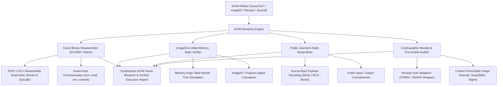

#### Technical Capabilities & Modules

1. **Guest Binary Disassembly (RISC-V RV32IM & Wasm):**
   - Ingest guest executables: 32-bit RISC-V ELF binaries (for RISC Zero and SP1) or WebAssembly modules (for zkWasm).
   - Disassemble standard instructions, identifying zkVM-specific host communication syscalls:
     - `sys_read` / `sys_write`: Reading private witness inputs from host.
     - `sys_commit`: Committing public outputs to the journal.
     - `sys_halt`: Terminating execution.

2. **ImageID & Initial State Verification:**
   - Simulate zkVM memory page initialization: partition the ELF image into standard 1 KB memory pages.
   - Compute the Merkle tree over the initial memory state using the zkVM's canonical hash function (BabyBear Poseidon2 or Keccak).
   - Verify whether a candidate guest binary produces the exact `ImageID` asserted in an on-chain verifier.

3. **Public Journal Deserialization:**
   - Extract raw byte slices from public receipt journals.
   - Deserialize payload schemas using standard Rust serialization codecs: `bincode`, `serde_json`, `borsh`, `postcard`.
   - Reconstruct structured public claims (e.g., aggregated state roots, verified light client headers).

4. **Hardware Precompile & Acceleration Mapping:**
   - Identify guest invocations of accelerated precompiles: SHA-256 compression, Keccak-256 f1600 permutations, Secp256k1 point additions/doublings, BigInt modular arithmetic.
   - Quantify compute cycles saved by specialized cryptographic hardware gates.

5. **Receipt Verification & On-Chain Wrapper Correlation:**
   - Verify receipt metadata structure (composite receipts, Groth16 / PLONK SNARK wrappers).
   - Correlate zkVM verification keys with deployed Ethereum verifier contracts (`RiscZeroGroth16Verifier`, `SP1Verifier`).

#### Acceptance Criteria

- [ ] Disassembly of RV32IM guest ELF binaries and identification of zkVM runtime syscalls.
- [ ] Simulation of memory page layout and calculation of deterministic ImageID digests.
- [ ] Structured deserialization of public journal byte buffers into typed records.
- [ ] Identification and mapping of accelerated cryptographic precompiles.
- [ ] Correlation of guest program hashes with on-chain verifier contracts.

#### Related Issues & Dependencies

- Complements #3621 (Unknown binary file-format inference)
- Complements #3716 (Common Bytecode and VM Framework)


## Tier 5: wallets and frontends


### #3737 [Feature] Wallet and dApp reverse engineering: EIP-1193 providers, WalletConnect sessions, JSON-RPC requests and frontend-to-wallet graphs

*matbrgz, open, https://github.com/morluto/rea/issues/3737*

#### Problem Statement & Context

Decentralized applications (dApps) are web-based or mobile client applications that interface with users' Web3 wallets. The bridge between the frontend application and the blockchain network is governed by standardized provider and messaging interfaces:
1. **Injected EIP-1193 Providers**: Standardized JavaScript object (`window.ethereum`) implementing `request({ method, params })`, events (`connect`, `disconnect`, `chainChanged`, `accountsChanged`), and EIP-6963 multi-provider discovery (`eip6963:announceProvider`).
2. **Standard Web3 JSON-RPC Calls**:
   - Transaction submission: `eth_sendTransaction`, `eth_sendRawTransaction`.
   - Off-chain signing: `personal_sign`, `eth_signTypedData_v4` (EIP-712 structured data signing).
   - Network control: `wallet_switchEthereumChain`, `wallet_addEthereumChain`, `wallet_watchAsset`.
3. **WalletConnect v2 Protocol**: Cross-device relay protocol over WebSocket using pairing topics, cryptographic session handshakes, namespaces, and JSON-RPC relay envelopes.
4. **Permit & Approval Phishing / Drainer Logic**: Malicious or aggressive dApps misleading users into signing unlimited token approvals (`permit`, `permit2`, `setApprovalForAll`) masked behind innocuous UI buttons.

While REA has powerful browser, React (#3608), and JavaScript analysis tools, it lacks domain comprehension of Web3 wallet interfaces. REA needs a wallet/dApp analyzer capable of parsing dApp client bundles, intercepting or simulating EIP-1193 calls, decoding EIP-712 typed signatures, and modeling the frontend-to-wallet interaction graph.

#### Proposed Architecture

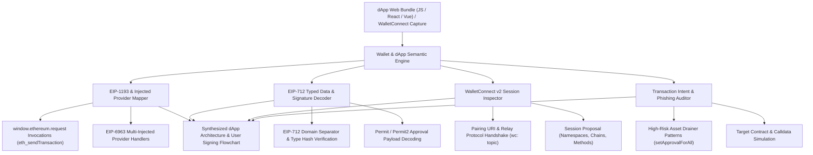

#### Technical Capabilities & Modules

1. **EIP-1193 Provider Call Site Extraction:**
   - Scan frontend JavaScript bundles for instances of `window.ethereum.request`, `ethers.BrowserProvider`, `viem/createWalletClient`, and `wagmi`.
   - Extract targeted JSON-RPC methods and parameter schemas without running the browser.

2. **EIP-712 Structured Data Deserialization:**
   - Parse `eth_signTypedData_v4` JSON payloads: domain separator (`name`, `version`, `chainId`, `verifyingContract`), primary type, and message contents.
   - Recognize standardized permit schemas: EIP-2612 (`Permit`), Uniswap `Permit2` (`PermitSingle`, `PermitBatch`), and Seaport orders.
   - Highlight expiration deadlines and authorized spender contracts.

3. **WalletConnect v2 Session Inspection:**
   - Parse WalletConnect pairing URIs (`wc:<topic>@2?relay-protocol=...&symKey=...`).
   - Decode session proposal and session request messages across WebSocket capture streams: required/optional namespaces, target chains (`eip155:1`), and permitted RPC methods.

4. **Security & Intent Audit (Drainer Detection):**
   - Identify deceptive UI patterns where low-value actions trigger high-value signatures (e.g. "Claim Airdrop" button invoking `setApprovalForAll` or ERC-20 `approve(address, type(uint256).max)`).
   - Flag unconstrained gas limits and unrecognized target contract addresses.

5. **Frontend-to-Wallet Graph Synthesis:**
   - Reconstruct the complete interaction graph linking UI buttons and user actions to emitted wallet signing prompts and on-chain contract calls.

#### Acceptance Criteria

- [ ] Automated discovery of EIP-1193 wallet interactions in compiled frontend JavaScript bundles.
- [ ] Complete decoding and structural validation of EIP-712 typed signing payloads.
- [ ] Parsing and session tracking of WalletConnect v2 handshake and request messages.
- [ ] Flagging of high-risk approval and permit signatures with parameter highlight.
- [ ] Generation of an interactive user journey flowchart from UI click to wallet confirmation.

#### Related Issues & Dependencies

- Complements #3608 (React Semantic Reconstruction & Decompiler Engine)
- Complements #972 (Solidity/EVM reverse engineering)
- Complements #117 (Full-stack reconstruction)


## Filed outside the tracker's index (related)


### #3746 [Feature] TON / TVM reverse engineering: BOC cells, TL-B schemas, TVM bytecode and message/state graphs

*matbrgz, open, https://github.com/morluto/rea/issues/3746*

#### Problem Statement & Context

The Open Network (TON) operates on an asynchronous actor-based multi-blockchain architecture centered around the **TON Virtual Machine (TVM)**:
1. **Bag of Cells (BOC) Architecture**: All code, data, contracts, blocks, and messages in TON are represented as directed acyclic graphs (DAGs) of "cells". Each cell stores up to 1023 bits of arbitrary data and up to 4 references (`refs`) to other cells. Serialized as binary BOC containers with CRC32-C checksums.
2. **TL-B (Typed Language - Binary) Schemas**: Formal binary specification language defining how high-level types (integers, coins, addresses, dictionaries, messages) serialize into cell trees.
3. **Hashic and Merkle Cells**: Cells addressed by their cryptographic 32-byte representation hash; Merkle proofs and exotic cells (pruned branch cells) allowing verifiable sub-graph inspection.
4. **TVM Bytecode**: Stack-based virtual machine executing variable-length bit-aligned opcodes (from 4 bits to dozens of bits). Features custom stack primitives, continuation registers (`c0`–`c7`), dictionary operations (hash maps stored as Patricia trees in cells), and integer arithmetic up to 1023-bit integers.
5. **Asynchronous Actor Messaging**: Contracts communicate strictly through asynchronous messages: Inbound External (user transactions), Inbound Internal (contract-to-contract), Outbound Internal, and Outbound External (events/logs).

Reverse engineering a TON smart contract or transaction requires a completely different paradigm than EVM or WASM. REA needs a dedicated TON/TVM semantic engine capable of deserializing BOC trees, applying TL-B schemas, disassembling TVM opcodes, and modeling asynchronous actor messaging.

#### Proposed Architecture

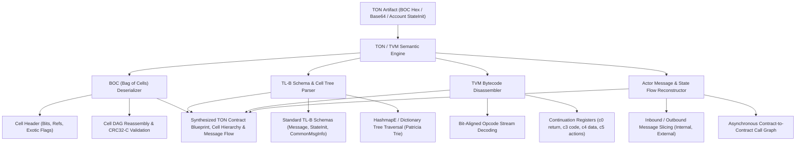

#### Technical Capabilities & Modules

1. **Bag of Cells (BOC) Binary Deserializer:**
   - Parse BOC binary headers: magic bytes (`0xB5EE9C72` standard, `0x68FF65F3` CRC-checked, `0xACC3A728` exotic), cell count, root count, and byte widths.
   - Reassemble the directed acyclic graph of cells: decode raw bit streams (up to 1023 bits) and reference indices (up to 4 references).
   - Compute standard cell representation hashes.

2. **TL-B Type System & Dictionary Decoding:**
   - Implement TL-B parser mapping cell trees into typed structures:
     - `MsgAddress`: `addr_none`, `addr_std` (workchain ID + 256-bit account ID).
     - `CommonMsgInfo`: `int_msg_info`, `ext_in_msg_info`, `ext_out_msg_info`.
     - `StateInit`: split code cell and data cell.
     - `Grams` / `Coins`: variable-length coin values.
   - Traverse binary Patricia trees (`HashmapE`, `HashmapAugE`) used for contract storage and jetton balances.

3. **TVM Bytecode Disassembly:**
   - Disassemble variable-length, bit-aligned TVM instructions:
     - Stack manipulation: `PUSH`, `POP`, `XCHG`, `ROT`, `BLKSWAP`.
     - Control flow & Continuations: `CALLDICT`, `EXECUTE`, `JMPX`, `IFRET`, `WHILE`.
     - Cell & Slice operations: `NEWC`, `ENDC`, `LDU`, `STU`, `LDSLICE`, `STREF`.
     - Dictionary operations: `DICTGET`, `DICTSET`, `DICTUGET`.

4. **Continuation & Special Register Modeling:**
   - Model TVM execution registers:
     - `c0`: Return continuation.
     - `c3`: Main code dictionary.
     - `c4`: Root persistent data cell.
     - `c5`: Outbound action list (messages queued to be sent).
     - `c7`: Temporary context tuple (balance, now, block_lt, config).

5. **Asynchronous Actor Message Flow Reconstruction:**
   - Trace contract execution: input message -> TVM state transition -> emitted output actions.
   - Construct an asynchronous message causality graph across multi-contract interactions (e.g. Jetton transfer, DEX swap).

#### Acceptance Criteria

- [ ] Robust parsing and validation of binary BOC files and serialized cell graphs.
- [ ] Extraction and traversal of cell bit slices and child reference trees.
- [ ] Decoding of standard TL-B schemas (`Message`, `StateInit`, `Account`).
- [ ] Disassembly of bit-aligned TVM opcodes and continuation control flow.
- [ ] Reconstruction of asynchronous contract message interactions and persistent data cells.

#### Related Issues & Dependencies

- Complements #3621 (Unknown binary file-format inference)
- Complements #3716 (Common Bytecode and VM Framework)


### #3748 [Feature] Foundry and Hardhat project reverse engineering: build-info, deployments, broadcasts, libraries and contract dependency graphs

*matbrgz, open, https://github.com/morluto/rea/issues/3748*

#### Problem Statement & Context

In smart contract auditing, vulnerability research, and incident response, analysts often receive local developer project folders authored in **Foundry** (`forge`) or **Hardhat**.

While REA issue #2389 addresses the raw solc Standard JSON format, modern developer frameworks generate extensive multi-file build and deployment pipelines:
1. **Build Info Containers (`artifacts/build-info/*.json` / `out/build-info/*.json`)**: Massive JSON files containing complete compiler input configurations, optimizer runs, EVM versions, and compiler outputs (ASTs, source files, bytecodes, method identifiers).
2. **Foundry Broadcasts & Deployments (`broadcast/**/*.json`)**: Transaction receipts, CREATE2 parameters, salts, deployed addresses, deployer nonces, and gas usage from automated deployment scripts.
3. **Hardhat Artifacts & Deployments (`artifacts/contracts/**/*.json`)**: Per-contract artifacts containing ABI, bytecode, deployedBytecode, linkReferences, and immutableReferences.
4. **Multi-Contract Dependency Graphs**: Complex inter-contract relationships: base inheritance, interface implementations, imported libraries, external calls, and proxy bindings.

Without framework-aware project ingestion, analysts must manually correlate scattered build-info JSON files with on-chain addresses. REA needs a dedicated Foundry and Hardhat project reverse engineering engine capable of reconstructing the complete repository architecture, source graph, and deployment record.

#### Proposed Architecture

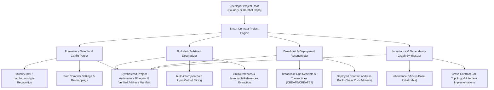

#### Technical Capabilities & Modules

1. **Framework Detection & Configuration Parsing:**
   - Detect project type: Foundry (`foundry.toml`), Hardhat (`hardhat.config.js` / `.ts`), or Brownie/Truffle.
   - Parse path re-mappings (`remappings.txt` or `foundry.toml` `remappings = [...]`) to resolve dependency aliases (e.g. `@openzeppelin/` -> `lib/openzeppelin-contracts/`).

2. **Build-Info File Parsing:**
   - Stream and parse multi-megabyte `build-info` JSON files without memory exhaustion.
   - Extract compiler metadata: compiler version, optimizer settings (runs), `evmVersion` (cancun, shanghai, paris).
   - Map contract source files to compiled creation bytecode and runtime bytecode.

3. **Link References & Immutables Mapping:**
   - Parse `linkReferences`: identify which bytecode offsets require external library addresses.
   - Parse `immutableReferences`: map immutable variable names to their exact byte offsets inside the deployed runtime bytecode.

4. **Foundry Broadcast & Deployment Analysis:**
   - Parse Foundry broadcast execution logs (`broadcast/<script>/<chain_id>/run-latest.json`):
     - Extract deployed contract addresses, deployer addresses, transaction hashes, gas used.
     - Extract `CREATE2` salts and constructor arguments.
   - Build a verified address book correlating local contracts with their on-chain deployment addresses per network.

5. **Inheritance & Dependency Graph Synthesis:**
   - Parse contract ASTs from build-info to extract inheritance trees (`is Ownable, ERC20`).
   - Map external function calls and interface dependencies (`IERC20(token).transfer(...)`).
   - Generate an interactive Mermaid class diagram illustrating the contract architecture.

#### Acceptance Criteria

- [ ] Automated detection and configuration ingestion for Foundry and Hardhat repositories.
- [ ] Efficient streaming and parsing of large `build-info` JSON files.
- [ ] Extraction of library link references and immutable variable byte offsets.
- [ ] Reconstruction of deployed contract address books from Foundry broadcast logs.
- [ ] Generation of an interactive contract inheritance and dependency graph.

#### Related Issues & Dependencies

- Complements #972 (Solidity/EVM reverse engineering)
- Complements #2389 (EVM Standard JSON and compiler metadata)
- Complements #3734 (EVM deployment lineage reverse engineering)


### #3716 [RFC/Epic] Common Bytecode and VM Framework: unified instruction decoding, CFG synthesis, SSA analysis and source decompilation

*matbrgz, open, https://github.com/morluto/rea/issues/3716*

#### Problem Statement & Architectural Context

Bytecode virtual machines (VMs) are pervasive across modern software: JVM (#1558), .NET CIL (#3607), Lua/LuaJIT (#3699), Luau (#3692), Python bytecode (#3678), ActionScript (#3614), Papyrus (#3706), GameMaker GML (#3632), QuickJS, Hermes (#3608), and Ethereum EVM.

Currently, reverse engineering tools—including REA—often implement decompilers as bespoke, siloed monoliths for each specific VM. This leads to duplicate implementations of textbook compiler algorithms (control-flow graph construction, loop restructuring, SSA form conversion, liveness analysis, dead-code elimination, and type propagation).

REA should introduce a **Common Bytecode & VM Framework** that separates VM-specific frontend decoders from shared, high-performance compiler analysis and source decompilation backends.

#### Proposed Architecture

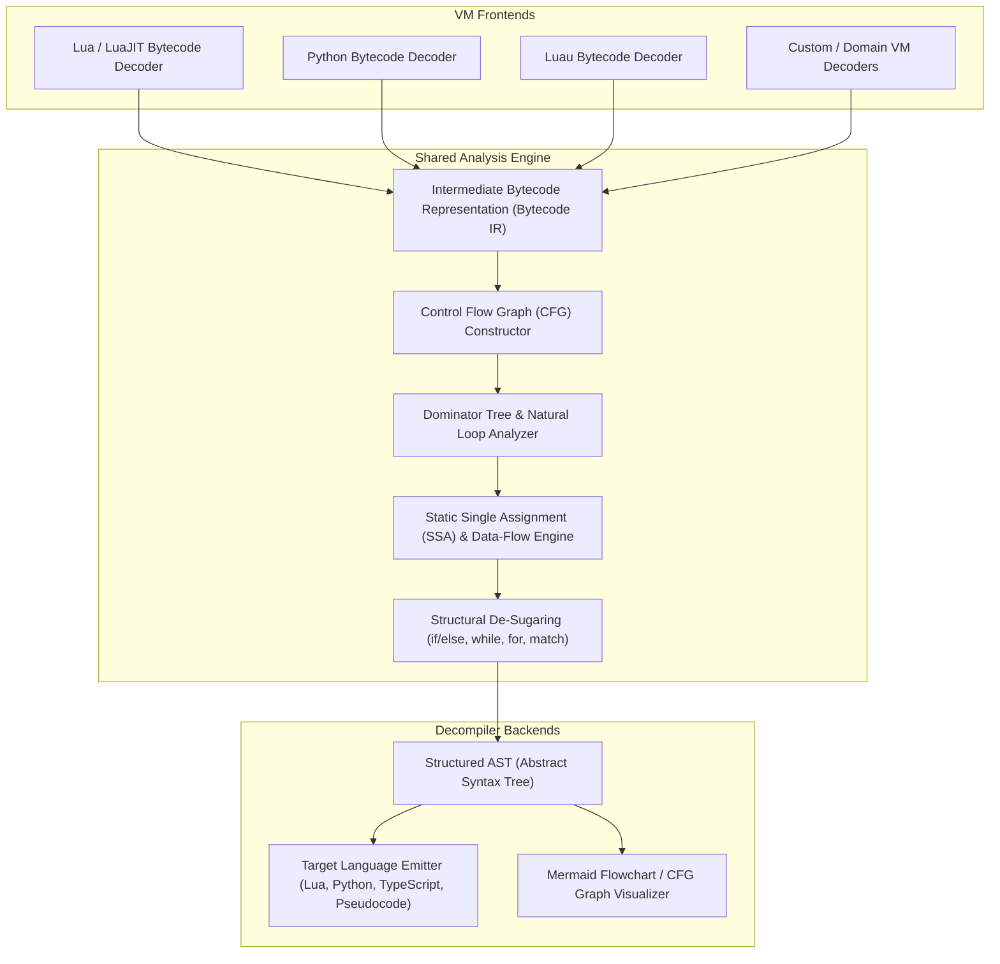

#### Technical Capabilities & Modules

1. **Generic Instruction & Virtual Register Abstraction:**
   - Universal instruction schema accommodating both stack-based VMs (e.g. JVM, Python, EVM) and register-based VMs (e.g. Lua, Luau, Dalvik).
   - Generalized operand types: register index, immediate value, string table index, upvalue/closure reference, branch target.

2. **CFG & Dominator Tree Synthesis:**
   - Universal basic block partitioning based on branch targets and fallthrough edges.
   - Lengauer-Tarjan dominator tree computation and dominance frontier identification.
   - Loop detection: identify loop headers, back edges, loop pre-headers, and classify into pre-tested (`while`), post-tested (`do-while`), and iterator-based (`for-in`) loops.

3. **SSA Form & Data-Flow Transformation:**
   - Place $\phi$-nodes (phi functions) and rename virtual registers into SSA form.
   - Sparse Conditional Constant Propagation (SCCP) to eliminate unreachable dead blocks and evaluate constant expressions.
   - Live-range analysis to consolidate compiler-generated temporary variables into clean source-level variable names.

4. **Expression Tree Reconstruction & Short-Circuiting:**
   - Reconstruct complex composite expressions from sequence of binary/unary operations.
   - De-sugar boolean short-circuit evaluation chains (`A and B or C`) into logical expression trees.

5. **Extensible Frontend Adapter API:**
   - Minimalist adapter interface requiring new VM modules to implement only:
     - Header/constant pool deserializer.
     - Opcode-to-GenericInstruction mapping table.
     - Calling convention / argument passing rules.
   - Enables adding support for obscure or custom proprietary VMs in hundreds of lines of code rather than thousands.

#### Acceptance Criteria

- [ ] Unified IR and CFG engine shared across multiple registered VM frontends.
- [ ] Accurate structural recovery of nested loops, break/continue statements, and conditional branches.
- [ ] Automatic elimination of temporary stack/register variables via SSA data-flow reduction.
- [ ] Emission of readable, syntactically clean pseudocode and ASTs.
- [ ] Demonstrated integration with at least two distinct VM families (e.g. Lua/LuaJIT and Python).

#### Related Issues & Dependencies

- Complements #3699 (Lua and LuaJIT bytecode reverse engineering)
- Complements #3692 (Roblox/Luau reverse engineering)
- Complements #3678 (Python packaged application reverse engineering)
- Complements #3608 (React Semantic Reconstruction & Hermes unbundling)


### #3137 research(architecture): establish demand and compatibility gates for external domain modules

*N0zoM1z0, open, https://github.com/morluto/rea/issues/3137*

Follow-up to #2016, whose original three-stage implementation and scoped verification are complete. This issue owns only the bounded continuation below. #740 owns the broader modularization roadmap; this issue owns only the demand/compatibility gate for the previously deferred external SDK.

#### Analyst question and outcome

Is there a concrete domain/provider integration that the current static descriptors and one REA distribution cannot reasonably support, sufficient to justify an external module SDK?

#### Existing evidence and decision boundary

Status: demand research and compatibility design only; a generic plugin ecosystem is deferred.

#2122/#2261 establish small static WASM/EVM bindings using named contracts, existing factories/CLI names, legacy injection and cleanup ownership. #2427 verifies incompatible static contract bindings through compiler assignability and duplicate SDK registration before provider use. This is not third-party dynamic ABI/version admission. Descriptor wiring alone established no token or latency reduction.

#### Bounded work

1. Collect at most two concrete extension use cases from actual maintainer/contributor workflows. For each, document the current static integration steps, repeated maintenance/discovery cost and exact limitation; do not infer demand from the availability of a plugin mechanism.
2. Compare keeping static composition, a documented internal extension recipe, and an optional external module boundary. Preserve one usable default distribution and existing capabilities/catalog; users must not install packs to regain shipped tools. Engine adapters, domain semantics and composed workflows remain distinct.
3. If external loading is justified, specify a small contract/identity/lifetime boundary and pre-use compatibility tests: exact named operations/types, post-SDK advertised schema dialect, version/ABI admission, duplicate registration, capability/effect declarations, partial/unavailable failure isolation and retained cleanup/retry ownership. No catalog position selects a handler/schema.
4. Document packaging/configuration migration and discovery costs. Automatic discovery, hot reload, plugin distribution, a mandatory Code Mode bridge, generic engine protocols and persistent database caches are not implemented by this issue. Add these only through independently justified proposals. A no-SDK decision closes this research task successfully.

#### Acceptance

- [ ] At most two concrete extension needs and observed costs demonstrate whether static composition is insufficient.
- [ ] Compare the smallest existing/static alternative with an external boundary, including migration and measured discovery/maintenance costs.
- [ ] Document a no-SDK decision or a narrow opt-in contract and meaningful pre-use/lifecycle/old-client verification plan.
- [ ] SDK/runtime loader/hot reload/distribution work remains deferred and separately scoped; existing user defaults and shipped capabilities remain usable.

#### Compatibility, measurement and host constraints

Token consumption and time to a correct answer are the primary outcomes. Record total/cached/uncached input, output, discovery, RPCs, retries and failed attempts separately from JSON bytes. Preserve negative results; a smaller response alone is not a speed or token win. Separate observed producer/transport/client work and unknown stages, and compare equivalent completed questions.

Keep current complete defaults, caller-selected inputs/providers, source bytes, Evidence identity/links, omission/null/type distinctions, partial coverage, and lifecycle/export/import behavior. Inspect the current advertised contracts and reuse existing selectors/views before adding code. Any implementation needs measured benefit and relevant compatibility verification; a documented no-change decision is a successful research outcome. Run checks for affected boundaries rather than repeating unrelated suites after each small correction.

Run heavy work serially under one CPU, 3 GiB early stop / 4 GiB hard memory, no swap, owned scopes and host-availability checks. Distinguish verified payload-phase observations from unavailable terminal whole-scope counters; missing counters stay unknown. For performance experiments, use real public CLI/MCP workflows and actual Codex CLI tasks when assessing agent token/time outcomes, with a private temporary profile pointing at the tested REA MCP; pin the requested model/reasoning and runtime within each cohort. Planning or demand-only work does not require an unrelated model/provider matrix. Simulated providers do not establish real-provider behavior. Keep raw captures/binaries/replies/transcripts/configuration private, commit source and curated reproducible findings, and record unrelated product bugs in the existing `/tmp` team handoff. No release is part of this task.

