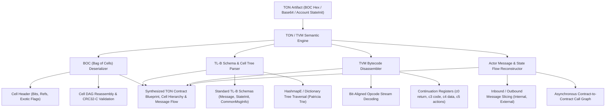
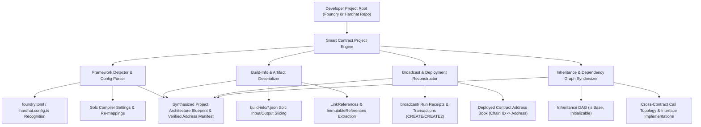
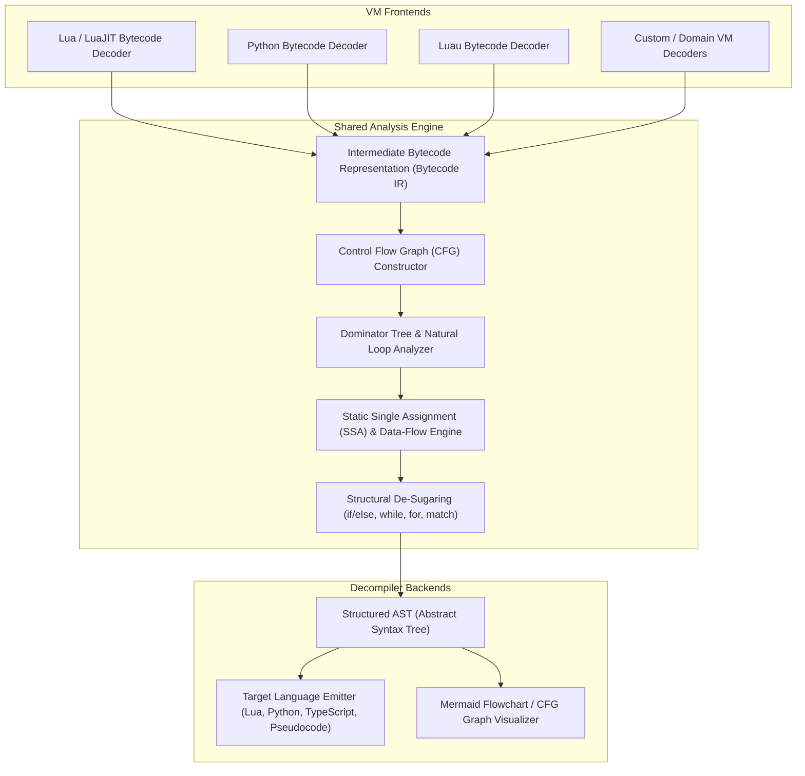

# Filed outside the tracker's index (related)

<!-- nav --> [← Tier 5](tier-5-wallets.md) · [Master tracker](README.md) · [Dashboard](../dashboard/README.md)

Status read from GitHub 2026-11-28.

| Issue                                               | Title                                                                                                                          | Author   | State | Priority / labels                                                         | Comments | Linked PRs |
| --------------------------------------------------- | ------------------------------------------------------------------------------------------------------------------------------ | -------- | ----- | ------------------------------------------------------------------------- | -------- | ---------- |
| [#3746](https://github.com/morluto/rea/issues/3746) | TON / TVM reverse engineering: BOC cells, TL-B schemas, TVM bytecode and message/state graphs                                  | matbrgz  | open  | enhancement                                                               | 0        | none found |
| [#3748](https://github.com/morluto/rea/issues/3748) | Foundry and Hardhat project reverse engineering: build-info, deployments, broadcasts, libraries and contract dependency graphs | matbrgz  | open  | enhancement, area: domain, area: build                                    | 0        | none found |
| [#3716](https://github.com/morluto/rea/issues/3716) | Common Bytecode and VM Framework: unified instruction decoding, CFG synthesis, SSA analysis and source decompilation           | matbrgz  | open  | area: native, design                                                      | 0        | none found |
| [#3137](https://github.com/morluto/rea/issues/3137) | research(architecture): establish demand and compatibility gates for external domain modules                                   | N0zoM1z0 | open  | enhancement, P1: high, area: domain, triage, roadmap, performance, design | 0        | none found |

## Related pull request

[#4479](https://github.com/morluto/rea/pull/4479) by yawningmonsoon: draft, documentation only (+28 lines in one skill reference). It explains how to connect EVM evidence to separately checked on-chain inclusion. It belongs with tier 1.

## Jump to an issue

[#3746](#issue-3746) · [#3748](#issue-3748) · [#3716](#issue-3716) · [#3137](#issue-3137)

## Source text

Verbatim issue text and comments follow. Badge images are removed and heading levels shifted. Claims are the authors', not verified here.

---

**━━━━━━━━ ISSUE 1 of 4 · #3746 ━━━━━━━━**

[↑ Top](#top) · [#3748 →](#issue-3748)

### [#3746](https://github.com/morluto/rea/issues/3746) [Feature] TON / TVM reverse engineering: BOC cells, TL-B schemas, TVM bytecode and message/state graphs

_matbrgz, open, https://github.com/morluto/rea/issues/3746_

#### Problem Statement & Context

The Open Network (TON) operates on an asynchronous actor-based multi-blockchain architecture centered around the **TON Virtual Machine (TVM)**:

1. **Bag of Cells (BOC) Architecture**: All code, data, contracts, blocks, and messages in TON are represented as directed acyclic graphs (DAGs) of "cells". Each cell stores up to 1023 bits of arbitrary data and up to 4 references (`refs`) to other cells. Serialized as binary BOC containers with CRC32-C checksums.
2. **TL-B (Typed Language - Binary) Schemas**: Formal binary specification language defining how high-level types (integers, coins, addresses, dictionaries, messages) serialize into cell trees.
3. **Hashic and Merkle Cells**: Cells addressed by their cryptographic 32-byte representation hash; Merkle proofs and exotic cells (pruned branch cells) allowing verifiable sub-graph inspection.
4. **TVM Bytecode**: Stack-based virtual machine executing variable-length bit-aligned opcodes (from 4 bits to dozens of bits). Features custom stack primitives, continuation registers (`c0`–`c7`), dictionary operations (hash maps stored as Patricia trees in cells), and integer arithmetic up to 1023-bit integers.
5. **Asynchronous Actor Messaging**: Contracts communicate strictly through asynchronous messages: Inbound External (user transactions), Inbound Internal (contract-to-contract), Outbound Internal, and Outbound External (events/logs).

Reverse engineering a TON smart contract or transaction requires a completely different paradigm than EVM or WASM. REA needs a dedicated TON/TVM semantic engine capable of deserializing BOC trees, applying TL-B schemas, disassembling TVM opcodes, and modeling asynchronous actor messaging.

#### Proposed Architecture

#### Technical Capabilities & Modules

1. **Bag of Cells (BOC) Binary Deserializer:**
   - Parse BOC binary headers: magic bytes (`0xB5EE9C72` standard, `0x68FF65F3` CRC-checked, `0xACC3A728` exotic), cell count, root count, and byte widths.
   - Reassemble the directed acyclic graph of cells: decode raw bit streams (up to 1023 bits) and reference indices (up to 4 references).
   - Compute standard cell representation hashes.

2. **TL-B Type System & Dictionary Decoding:**
   - Implement TL-B parser mapping cell trees into typed structures:
     - `MsgAddress`: `addr_none`, `addr_std` (workchain ID + 256-bit account ID).
     - `CommonMsgInfo`: `int_msg_info`, `ext_in_msg_info`, `ext_out_msg_info`.
     - `StateInit`: split code cell and data cell.
     - `Grams` / `Coins`: variable-length coin values.
   - Traverse binary Patricia trees (`HashmapE`, `HashmapAugE`) used for contract storage and jetton balances.

3. **TVM Bytecode Disassembly:**
   - Disassemble variable-length, bit-aligned TVM instructions:
     - Stack manipulation: `PUSH`, `POP`, `XCHG`, `ROT`, `BLKSWAP`.
     - Control flow & Continuations: `CALLDICT`, `EXECUTE`, `JMPX`, `IFRET`, `WHILE`.
     - Cell & Slice operations: `NEWC`, `ENDC`, `LDU`, `STU`, `LDSLICE`, `STREF`.
     - Dictionary operations: `DICTGET`, `DICTSET`, `DICTUGET`.

4. **Continuation & Special Register Modeling:**
   - Model TVM execution registers:
     - `c0`: Return continuation.
     - `c3`: Main code dictionary.
     - `c4`: Root persistent data cell.
     - `c5`: Outbound action list (messages queued to be sent).
     - `c7`: Temporary context tuple (balance, now, block_lt, config).

5. **Asynchronous Actor Message Flow Reconstruction:**
   - Trace contract execution: input message -> TVM state transition -> emitted output actions.
   - Construct an asynchronous message causality graph across multi-contract interactions (e.g. Jetton transfer, DEX swap).

#### Acceptance Criteria

- [ ] Robust parsing and validation of binary BOC files and serialized cell graphs.
- [ ] Extraction and traversal of cell bit slices and child reference trees.
- [ ] Decoding of standard TL-B schemas (`Message`, `StateInit`, `Account`).
- [ ] Disassembly of bit-aligned TVM opcodes and continuation control flow.
- [ ] Reconstruction of asynchronous contract message interactions and persistent data cells.

#### Related Issues & Dependencies

- Complements [#3621](https://github.com/morluto/rea/issues/3621) (Unknown binary file-format inference)
- Complements [#3716](https://github.com/morluto/rea/issues/3716) (Common Bytecode and VM Framework)

---

**━━━━━━━━ ISSUE 2 of 4 · #3748 ━━━━━━━━**

[← #3746](#issue-3746) · [↑ Top](#top) · [#3716 →](#issue-3716)

### [#3748](https://github.com/morluto/rea/issues/3748) [Feature] Foundry and Hardhat project reverse engineering: build-info, deployments, broadcasts, libraries and contract dependency graphs

_matbrgz, open, https://github.com/morluto/rea/issues/3748_

#### Problem Statement & Context

In smart contract auditing, vulnerability research, and incident response, analysts often receive local developer project folders authored in **Foundry** (`forge`) or **Hardhat**.

While REA issue [#2389](https://github.com/morluto/rea/issues/2389) addresses the raw solc Standard JSON format, modern developer frameworks generate extensive multi-file build and deployment pipelines:

1. **Build Info Containers (`artifacts/build-info/*.json` / `out/build-info/*.json`)**: Massive JSON files containing complete compiler input configurations, optimizer runs, EVM versions, and compiler outputs (ASTs, source files, bytecodes, method identifiers).
2. **Foundry Broadcasts & Deployments (`broadcast/**/*.json`)**: Transaction receipts, CREATE2 parameters, salts, deployed addresses, deployer nonces, and gas usage from automated deployment scripts.
3. **Hardhat Artifacts & Deployments (`artifacts/contracts/**/*.json`)**: Per-contract artifacts containing ABI, bytecode, deployedBytecode, linkReferences, and immutableReferences.
4. **Multi-Contract Dependency Graphs**: Complex inter-contract relationships: base inheritance, interface implementations, imported libraries, external calls, and proxy bindings.

Without framework-aware project ingestion, analysts must manually correlate scattered build-info JSON files with on-chain addresses. REA needs a dedicated Foundry and Hardhat project reverse engineering engine capable of reconstructing the complete repository architecture, source graph, and deployment record.

#### Proposed Architecture

#### Technical Capabilities & Modules

1. **Framework Detection & Configuration Parsing:**
   - Detect project type: Foundry (`foundry.toml`), Hardhat (`hardhat.config.js` / `.ts`), or Brownie/Truffle.
   - Parse path re-mappings (`remappings.txt` or `foundry.toml` `remappings = [...]`) to resolve dependency aliases (e.g. `@openzeppelin/` -> `lib/openzeppelin-contracts/`).

2. **Build-Info File Parsing:**
   - Stream and parse multi-megabyte `build-info` JSON files without memory exhaustion.
   - Extract compiler metadata: compiler version, optimizer settings (runs), `evmVersion` (cancun, shanghai, paris).
   - Map contract source files to compiled creation bytecode and runtime bytecode.

3. **Link References & Immutables Mapping:**
   - Parse `linkReferences`: identify which bytecode offsets require external library addresses.
   - Parse `immutableReferences`: map immutable variable names to their exact byte offsets inside the deployed runtime bytecode.

4. **Foundry Broadcast & Deployment Analysis:**
   - Parse Foundry broadcast execution logs (`broadcast/<script>/<chain_id>/run-latest.json`):
     - Extract deployed contract addresses, deployer addresses, transaction hashes, gas used.
     - Extract `CREATE2` salts and constructor arguments.
   - Build a verified address book correlating local contracts with their on-chain deployment addresses per network.

5. **Inheritance & Dependency Graph Synthesis:**
   - Parse contract ASTs from build-info to extract inheritance trees (`is Ownable, ERC20`).
   - Map external function calls and interface dependencies (`IERC20(token).transfer(...)`).
   - Generate an interactive Mermaid class diagram illustrating the contract architecture.

#### Acceptance Criteria

- [ ] Automated detection and configuration ingestion for Foundry and Hardhat repositories.
- [ ] Efficient streaming and parsing of large `build-info` JSON files.
- [ ] Extraction of library link references and immutable variable byte offsets.
- [ ] Reconstruction of deployed contract address books from Foundry broadcast logs.
- [ ] Generation of an interactive contract inheritance and dependency graph.

#### Related Issues & Dependencies

- Complements [#972](https://github.com/morluto/rea/issues/972) (Solidity/EVM reverse engineering)
- Complements [#2389](https://github.com/morluto/rea/issues/2389) (EVM Standard JSON and compiler metadata)
- Complements [#3734](https://github.com/morluto/rea/issues/3734) (EVM deployment lineage reverse engineering)

---

**━━━━━━━━ ISSUE 3 of 4 · #3716 ━━━━━━━━**

[← #3748](#issue-3748) · [↑ Top](#top) · [#3137 →](#issue-3137)

### [#3716](https://github.com/morluto/rea/issues/3716) [RFC/Epic] Common Bytecode and VM Framework: unified instruction decoding, CFG synthesis, SSA analysis and source decompilation

_matbrgz, open, https://github.com/morluto/rea/issues/3716_

#### Problem Statement & Architectural Context

Bytecode virtual machines (VMs) are pervasive across modern software: JVM ([#1558](https://github.com/morluto/rea/issues/1558)), .NET CIL ([#3607](https://github.com/morluto/rea/issues/3607)), Lua/LuaJIT ([#3699](https://github.com/morluto/rea/issues/3699)), Luau ([#3692](https://github.com/morluto/rea/issues/3692)), Python bytecode ([#3678](https://github.com/morluto/rea/issues/3678)), ActionScript ([#3614](https://github.com/morluto/rea/issues/3614)), Papyrus ([#3706](https://github.com/morluto/rea/issues/3706)), GameMaker GML ([#3632](https://github.com/morluto/rea/issues/3632)), QuickJS, Hermes ([#3608](https://github.com/morluto/rea/issues/3608)), and Ethereum EVM.

Currently, reverse engineering tools—including REA—often implement decompilers as bespoke, siloed monoliths for each specific VM. This leads to duplicate implementations of textbook compiler algorithms (control-flow graph construction, loop restructuring, SSA form conversion, liveness analysis, dead-code elimination, and type propagation).

REA should introduce a **Common Bytecode & VM Framework** that separates VM-specific frontend decoders from shared, high-performance compiler analysis and source decompilation backends.

#### Proposed Architecture

#### Technical Capabilities & Modules

1. **Generic Instruction & Virtual Register Abstraction:**
   - Universal instruction schema accommodating both stack-based VMs (e.g. JVM, Python, EVM) and register-based VMs (e.g. Lua, Luau, Dalvik).
   - Generalized operand types: register index, immediate value, string table index, upvalue/closure reference, branch target.

2. **CFG & Dominator Tree Synthesis:**
   - Universal basic block partitioning based on branch targets and fallthrough edges.
   - Lengauer-Tarjan dominator tree computation and dominance frontier identification.
   - Loop detection: identify loop headers, back edges, loop pre-headers, and classify into pre-tested (`while`), post-tested (`do-while`), and iterator-based (`for-in`) loops.

3. **SSA Form & Data-Flow Transformation:**
   - Place $\phi$-nodes (phi functions) and rename virtual registers into SSA form.
   - Sparse Conditional Constant Propagation (SCCP) to eliminate unreachable dead blocks and evaluate constant expressions.
   - Live-range analysis to consolidate compiler-generated temporary variables into clean source-level variable names.

4. **Expression Tree Reconstruction & Short-Circuiting:**
   - Reconstruct complex composite expressions from sequence of binary/unary operations.
   - De-sugar boolean short-circuit evaluation chains (`A and B or C`) into logical expression trees.

5. **Extensible Frontend Adapter API:**
   - Minimalist adapter interface requiring new VM modules to implement only:
     - Header/constant pool deserializer.
     - Opcode-to-GenericInstruction mapping table.
     - Calling convention / argument passing rules.
   - Enables adding support for obscure or custom proprietary VMs in hundreds of lines of code rather than thousands.

#### Acceptance Criteria

- [ ] Unified IR and CFG engine shared across multiple registered VM frontends.
- [ ] Accurate structural recovery of nested loops, break/continue statements, and conditional branches.
- [ ] Automatic elimination of temporary stack/register variables via SSA data-flow reduction.
- [ ] Emission of readable, syntactically clean pseudocode and ASTs.
- [ ] Demonstrated integration with at least two distinct VM families (e.g. Lua/LuaJIT and Python).

#### Related Issues & Dependencies

- Complements [#3699](https://github.com/morluto/rea/issues/3699) (Lua and LuaJIT bytecode reverse engineering)
- Complements [#3692](https://github.com/morluto/rea/issues/3692) (Roblox/Luau reverse engineering)
- Complements [#3678](https://github.com/morluto/rea/issues/3678) (Python packaged application reverse engineering)
- Complements [#3608](https://github.com/morluto/rea/issues/3608) (React Semantic Reconstruction & Hermes unbundling)

---

**━━━━━━━━ ISSUE 4 of 4 · #3137 ━━━━━━━━**

[← #3716](#issue-3716) · [↑ Top](#top)

### [#3137](https://github.com/morluto/rea/issues/3137) research(architecture): establish demand and compatibility gates for external domain modules

_N0zoM1z0, open, https://github.com/morluto/rea/issues/3137_

Follow-up to [#2016](https://github.com/morluto/rea/issues/2016), whose original three-stage implementation and scoped verification are complete. This issue owns only the bounded continuation below. [#740](https://github.com/morluto/rea/issues/740) owns the broader modularization roadmap; this issue owns only the demand/compatibility gate for the previously deferred external SDK.

#### Analyst question and outcome

Is there a concrete domain/provider integration that the current static descriptors and one REA distribution cannot reasonably support, sufficient to justify an external module SDK?

#### Existing evidence and decision boundary

Status: demand research and compatibility design only; a generic plugin ecosystem is deferred.

[#2122](https://github.com/morluto/rea/pull/2122)/#2261 establish small static WASM/EVM bindings using named contracts, existing factories/CLI names, legacy injection and cleanup ownership. [#2427](https://github.com/morluto/rea/pull/2427) verifies incompatible static contract bindings through compiler assignability and duplicate SDK registration before provider use. This is not third-party dynamic ABI/version admission. Descriptor wiring alone established no token or latency reduction.

#### Bounded work

1. Collect at most two concrete extension use cases from actual maintainer/contributor workflows. For each, document the current static integration steps, repeated maintenance/discovery cost and exact limitation; do not infer demand from the availability of a plugin mechanism.
2. Compare keeping static composition, a documented internal extension recipe, and an optional external module boundary. Preserve one usable default distribution and existing capabilities/catalog; users must not install packs to regain shipped tools. Engine adapters, domain semantics and composed workflows remain distinct.
3. If external loading is justified, specify a small contract/identity/lifetime boundary and pre-use compatibility tests: exact named operations/types, post-SDK advertised schema dialect, version/ABI admission, duplicate registration, capability/effect declarations, partial/unavailable failure isolation and retained cleanup/retry ownership. No catalog position selects a handler/schema.
4. Document packaging/configuration migration and discovery costs. Automatic discovery, hot reload, plugin distribution, a mandatory Code Mode bridge, generic engine protocols and persistent database caches are not implemented by this issue. Add these only through independently justified proposals. A no-SDK decision closes this research task successfully.

#### Acceptance

- [ ] At most two concrete extension needs and observed costs demonstrate whether static composition is insufficient.
- [ ] Compare the smallest existing/static alternative with an external boundary, including migration and measured discovery/maintenance costs.
- [ ] Document a no-SDK decision or a narrow opt-in contract and meaningful pre-use/lifecycle/old-client verification plan.
- [ ] SDK/runtime loader/hot reload/distribution work remains deferred and separately scoped; existing user defaults and shipped capabilities remain usable.

#### Compatibility, measurement and host constraints

Token consumption and time to a correct answer are the primary outcomes. Record total/cached/uncached input, output, discovery, RPCs, retries and failed attempts separately from JSON bytes. Preserve negative results; a smaller response alone is not a speed or token win. Separate observed producer/transport/client work and unknown stages, and compare equivalent completed questions.

Keep current complete defaults, caller-selected inputs/providers, source bytes, Evidence identity/links, omission/null/type distinctions, partial coverage, and lifecycle/export/import behavior. Inspect the current advertised contracts and reuse existing selectors/views before adding code. Any implementation needs measured benefit and relevant compatibility verification; a documented no-change decision is a successful research outcome. Run checks for affected boundaries rather than repeating unrelated suites after each small correction.

Run heavy work serially under one CPU, 3 GiB early stop / 4 GiB hard memory, no swap, owned scopes and host-availability checks. Distinguish verified payload-phase observations from unavailable terminal whole-scope counters; missing counters stay unknown. For performance experiments, use real public CLI/MCP workflows and actual Codex CLI tasks when assessing agent token/time outcomes, with a private temporary profile pointing at the tested REA MCP; pin the requested model/reasoning and runtime within each cohort. Planning or demand-only work does not require an unrelated model/provider matrix. Simulated providers do not establish real-provider behavior. Keep raw captures/binaries/replies/transcripts/configuration private, commit source and curated reproducible findings, and record unrelated product bugs in the existing `/tmp` team handoff. No release is part of this task.

---

<!-- nav --> [← Tier 5](tier-5-wallets.md) · [Master tracker](README.md) · [Dashboard](../dashboard/README.md)
