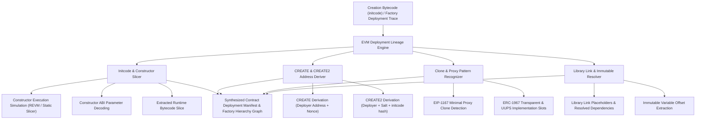
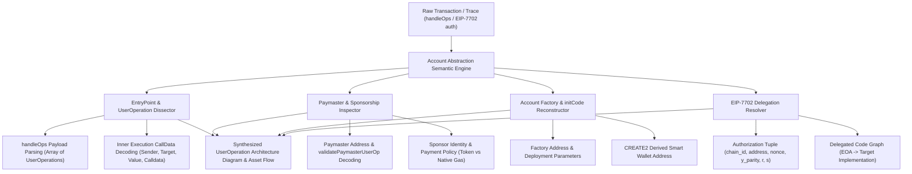
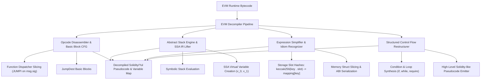

# Tier 1: advanced EVM and decompilation

[Master tracker](README.md). Status read from GitHub 2026-11-28.

| Issue                                               | Title                                                                                                                                    | Author  | State | Priority / labels                                                                          | Comments | Linked PRs                                                                                                                                                                         |
| --------------------------------------------------- | ---------------------------------------------------------------------------------------------------------------------------------------- | ------- | ----- | ------------------------------------------------------------------------------------------ | -------- | ---------------------------------------------------------------------------------------------------------------------------------------------------------------------------------- |
| [#3734](https://github.com/morluto/rea/issues/3734) | EVM deployment lineage reverse engineering: CREATE/CREATE2 initcode, constructors, factories, clones and library-link graphs             | matbrgz | open  | enhancement, provider: evm                                                                 | 0        | none found                                                                                                                                                                         |
| [#3733](https://github.com/morluto/rea/issues/3733) | ERC-4337 / EIP-7702 account-abstraction reverse engineering: UserOperations, EntryPoint, paymasters, factories and delegated-code graphs | matbrgz | open  | enhancement                                                                                | 0        | none found                                                                                                                                                                         |
| [#3736](https://github.com/morluto/rea/issues/3736) | EVM pseudocode decompilation: stack-to-SSA IR, expressions and Solidity-like control/data-flow reconstruction                            | matbrgz | open  | enhancement, area: native, area: evidence, provider: evm                                   | 0        | none found                                                                                                                                                                         |
| [#2388](https://github.com/morluto/rea/issues/2388) | Solidity: inspect bytecode CBOR metadata losslessly and bind supplied metadata files                                                     | matbrgz | open  | enhancement, P2: medium, area: domain, provider: evm                                       | 1        | [#2420](https://github.com/morluto/rea/pull/2420) (closed), [#2790](https://github.com/morluto/rea/pull/2790) (merged)                                                             |
| [#2389](https://github.com/morluto/rea/issues/2389) | Solidity: select exact solc Standard JSON contract artifacts and bytecode kinds                                                          | matbrgz | open  | enhancement, P2: medium, area: domain, provider: evm                                       | 2        | [#12743](https://github.com/morluto/rea/pull/12743) (open), [#2415](https://github.com/morluto/rea/pull/2415) (closed), [#3024](https://github.com/morluto/rea/pull/3024) (closed) |
| [#2390](https://github.com/morluto/rea/issues/2390) | Solidity: map EVM byte PCs to original and generated source spans                                                                        | matbrgz | open  | enhancement, P2: medium, area: domain, provider: evm                                       | 1        | none found                                                                                                                                                                         |
| [#2391](https://github.com/morluto/rea/issues/2391) | Solidity: decode supplied ABI calldata, logs and revert payloads with explicit ambiguity                                                 | matbrgz | open  | enhancement, P2: medium, area: domain, provider: evm                                       | 1        | none found                                                                                                                                                                         |
| [#2392](https://github.com/morluto/rea/issues/2392) | Solidity: inspect and compare compiler storage layouts without inferring live state                                                      | matbrgz | open  | enhancement, P2: medium, area: domain, provider: evm                                       | 1        | none found                                                                                                                                                                         |
| [#2393](https://github.com/morluto/rea/issues/2393) | Solidity: inspect offline proxy patterns and supplied implementation-slot evidence                                                       | matbrgz | open  | enhancement, P2: medium, area: evidence, provider: evm                                     | 1        | none found                                                                                                                                                                         |
| [#2394](https://github.com/morluto/rea/issues/2394) | Solidity: inspect recorded EVM opcode/call traces and attribute debugging locations                                                      | matbrgz | open  | enhancement, P2: medium, area: evidence, provider: evm                                     | 1        | none found                                                                                                                                                                         |
| [#2395](https://github.com/morluto/rea/issues/2395) | Solidity: expose fork-profiled EVM disassembly and bounded control-flow evidence                                                         | matbrgz | open  | enhancement, P2: medium, area: domain, area: native, area: evidence, design, provider: evm | 1        | none found                                                                                                                                                                         |
| [#2396](https://github.com/morluto/rea/issues/2396) | Solidity: compare exact bytecode with separately explained compiler patch spans                                                          | matbrgz | open  | enhancement, P2: medium, area: domain, provider: evm                                       | 1        | none found                                                                                                                                                                         |

## Source text

Verbatim issue text and comments follow. Badge images are removed and heading levels shifted. Claims are the authors', not verified here.

### [#3734](https://github.com/morluto/rea/issues/3734) [Feature] EVM deployment lineage reverse engineering: CREATE/CREATE2 initcode, constructors, factories, clones and library-link graphs

_matbrgz, open, https://github.com/morluto/rea/issues/3734_

#### Problem Statement & Context

In on-chain EVM forensics, inspecting a deployed contract's runtime bytecode only reveals its active state machine. It conceals the deployment ceremony that brought the contract into existence:

1. **Creation Bytecode vs Runtime Bytecode**: The initialization code (`initcode`) executes once in a transient context, evaluates constructor arguments, sets immutable variables, populates initial storage slots, and returns the runtime bytecode slice via the `RETURN` opcode.
2. **Deterministic Addresses (`CREATE2`)**: Smart contracts deployed at predictable addresses via `keccak256(0xff ++ deployer ++ salt ++ keccak256(initcode))[12:]`, widely used by Uniswap pair factories, rollup bridges, and account abstraction wallets.
3. **Minimal Proxy Clones (EIP-1167 / ERC-3448 / ERC-1967)**: Ultra-cheap 45-byte proxy bytecodes (`363d3d373d3d3d363d73bebebebebebebebebebebebebebebebebebebebe5af43d82803e903d91602b57fd5bf3`) delegating all calls to a shared master implementation.
4. **Link References & Libraries**: Unlinked bytecodes containing 20-byte placeholder signatures (`__$30bbc75f483...$__`) replaced during deployment with external library addresses.
5. **Constructor Arguments & Immutables**: Trailing bytes appended to initcode or runtime code representing constructor parameter buffers and compiled immutable value offsets.

REA lacks a dedicated deployment lineage engine capable of dissecting initcode, reconstructing constructor arguments, calculating CREATE2 salts, and mapping factory-to-clone hierarchies.

#### Proposed Architecture

#### Technical Capabilities & Modules

1. **Initcode Disassembly & Constructor Parameter Extraction:**
   - Separate transient constructor bytecode from trailing ABI-encoded constructor parameters.
   - Decompile constructor logic: initialization assignments, ownership setup, and storage initializations.
   - Extract the returned runtime bytecode slice defined by the terminal `CODECOPY` / `RETURN` opcodes.

2. **CREATE & CREATE2 Address Verification:**
   - Reconstruct `CREATE` addresses from deployer address and deployment transaction nonces (RLP encoding).
   - Reconstruct `CREATE2` addresses: extract 32-byte salt parameters, compute `keccak256(initcode)`, and verify counterfactual deployment addresses.

3. **Proxy Clone Family Detection:**
   - Recognize standardized clone bytecode templates:
     - EIP-1167 Minimal Proxy: extract target master implementation address from byte offsets 10..30.
     - ERC-3448 MetaProxy: extract trailing metadata payloads.
     - ERC-1967 Implementation and Admin storage slots (`0x360894a13ba1a3210667c828492db98dca3e2076cc3735a920a3ca505d382bbc`).

4. **External Library Link Resolution:**
   - Scan for unresolved library placeholder patterns in compiled artifacts (`__$name$__` or 20-byte zero placeholders).
   - Match linked addresses against deployed external utility libraries (e.g. OpenZeppelin `SafeCast`, `Strings`).

5. **Factory Deployment Lineage Graph:**
   - Given a factory contract (e.g. AMM Pool Factory, Token Factory), trace all deployed child contracts.
   - Reconstruct the deployment dependency tree showing parent factories, deployed instances, and implementation upgrades.

#### Acceptance Criteria

- [ ] Automated separation of initcode into constructor logic, runtime bytecode, and constructor parameters.
- [ ] Accurate calculation and validation of both `CREATE` and `CREATE2` deployment addresses.
- [ ] Detection and target address extraction for EIP-1167 minimal clones and ERC-1967 proxies.
- [ ] Extraction of constructor arguments and matching against candidate Solidity ABI definitions.
- [ ] Generation of an interactive factory-to-instance deployment lineage diagram.

#### Related Issues & Dependencies

- Complements [#972](https://github.com/morluto/rea/issues/972) (Solidity/EVM reverse engineering)
- Complements [#2389](https://github.com/morluto/rea/issues/2389) (EVM Standard JSON and compiler metadata)
- Complements [#2393](https://github.com/morluto/rea/issues/2393) (EVM storage layout and proxy detection)
- Complements [#2396](https://github.com/morluto/rea/issues/2396) (EVM bytecode comparison and semantic diffing)

### [#3733](https://github.com/morluto/rea/issues/3733) [Feature] ERC-4337 / EIP-7702 account-abstraction reverse engineering: UserOperations, EntryPoint, paymasters, factories and delegated-code graphs

_matbrgz, open, https://github.com/morluto/rea/issues/3733_

#### Problem Statement & Context

Account Abstraction is fundamentally reshaping how Ethereum and EVM-compatible chains handle identity, transaction sponsorship, and smart contract wallets:

1. **ERC-4337 (Off-Chain Alternative Mempool)**: User transactions packaged as `UserOperation` structs instead of raw Ethereum transactions, processed through an authoritative `EntryPoint` contract (`0x0000000071727De22E5E9d8BAf0edAc6f37da032` or v0.7 `0x0000000071727De22E5E9d8BAf0edAc6f37da032`).
2. **UserOperation Structure**: Sender account, nonce, `initCode` (account creation code), `callData` (target action), execution gas limits, paymaster verification limits, pre-verification gas, max fee, and signature.
3. **Paymasters & Gas Sponsorship**: Specialized smart contracts validating and sponsoring gas payments (`validatePaymasterUserOp`, `postOp`), often utilizing off-chain sponsor signatures.
4. **Smart Account Factories & Bundlers**: Deterministic account deployment via `initCode` using factories (e.g. SimpleAccountFactory, Safe4337Factory) and batched bundling via `handleOps`.
5. **EIP-7702 (EOA Code Delegation)**: Ephemeral delegation allowing standard Externally Owned Accounts (EOAs) to set a contract code pointer (`0xef0100 || contract_address`) for the duration of a transaction, temporarily granting smart account capabilities to regular wallets.

Currently, reverse engineering an EVM transaction involving account abstraction produces confusing, deeply nested call trees where the origin sender appears as the bundler instead of the user. REA needs an account-abstraction semantic engine capable of decoding UserOperations, identifying paymasters, modeling account creation, and unraveling EIP-7702 delegation graphs.

#### Proposed Architecture

#### Technical Capabilities & Modules

1. **UserOperation Slicing & Deserialization:**
   - Detect calls to `EntryPoint.handleOps` (versions v0.6 and v0.7).
   - Unpack packed `UserOperation` structs: `sender`, `nonce`, `initCode`, `callData`, `accountGasLimits`, `preVerificationGas`, `gasFees`, `paymasterAndData`, `signature`.
   - Decode inner target transactions from `callData` (e.g. `execute`, `executeBatch`).

2. **Paymaster & Sponsorship Policy Reconstruction:**
   - Extract paymaster contract addresses from `paymasterAndData`.
   - Identify sponsorship models: free sponsorship, ERC-20 token payment, subscription-based allowance.
   - Decode paymaster verification signatures and post-operation accounting logic.

3. **Smart Account Factory & Creation Modeling:**
   - Parse `initCode`: separate factory address (first 20 bytes) from factory calldata (remaining bytes).
   - Calculate deterministic derived counterfactual contract addresses (`CREATE2`).
   - Map initialization ownership parameters (owners, signers, recovery guardians).

4. **EIP-7702 Code Delegation Analysis:**
   - Parse EIP-7702 transaction envelopes: authorization lists, delegated contract implementation addresses, and nonces.
   - Map execution boundaries: trace how an EOA's temporary code pointer behaves during multi-step contract calls.

5. **Semantic Identity & Flow Reconstruction:**
   - Reconstruct true user attribution: re-anchor transaction causality from the bundler relayer to the actual `UserOp.sender`.
   - Build an asset flow diagram showing token movements, gas reimbursements, and state changes.

#### Acceptance Criteria

- [ ] Automated decoding of ERC-4337 v0.6 and v0.7 `UserOperation` arrays from transaction traces.
- [ ] Accurate extraction and separation of inner execution calldata and target contracts.
- [ ] Attribution of paymaster sponsors and gas payment mechanisms.
- [ ] Parsing of `initCode` to identify account factory parameters and derived wallet addresses.
- [ ] Decoding of EIP-7702 authorization lists and delegated implementation contracts.

#### Related Issues & Dependencies

- Complements [#972](https://github.com/morluto/rea/issues/972) (Solidity/EVM reverse engineering)
- Complements [#2391](https://github.com/morluto/rea/issues/2391) (EVM calldata and execution trace analysis)
- Complements [#2394](https://github.com/morluto/rea/issues/2394) (EVM transaction simulation and state diffs)

### [#3736](https://github.com/morluto/rea/issues/3736) [Feature] EVM pseudocode decompilation: stack-to-SSA IR, expressions and Solidity-like control/data-flow reconstruction

_matbrgz, open, https://github.com/morluto/rea/issues/3736_

#### Problem Statement & Context

In REA's existing EVM architecture, issue [#2395](https://github.com/morluto/rea/issues/2395) provides essential bytecode disassembly and basic block control flow graph (CFG) generation. However, analyzing raw EVM opcodes (`SWAP4`, `DUP2`, `JUMPI`, `MLOAD`, `ADD`) requires mental emulation of the 1024-element 256-bit EVM stack.

To elevate REA from an opcode viewer to a true high-level reverse engineering suite, an intermediate decompilation pipeline is required:

1. **Stack-to-SSA IR Lift**: Convert 256-bit stack operations into Static Single Assignment (SSA) virtual variables ($v_0, v_1, v_2$), tracking stack depth and resolving `SWAP` and `DUP` permutations.
2. **Expression Tree Reconstruction**: Collapse linear SSA statements into composite arithmetic and logical expressions (e.g. converting `AND(SHR(224, calldataload(0)), 0xffffffff)` into `msg.sig`).
3. **Control Flow De-Sugaring**: Reconstruct high-level control structures (`if/else`, `while`, `for`, `revert(reason)`) from raw `JUMP` and conditional `JUMPI` branches.
4. **Memory & Storage Pattern Recognition**: Detect compiler idioms: ABI decoding loops, dynamic array allocations, mapping slot calculations (`keccak256(key ++ slot)`), and packed storage variable packing/unpacking.
5. **Solidity-Like Pseudocode Generation**: Emit clean, human-readable pseudocode closely resembling high-level Solidity/Yul code with inferred variable types and function signatures.

REA needs a native decompiler pipeline (conceptually inspired by Heimdall-rs / Panoramix / Slither) that translates raw EVM bytecode into readable pseudocode.

#### Proposed Architecture

#### Technical Capabilities & Modules

1. **Symbolic Stack-to-SSA Transformation:**
   - Execute an abstract interpreter over each basic block, maintaining a symbolic stack of AST nodes.
   - Replace physical stack push/pop/swap/dup operations with immutable SSA assignments ($v_n = ext{op}(v_a, v_b)$).
   - Insert phi-nodes at control flow join points.

2. **Dispatcher & Function Slicing:**
   - Identify the contract function selector dispatcher tree (`PUSH4 selector, DUP2, EQ, PUSH2 dest, JUMPI`).
   - Extract 4-byte function selectors and isolate independent function subgraphs.
   - Correlate selectors with candidate human-readable signatures (via 4byte / OpenChain directories or EVMole).

3. **Storage & Memory Idiom Desugaring:**
   - Identify mapping slot computations: recognize `keccak256(abi.encode(key, slot))` patterns and rewrite as `mapping_X[key]`.
   - Identify dynamic array indexing: `keccak256(slot) + index`.
   - Identify memory string copying and revert reason extraction (`revert("Error string")`).

4. **Structured Control Flow Reconstruction:**
   - Perform dominator tree analysis to reconstruct conditional statements (`if-then-else`).
   - Detect natural loops and classify loop induction variables, loop conditions, and break statements.
   - Transform `ISZERO, JUMPI, PUSH 0, DUP1, REVERT` patterns into clean `require(condition)` assertions.

5. **Solidity-Like Pseudocode Formatting:**
   - Generate well-formatted, indented pseudocode matching modern Solidity syntax conventions.
   - Type-infer variables (address, uint256, bool, bytes32) based on operator contexts (e.g. `EXTCODESIZE` implies address, `SLT` implies signed integer).

#### Acceptance Criteria

- [ ] Successful conversion of raw EVM bytecode to SSA intermediate representation.
- [ ] De-sugaring of mapping and array storage access patterns into readable accessor syntax.
- [ ] Structural recovery of `if`, `else`, and loop statements from raw `JUMP`/`JUMPI` opcodes.
- [ ] Transformation of revert blocks into `require(condition, "reason")` expressions.
- [ ] Output of readable, syntactically coherent Solidity-like pseudocode.

#### Related Issues & Dependencies

- Complements [#972](https://github.com/morluto/rea/issues/972) (Solidity/EVM reverse engineering)
- Complements [#2395](https://github.com/morluto/rea/issues/2395) (EVM disassembly and CFG generation)
- Complements [#3716](https://github.com/morluto/rea/issues/3716) (Common Bytecode and VM Framework)

### [#2388](https://github.com/morluto/rea/issues/2388) [Feature] Solidity: inspect bytecode CBOR metadata losslessly and bind supplied metadata files

_matbrgz, open, https://github.com/morluto/rea/issues/2388_

#### Analyst question and current gap

REA retains EVMole-reported terminal metadata in raw_result, but its JS binding leaves integer precision and non-text-key coverage unknown. A Solidity analyst needs a lossless account of the actual trailer and whether a supplied metadata JSON belongs to it.

#### Proposed outcome

- Parse the terminal length and bounded CBOR region from exact selected bytecode; retain decoded-byte offsets, raw bytes and carrier identity.
- Preserve integer precision, byte strings, unknown keys and unsupported CBOR values without converting them into guessed text. Report malformed, absent and ambiguous trailers distinctly.
- Decode admitted solc version representations, retaining release versus prerelease/unknown forms and raw values.
- Optionally bind a caller-selected local metadata JSON to the bytecode metadata commitment using the exact admitted content-addressing algorithm. Preserve unavailable or mismatched associations.
- Treat source URLs/hashes as metadata; do not retrieve IPFS/Swarm/source content implicitly or call inferred metadata verified original source.

#### Acceptance and verification

- [ ] Compiler-pinned owned fixtures cover metadata present, appendCBOR=false and bytecodeHash=none.
- [ ] Synthetic trailers cover reordered/unknown/non-text keys, large integers, truncated CBOR and invalid terminal lengths.
- [ ] Wrong supplied metadata and unknown commitment schemes stay mismatched/unverified.
- [ ] CLI/MCP retain the same fields and source ranges; parsing bounds, cancellation and legacy EVM results remain intact.
- [ ] Define one feature specification, one implementation plan and incremental tasks under docs/specs/solidity/cbor-metadata/ before implementation.

#### Scope and relationships

Offline caller-selected artifact inspection. Existing EVM interface recovery (PR [#1051](https://github.com/morluto/rea/pull/1051)), retained delivery (PR [#2308](https://github.com/morluto/rea/pull/2308)) and roadmap [#972](https://github.com/morluto/rea/issues/972) are the foundations; this feature is independently scoped and does not reopen the entire roadmap. Parent language tracker: [#2383](https://github.com/morluto/rea/issues/2383). Use self-owned compiler fixtures and preserve provider/version provenance. New provider choices, if needed, follow CONTRIBUTING.md before substantial integration work.

#### Primary references

- [Solidity contract metadata](https://docs.soliditylang.org/en/latest/metadata.html)

#### Comment by matbrgz (2026-10-12) on [#2388](https://github.com/morluto/rea/issues/2388)

#### Implementation & Triage Status Update

**Summary (ELI5):**
Extract and verify Solidity compiler metadata appended at the end of runtime/creation bytecode via CBOR encoding without data loss or heuristics.

**Current State & Validation:**

1. Branch `feat/solidity-cbor-metadata` contains:
   - Lossless CBOR decoder parsing compiler-embedded payloads (`ipfs`, `bzzr0`, `bzzr1`, `solc`).
   - Unit test suite (`src/evm/SolidityMetadata.test.ts`) verifying CBOR boundary lengths, version extraction across legacy (0.4.x - 0.5.x) and modern (0.8.x+) bytecodes.
   - Exact offset isolation to prevent trailing swarm hashes from distorting opcode disassembly or instructions coverage.
2. Next Step:
   - Format canonical spec under `docs/specs/evm/cbor-metadata/{spec.md,plan.md,tasks.md}` and submit the formal PR.

### [#2389](https://github.com/morluto/rea/issues/2389) [Feature] Solidity: select exact solc Standard JSON contract artifacts and bytecode kinds

_matbrgz, open, https://github.com/morluto/rea/issues/2389_

#### Analyst question and current gap

inspect_evm_interface accepts only explicit raw/hex carriers and leaves init/runtime kind unknown. A compiler output can contain several source files/contracts, creation and deployed objects, unlinked libraries, immutable references and diagnostics; it cannot be treated as one runtime hex string.

#### Proposed outcome

- Inspect caller-selected existing solc Standard JSON output without running a compiler; select an exact source-unit/contract and creation or deployed bytecode field.
- Preserve file digest, JSON source coordinates, selected object identity, recorded compiler/settings and diagnostics. Output errors must remain visible even if an external compiler exited successfully.
- Keep unresolved link placeholders, linkReferences and immutableReferences as distinct facts. Do not invent addresses or silently rewrite the input.
- Feed admitted concrete selected bytes to the existing EVM interface operation with explicit selection provenance; bytecode kind is a supplied compiler-artifact fact, not proof of deployment.
- Report absent outputs, malformed objects, conflicting contract names and compiler-version-dependent facets precisely.

#### Acceptance and verification

- [ ] An owned multi-contract solc fixture selects creation/deployed objects independently and preserves compiler diagnostics.
- [ ] Unlinked library placeholders are reported without being interpreted as hexadecimal bytes.
- [ ] Missing contracts, ambiguous basename selectors and out-of-range reference spans fail or remain unavailable precisely.
- [ ] CLI/MCP preserve exact selected identities with bounded JSON parsing and cancellation.
- [ ] Define one feature specification, one implementation plan and incremental tasks under docs/specs/solidity/compiler-artifacts/ before implementation.

#### Scope and relationships

Offline caller-selected artifact inspection. Existing EVM interface recovery (PR [#1051](https://github.com/morluto/rea/pull/1051)), retained delivery (PR [#2308](https://github.com/morluto/rea/pull/2308)) and roadmap [#972](https://github.com/morluto/rea/issues/972) are the foundations; this feature is independently scoped and does not reopen the entire roadmap. Parent language tracker: [#2383](https://github.com/morluto/rea/issues/2383). Use self-owned compiler fixtures and preserve provider/version provenance. New provider choices, if needed, follow CONTRIBUTING.md before substantial integration work.

#### Primary references

- [Solidity compiler Standard JSON](https://docs.soliditylang.org/en/latest/using-the-compiler.html)

#### Comment by matbrgz (2026-10-12) on [#2389](https://github.com/morluto/rea/issues/2389)

#### Triage & Architectural Review Notes

**Objective (ELI5):**
Disambiguate contract artifacts produced by `solc` Standard JSON output (`bin` creation bytecode vs `bin-runtime` deployed bytecode) and preserve provenance across compilation targets.

**Design Alignment:**

- **Boundary Ownership:** Standard JSON schema parsing belongs in `src/domain/evm/`. The domain contract must expose explicit discriminant properties (`bytecodeKind: "creation" | "deployed"`) rather than inferring role from byte length or deployment context.
- **Fail-Closed Validation:** Missing link references or unresolved library addresses (`__$30...$__`) must be retained as unresolved linkage evidence rather than zeroed or stripped.
- **Spec Target:** `docs/specs/evm/standard-json-artifacts/`

#### Comment by fangkangmi (2026-10-12) on [#2389](https://github.com/morluto/rea/issues/2389)

I'd like to take this issue, working on it

### [#2390](https://github.com/morluto/rea/issues/2390) [Feature] Solidity: map EVM byte PCs to original and generated source spans

_matbrgz, open, https://github.com/morluto/rea/issues/2390_

#### Analyst question and current gap

EVM interface results retain byte offsets but do not interpret Solidity source maps. Source-map entries index instructions, while PUSH immediates change byte PCs; direct index-to-PC substitution would produce incorrect debugging locations.

#### Proposed outcome

- Consume caller-selected bytecode, source-map and source-ID facts from a selected compiler artifact, with explicit binding evidence.
- Decode compressed mapping inheritance and instruction ordinals into byte PC ranges using the admitted bytecode profile.
- Preserve original versus compiler-generated source identity, byte-based source spans, jump information and modifier depth when available.
- Return unmapped/generated/invalid/unknown associations explicitly; validate source spans against caller-supplied source bytes before presenting snippets.
- Keep compiler-attributed source positions distinct from reconstructed pseudocode and runtime observations. Do not read paths or fetch source URLs implicitly.

#### Acceptance and verification

- [ ] Pinned owned fixtures cover PUSH1/PUSH32, omitted mapping fields, generated Yul sources, modifier nesting and UTF-8 source text.
- [ ] Nonexistent source IDs, out-of-range spans, truncated instructions and wrong artifact associations never produce verified snippets.
- [ ] Creation and deployed maps cannot be joined interchangeably.
- [ ] CLI/MCP map exact selected PCs and retain coverage, bounds and cancellation.
- [ ] Define one feature specification, one implementation plan and incremental tasks under docs/specs/solidity/source-mappings/ before implementation.

#### Scope and relationships

Offline caller-selected artifact inspection. Existing EVM interface recovery (PR [#1051](https://github.com/morluto/rea/pull/1051)), retained delivery (PR [#2308](https://github.com/morluto/rea/pull/2308)) and roadmap [#972](https://github.com/morluto/rea/issues/972) are the foundations; this feature is independently scoped and does not reopen the entire roadmap. Parent language tracker: [#2383](https://github.com/morluto/rea/issues/2383). Use self-owned compiler fixtures and preserve provider/version provenance. New provider choices, if needed, follow CONTRIBUTING.md before substantial integration work.

#### Primary references

- [Solidity source mapping semantics](https://docs.soliditylang.org/en/latest/internals/source_mappings.html)

#### Comment by matbrgz (2026-10-12) on [#2390](https://github.com/morluto/rea/issues/2390)

#### Triage & Architectural Review Notes

**Objective (ELI5):**
Map EVM program counters (PC byte offsets) back to exact source code spans (file, line, column, length) using compiler `srcmap` / `srcmap-runtime`.

**Critical Considerations:**

1. **Compiler-Generated Code:** In Solidity 0.8.x and Yul IR pipelines, certain opcodes originate from compiler internal routines (utility functions, panic reverts). These carry source index `-1` or out-of-bounds spans. They must be explicitly classified as `compiler-generated` evidence rather than missing or faulty source files.
2. **PC-to-Instruction Offset:** EVM instruction byte offsets deviate from instruction indices due to variable-length `PUSH<N>` data bytes. The PC mapping table must index by exact byte PC.
3. **Spec Target:** `docs/specs/evm/source-mappings/`

### [#2391](https://github.com/morluto/rea/issues/2391) [Feature] Solidity: decode supplied ABI calldata, logs and revert payloads with explicit ambiguity

_matbrgz, open, https://github.com/morluto/rea/issues/2391_

#### Analyst question and current gap

REA currently infers dispatch selectors and argument/mutability strings from bytecode. Those candidates do not provide verified function names or an ABI-aware interpretation of caller-selected calldata, event logs and revert bytes.

#### Proposed outcome

- Accept a caller-selected ABI plus a separately identified local payload and its role: calldata, return data, event log or revert data.
- Compute canonical signatures/selectors/event identifiers using Ethereum Keccak and preserve all matching candidates. Distinguish caller-supplied ABI facts from bytecode inference.
- Decode admitted tuples/arrays/dynamic types with lossless integer and byte values; retain raw payload and byte ranges.
- Preserve unknown custom errors/selectors, malformed offsets, trailing bytes and ambiguous matches instead of selecting a guessed signature.
- Keep indexed dynamic event values as hashes rather than claiming to recover their original contents. No signature database, RPC, wallet or transaction action is implied.

#### Acceptance and verification

- [ ] Owned contract fixtures cover overloads, nested dynamic tuples/arrays, custom errors, Error/Panic payloads, anonymous events and indexed dynamic fields.
- [ ] Synthetic malformed offsets/lengths and adversarial size expansion are rejected before allocation.
- [ ] Conflicting ABI candidates remain distinct; every uint256/int256 stays lossless through JSON.
- [ ] CLI/MCP provide equivalent decoded facts, raw evidence and unavailable facets.
- [ ] Define one feature specification, one implementation plan and incremental tasks under docs/specs/solidity/abi-decoding/ before implementation.

#### Scope and relationships

Offline caller-selected artifact inspection. Existing EVM interface recovery (PR [#1051](https://github.com/morluto/rea/pull/1051)), retained delivery (PR [#2308](https://github.com/morluto/rea/pull/2308)) and roadmap [#972](https://github.com/morluto/rea/issues/972) are the foundations; this feature is independently scoped and does not reopen the entire roadmap. Parent language tracker: [#2383](https://github.com/morluto/rea/issues/2383). Use self-owned compiler fixtures and preserve provider/version provenance. New provider choices, if needed, follow CONTRIBUTING.md before substantial integration work.

#### Primary references

- [Solidity ABI specification](https://docs.soliditylang.org/en/latest/abi-spec.html)

#### Comment by matbrgz (2026-10-12) on [#2391](https://github.com/morluto/rea/issues/2391)

#### Triage & Architectural Review Notes

**Objective (ELI5):**
Decode ABI calldata, emitted event topics/data, and revert reasons into structured parameters while explicitly signaling ambiguities (e.g. 4-byte selector collisions).

**Core Invariants:**

1. **Ambiguity Preservation:** When a 4-byte function selector matches multiple ABI definitions, the tool must not guess. It must return all candidate matches marked with `ambiguous: true` and their respective parameter decodings.
2. **Modern Error Support:** Must natively decode standard `Error(string)` (`0x08c379a0`), `Panic(uint256)` (`0x4e487b71`), and arbitrary custom errors from the contract's ABI. Unknown error selectors should remain raw bytes with `unmatched_custom_error` diagnostics.

### [#2392](https://github.com/morluto/rea/issues/2392) [Feature] Solidity: inspect and compare compiler storage layouts without inferring live state

_matbrgz, open, https://github.com/morluto/rea/issues/2392_

#### Analyst question and current gap

The current EVM interface profile does not expose Solidity storage layouts. An analyst comparing two builds needs typed slot/offset facts and specific layout changes without treating them as observed chain state or a proven safe upgrade.

#### Proposed outcome

- Consume caller-selected compiler storageLayout and transientStorageLayout artifacts, retaining source/contract/build identity and unsupported schema versions.
- Preserve arbitrary-width slots, packed byte offsets, type references, inherited declarations, struct fields, array/mapping structure and recursive references.
- Compare explicitly paired layouts with explanations for moved, removed, added and type-changed fields; do not infer semantic upgrade safety from equal slot coordinates.
- Keep persistent versus transient storage distinct. Report partial/unknown type coverage and unresolved build association.
- Provide focused CLI/MCP inventory and comparison with bounded traversal and stable paging.

#### Acceptance and verification

- [ ] Own compiler-pinned fixtures cover packing, inheritance, structs, mappings, dynamic arrays and admitted transient-layout output.
- [ ] Malformed type graphs, cycles, oversized slot values and missing type references remain bounded and lossless.
- [ ] A changed packed field, inheritance order and storage type produce specific deltas.
- [ ] No RPC or storage-value acquisition occurs; same layout does not produce a claim of equivalent execution.
- [ ] Record one feature specification, one implementation plan and incremental tasks under docs/specs/solidity/storage-layout/ before code.

#### Scope and relationships

Independently scoped follow-up to roadmap [#972](https://github.com/morluto/rea/issues/972) and existing EVM interface PR [#1051](https://github.com/morluto/rea/pull/1051); parent TIOBE language tracker [#2383](https://github.com/morluto/rea/issues/2383). Initial analysis uses caller-selected local evidence and owned fixtures. New provider choices require the explicit CONTRIBUTING.md maintainer decision before substantial implementation for integration. Runtime acquisition, local execution and blockchain mutation are not implicit parts of this feature.

#### Primary references

- [Solidity storage-layout semantics](https://docs.soliditylang.org/en/latest/internals/layout_in_storage.html)

#### Comment by matbrgz (2026-10-12) on [#2392](https://github.com/morluto/rea/issues/2392)

#### Triage & Architectural Review Notes

**Objective (ELI5):**
Parse and visualize EVM contract storage layouts (`storageLayout` from solc) without connecting to a live blockchain network or querying live RPC state.

**Key Requirements:**

1. **Packing & Offsets:** Correctly model continuous 32-byte slot assignments and byte offsets (`offset: 0..31`) for packed elementary types (`uint128`, `bool`, `address`).
2. **Dynamic Structures:** Represent mappings and dynamic arrays by their hashing derivations (`keccak256(p . s)`) as structural recipes rather than attempting runtime key enumeration.

### [#2393](https://github.com/morluto/rea/issues/2393) [Feature] Solidity: inspect offline proxy patterns and supplied implementation-slot evidence

_matbrgz, open, https://github.com/morluto/rea/issues/2393_

#### Analyst question and current gap

Interface inference on proxy bytecode can hide the distinction between proxy dispatch and implementation behavior. REA needs explicitly attributed offline proxy relationships rather than automatic network resolution or guessed deployed identities.

#### Proposed outcome

- Recognize admitted ERC-1167 runtime patterns from exact local bytecode and retain the embedded implementation address with byte-range evidence.
- Interpret explicitly supplied recorded ERC-1967 implementation/beacon/admin slots with snapshot identity, availability and precision.
- Separate observed slot values, bytecode-pattern classification and inferred delegation edges. Missing storage differs from observed zero.
- Preserve code address and storage/execution context separately for delegatecall; retain unresolved beacon relationships instead of executing implementation() implicitly.
- Keep proxy-chain cycles, modified/unknown patterns and unmatched implementation bytecode explicit. No RPC lookup, wallet or deployment action is implied.

#### Acceptance and verification

- [ ] Own/synthetic fixtures cover exact minimal proxies, altered patterns, implementation/beacon alternatives and observed zero versus unavailable slots.
- [ ] Wrong snapshot/chain/block associations cannot become verified implementation relationships.
- [ ] Cycles and missing implementation artifacts terminate with explicit unresolved edges.
- [ ] CLI/MCP preserve raw bytes/slots and distinguish pattern evidence from actual runtime calls.
- [ ] Record one feature specification, one implementation plan and incremental tasks under docs/specs/solidity/proxy-evidence/ before code.

#### Scope and relationships

Independently scoped follow-up to roadmap [#972](https://github.com/morluto/rea/issues/972) and existing EVM interface PR [#1051](https://github.com/morluto/rea/pull/1051); parent TIOBE language tracker [#2383](https://github.com/morluto/rea/issues/2383). Initial analysis uses caller-selected local evidence and owned fixtures. New provider choices require the explicit CONTRIBUTING.md maintainer decision before substantial implementation for integration. Runtime acquisition, local execution and blockchain mutation are not implicit parts of this feature.

#### Primary references

- [ERC-1167 minimal proxy](https://eips.ethereum.org/EIPS/eip-1167)
- [ERC-1967 proxy slots](https://eips.ethereum.org/EIPS/eip-1967)

#### Comment by matbrgz (2026-10-12) on [#2393](https://github.com/morluto/rea/issues/2393)

#### Triage & Architectural Review Notes

**Objective (ELI5):**
Identify upgradeable proxy patterns (ERC-1967, ERC-1822 UUPS, Diamond Multi-Facet ERC-2535) and trace static implementation slots entirely offline.

**Implementation Invariants:**

- Verify canonical storage slots directly:
  - ERC-1967 Implementation: `0x360894a13ba1a3210667c828492db98dca3e2076cc3735a920a3ca505d382bbc`
  - ERC-1967 Admin: `0xb53127684a568b3173ae13b9f8a6016e243e63b6e8ee1178d6a717850b5d6103`
  - ERC-1967 Beacon: `0xa3f0ad74e5423aebfd80d3ef4346578335a9a72aeaee59ff6cb3582b35133d50`
- If an implementation address cannot be resolved from supplied artifacts or recorded storage diffs, report `implementation: unknown` instead of executing remote eth_call heuristics.

### [#2394](https://github.com/morluto/rea/issues/2394) [Feature] Solidity: inspect recorded EVM opcode/call traces and attribute debugging locations

_matbrgz, open, https://github.com/morluto/rea/issues/2394_

#### Analyst question and current gap

Static selectors do not show which call, revert or source location ran. REA can add a recorded-debugging lane without starting a node, executing contracts or retrieving transactions.

#### Proposed outcome

- Import explicitly selected local captures for separately admitted Geth struct/opcode-log and callTracer profiles; record capture digest, producer/version/configuration and available transaction/block/fork context.
- Retain exact PCs, depth, call type, stack/memory/storage availability, return/revert payloads and code versus storage context when established.
- Link known bytecode/source-map/ABI evidence without inventing identity from addresses or treating missing trace facets as empty state.
- Expose bounded step/call selections and source-attributed observations through CLI/MCP. Record truncation and unverified capture claims.
- Keep original recorded observations separate from any later replay-derived results; importing a trace performs no RPC, wallet action or contract execution.

#### Acceptance and verification

- [ ] Owned local test contracts produce nested calls, delegatecall, reverts, logs and persistent/transient storage activity outside the import operation.
- [ ] Real captured formats establish each advertised producer profile; synthetic JSON alone is insufficient.
- [ ] Truncated captures, disabled memory/stack/storage, unknown code and wrong source-map associations preserve partial facets.
- [ ] Large captures page/bound records and cancel without reading source URLs or launching a node.
- [ ] Record one feature specification, one implementation plan and incremental tasks under docs/specs/solidity/recorded-traces/ before code.

#### Scope and relationships

Independently scoped follow-up to roadmap [#972](https://github.com/morluto/rea/issues/972) and existing EVM interface PR [#1051](https://github.com/morluto/rea/pull/1051); parent TIOBE language tracker [#2383](https://github.com/morluto/rea/issues/2383). Initial analysis uses caller-selected local evidence and owned fixtures. New provider choices require the explicit CONTRIBUTING.md maintainer decision before substantial implementation for integration. Runtime acquisition, local execution and blockchain mutation are not implicit parts of this feature.

#### Primary references

- [Geth built-in trace profiles](https://geth.ethereum.org/docs/developers/evm-tracing/built-in-tracers)

#### Comment by matbrgz (2026-10-12) on [#2394](https://github.com/morluto/rea/issues/2394)

#### Triage & Architectural Review Notes

**Objective (ELI5):**
Reconstruct recorded execution paths (EVM opcode execution traces and call tree frames) offline and map steps back to source coordinates.

**Boundary Contract:**

- Consume standard debug traces (`debug_traceTransaction` / `structLogs` or Foundry/Anvil call traces).
- Frame hierarchy must preserve child calls (`DELEGATECALL`, `STATICCALL`, `CALL`, `CREATE2`), gas consumption delta, and retained return/revert memory slices.
- Trace step PC numbers must look up directly into the verified source mapping provider ([#2390](https://github.com/morluto/rea/issues/2390)).

### [#2395](https://github.com/morluto/rea/issues/2395) [Design] Solidity: expose fork-profiled EVM disassembly and bounded control-flow evidence

_matbrgz, open, https://github.com/morluto/rea/issues/2395_

#### Analyst question and current gap

REA's interface-only EVMole adapter explicitly excludes disassembly/basic-block/CFG facets and leaves hardfork unknown. Selector inference cannot explain branches or establish the semantics of later-fork instructions.

#### Proposed outcome

- Evaluate an existing engine behind a separately scoped static instruction/CFG contract, with actual adapter/engine version and admitted fork profile.
- Retain byte PCs, opcode bytes, PUSH immediate spans, block boundaries and direct/unresolved jump edges; immediate data is not executable code.
- Distinguish unknown/unavailable dynamic jump targets from exhaustively resolved edges; bound graph/result growth.
- Report unsupported fork/opcode/container profiles precisely. Legacy flat bytecode admission does not imply EOF or every L2 variant.
- Label reconstructed expressions/pseudocode as derivations/inferences if proposed later; this first contract does not execute code or silently reuse an engine's Latest default.

#### Acceptance and verification

- [ ] Owned compiler fixtures span documented optimizer/viaIR settings and representative admitted fork targets.
- [ ] Tests distinguish PUSH immediates containing JUMPDEST-like bytes, truncated PUSH data, dynamic jumps, PUSH0 and admitted transient-storage opcodes.
- [ ] Unknown fork and EOF-style inputs preserve explicit unsupported profiles.
- [ ] CLI/MCP retain identity, unresolved edges, bounds and cancellation; actual engine runs verify every supported profile.
- [ ] Record one feature specification, one implementation plan and incremental tasks under docs/specs/solidity/fork-cfg/ before code.

#### Scope and relationships

Independently scoped follow-up to roadmap [#972](https://github.com/morluto/rea/issues/972) and existing EVM interface PR [#1051](https://github.com/morluto/rea/pull/1051); parent TIOBE language tracker [#2383](https://github.com/morluto/rea/issues/2383). Initial analysis uses caller-selected local evidence and owned fixtures. New provider choices require the explicit CONTRIBUTING.md maintainer decision before substantial implementation for integration. Runtime acquisition, local execution and blockchain mutation are not implicit parts of this feature.

#### Primary references

- [EIP-3855 PUSH0](https://eips.ethereum.org/EIPS/eip-3855)
- [EIP-1153 transient storage](https://eips.ethereum.org/EIPS/eip-1153)

#### Comment by matbrgz (2026-10-12) on [#2395](https://github.com/morluto/rea/issues/2395)

#### Triage & Architectural Review Notes

**Objective (ELI5):**
Provide fork-aware EVM disassembly and bounded basic-block control flow graphs (CFGs) without infinite expansion risk.

**Technical Constraints:**

- **Fork Profiles:** Explicitly account for opcode introducers across EVM hardforks:
  - Shanghai (`PUSH0` `0x5f`)
  - Cancun (`TLOAD` `0x5c`, `TSTORE` `0x5d`, `MCOPY` `0x5e`)
  - Prague / Osaka future opcodes.
- **CFG Bounds:** Jump destinations (`JUMPDEST` `0x5b`) linked via static `PUSH<N>` analysis must enforce bounded exploration depth and block count to guard against maliciously tangled jump tables or decompiler traps.

### [#2396](https://github.com/morluto/rea/issues/2396) [Feature] Solidity: compare exact bytecode with separately explained compiler patch spans

_matbrgz, open, https://github.com/morluto/rea/issues/2396_

#### Analyst question and current gap

Two Solidity builds can differ in metadata, library links or immutable patch values. A useful comparison must show those differences while preserving exact byte inequality and avoiding a false behavioral-equivalence claim.

#### Proposed outcome

- Compare separately selected concrete bytecodes with original carrier and decoded identities, byte lengths and exact changed ranges.
- Optionally consume explicitly bound compiler metadata/link/immutable ranges; report an additional comparison view with each explained span and original values.
- Do not normalize arbitrary suffixes, guessed addresses or unexplained differences. Reject overlapping/out-of-range or incorrectly associated patch spans.
- Preserve creation versus deployed selection and unknown association; compiler artifact facts are not proof of deployment.
- Keep exact equality, equality under stated span exclusions and semantic equivalence as distinct conclusions. Metadata/data can be observable to executing code; excluded spans do not establish behavior equality.

#### Acceptance and verification

- [ ] Pinned own fixtures cover metadata-only changes, linked libraries, constructor-patched immutables and actual executable differences.
- [ ] Wrong reference ranges, overlapping masks and unbound artifacts never produce an explained equality result.
- [ ] Raw versus differently formatted hex carriers retain distinct carrier identities and equal decoded bytes when appropriate.
- [ ] CLI/MCP retain both complete byte identities, changed/excluded ranges, cancellation and bounded output.
- [ ] Record one feature specification, one implementation plan and incremental tasks under docs/specs/solidity/bytecode-comparison/ before code.

#### Scope and relationships

Independently scoped follow-up to roadmap [#972](https://github.com/morluto/rea/issues/972) and existing EVM interface PR [#1051](https://github.com/morluto/rea/pull/1051); parent TIOBE language tracker [#2383](https://github.com/morluto/rea/issues/2383). Initial analysis uses caller-selected local evidence and owned fixtures. New provider choices require the explicit CONTRIBUTING.md maintainer decision before substantial implementation for integration. Runtime acquisition, local execution and blockchain mutation are not implicit parts of this feature.

#### Primary references

- [Compiler bytecode and patch-reference outputs](https://docs.soliditylang.org/en/latest/using-the-compiler.html)
- [Solidity metadata bytecode effects](https://docs.soliditylang.org/en/latest/metadata.html)

#### Comment by matbrgz (2026-10-12) on [#2396](https://github.com/morluto/rea/issues/2396)

#### Triage & Architectural Review Notes

**Objective (ELI5):**
Compare deployed on-chain bytecode against locally recompiled bytecode, isolating and explaining legitimate compiler variances (link references, immutable values, metadata hashes).

**Diff Taxonomy:**

1. **CBOR Metadata Suffix ([#2388](https://github.com/morluto/rea/issues/2388)):** Highlighted separately as non-executable provenance differences (compiler version, hash type).
2. **Linker Placeholders:** Explaining 20-byte library address patch spans (`__$30...$__`).
3. **Immutable Slots:** Recognizing constructor assignments replaced into deployed code as data slots rather than code logic alterations.
4. If code outside these allowed patch spans differs, mark the comparison as `mismatch`.
