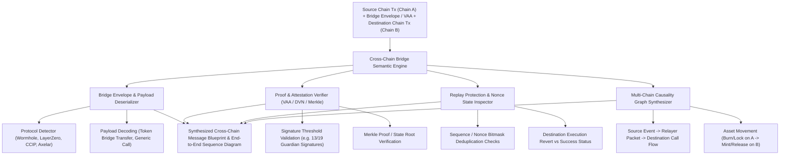
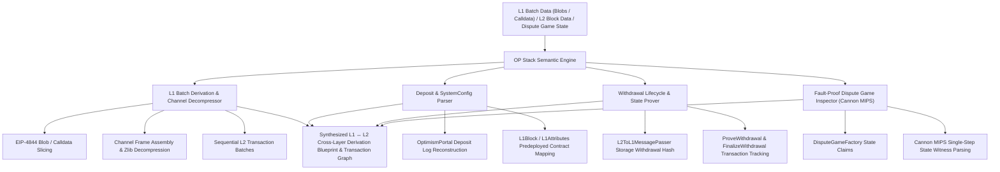
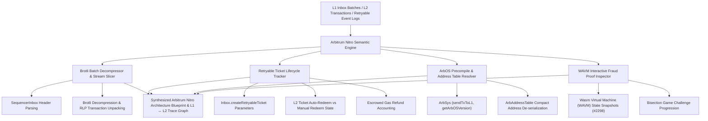

# Tier 3: rollups and cross-chain

[Master tracker](README.md). Status read from GitHub 2026-11-28.

| Issue                                               | Title                                                                                                                        | Author  | State | Priority / labels           | Comments | Linked PRs |
| --------------------------------------------------- | ---------------------------------------------------------------------------------------------------------------------------- | ------- | ----- | --------------------------- | -------- | ---------- |
| [#3745](https://github.com/morluto/rea/issues/3745) | Cross-chain bridge reverse engineering: message envelopes, nonces, proofs, relayers and source-to-destination state machines | matbrgz | open  | enhancement, area: bridge   | 0        | none found |
| [#3743](https://github.com/morluto/rea/issues/3743) | OP Stack reverse engineering: L1 batches, deposits, withdrawals, derivation and fault-proof artifacts                        | matbrgz | open  | enhancement, area: evidence | 0        | none found |
| [#3744](https://github.com/morluto/rea/issues/3744) | Arbitrum Nitro reverse engineering: Inbox batches, retryables, ArbOS calls and L1-to-L2 message reconstruction               | matbrgz | open  | enhancement, area: evidence | 0        | none found |

## Source text

Verbatim issue text and comments follow. Badge images are removed and heading levels shifted. Claims are the authors', not verified here.

### [#3745](https://github.com/morluto/rea/issues/3745) [Feature] Cross-chain bridge reverse engineering: message envelopes, nonces, proofs, relayers and source-to-destination state machines

_matbrgz, open, https://github.com/morluto/rea/issues/3745_

#### Problem Statement & Context

Cross-chain bridges (e.g. Wormhole, LayerZero, Chainlink CCIP, Axelar, canonical rollup bridges) connect isolated blockchains, enabling cross-chain token transfers, governance relaying, and arbitrary contract calls.

Because cross-chain bridges move billions of dollars across asynchronous execution environments, they are the most critical attack surface in the blockchain ecosystem (historically suffering catastrophic exploits: Wormhole $320M, Nomad $190M, Ronin $620M). Reverse engineering a cross-chain transaction requires understanding multi-chain causality:

1. **Message Envelopes & Serialization**: Standardized payload headers packing source chain ID, emitter contract address, destination chain ID, recipient contract address, sequential sequence/nonce, payload type, and arbitrary execution calldata.
2. **Proof & Attestation Formats**:
   - Multi-Signature Attestations: Wormhole Verified Action Approvals (VAA) signed by 19 Guardian nodes.
   - Oracle / Relayer Pairs: LayerZero v1/v2 Packet payloads verified via Decentralized Verifier Networks (DVN) and Executing Relayers.
   - Merkle Storage Proofs: Canonical rollup state roots verified via light clients.
3. **Execution Relaying & Replay Protection**: Nonce verification, bitmask replay tables, and gas payment reimbursement contracts.
4. **Source-to-Destination Causality**: Connecting the origin transaction on Chain A, through the off-chain relayer packet, to the destination execution transaction on Chain B.

REA needs a cross-chain bridge reverse engineering engine capable of decoding bridge envelopes, verifying attestation proofs, and graphing cross-chain message propagation.

#### Proposed Architecture

#### Technical Capabilities & Modules

1. **Universal Bridge Protocol Signature Detection:**
   - Detect signatures of major bridge protocols in transaction event logs and calldata:
     - Wormhole: `LogMessagePublished` events, VAA binary payloads (Version, Guardian Set Index, Signatures, Header, Payload).
     - LayerZero (v1 & v2): `Packet` structs, Endpoint calls, EndpointV2 `send` / `lzReceive`.
     - Chainlink CCIP: `CCIPSend` / `CCIPReceive` messages, Merkle root commitments.
     - Axelar: Gateway message approval hashes and GMP (General Message Passing) payloads.

2. **Binary VAA & Packet Deserialization:**
   - Parse Wormhole VAA binary format: 6-byte header, array of 66-byte guardian signatures ($r, s, v$), emitter chain, emitter address, sequence, consistency level, and payload.
   - Decode payload types: Token Bridge (`Transfer`, `TransferWithPayload`), NFT Bridge, or custom governance actions.

3. **LayerZero v2 Packet Dissection:**
   - Dissect LayerZero v2 packet byte streams: packet header (nonce, source EID, sender, destination EID, receiver), message GUID, and payload.
   - Map execution requirements: DVN verification threshold checks and gas executor parameters.

4. **Replay Protection & Nonce Tracking:**
   - Inspect destination contract replay protection logic: verify whether a message's sequence number has been marked as consumed in on-chain storage bitmasks (`consumedVAAs`, `inboundNonce`).
   - Detect replay vulnerabilities (e.g. missing hash verification or unconstrained message reuse).

5. **Cross-Chain Causality Reconstruction:**
   - Correlate the originating transaction on the source blockchain with the corresponding relay execution on the target blockchain.
   - Model asset state changes: lock-and-mint vs burn-and-release mechanisms.

#### Acceptance Criteria

- [ ] Automated parsing of binary Wormhole VAAs and LayerZero v1/v2 packet envelopes.
- [ ] Decoding of inner cross-chain payloads (token transfer amounts, target contracts, execution calldata).
- [ ] Verification of guardian signature thresholds and DVN verification proofs.
- [ ] Detection and verification of destination-chain replay protection states.
- [ ] Generation of an end-to-end multi-chain sequence diagram depicting message flow from Chain A to Chain B.

#### Related Issues & Dependencies

- Complements [#972](https://github.com/morluto/rea/issues/972) (Solidity/EVM reverse engineering)
- Complements [#2391](https://github.com/morluto/rea/issues/2391) (EVM calldata and execution trace analysis)
- Complements [#3621](https://github.com/morluto/rea/issues/3621) (Unknown binary file-format inference)

### [#3743](https://github.com/morluto/rea/issues/3743) [Feature] OP Stack reverse engineering: L1 batches, deposits, withdrawals, derivation and fault-proof artifacts

_matbrgz, open, https://github.com/morluto/rea/issues/3743_

#### Problem Statement & Context

The OP Stack (powering OP Mainnet, Base, Zora, Mode, and the Superchain ecosystem) represents the most widely deployed Optimistic Rollup framework on Ethereum.

An OP Stack rollup is not an isolated blockchain; its canonical state is derived directly from Layer 1 Ethereum:

1. **L1 Batch Ingestion & Channel Derivation**: Sequencer transaction batches posted to L1 batch inbox addresses (e.g., as EIP-4844 blobs or calldata). Batches are framed into channels, compressed using Zlib, and decompressed into sequential L2 execution blocks.
2. **Deposit Transactions & System Config**: L1-to-L2 deposits initiated via `OptimismPortal` contracts, creating special `L1Attributes` transactions in each L2 block without cryptographic signatures (derived from L1 event logs).
3. **Withdrawal Provenance & Two-Step Finalization**: L2-to-L1 withdrawals initiated via `L2ToL1MessagePasser`, requiring an on-chain Merkle proof against the `L2OutputOracle` / `DisputeGameFactory`, followed by a 7-day challenge window and finalization call.
4. **Fault Proof Artifacts (Cannon / op-challenger)**: Interactive dispute games executing MIPS32 / 64-bit state transition programs inside a single-step fault-proof virtual machine to resolve disputed L2 state claims.

Reverse engineering an incident or transaction on an OP Stack rollup requires tracing derivation pipelines from L1 down to L2. REA needs a dedicated OP Stack analyzer capable of parsing L1 batch blobs, reconstructing channel frames, modeling deposit/withdrawal lifecycles, and inspecting fault-proof dispute artifacts.

#### Proposed Architecture

#### Technical Capabilities & Modules

1. **L1 Derivation Pipeline Slicing:**
   - Ingest raw L1 transactions targeting the batch inbox address (including EIP-4844 blob sidecars).
   - Parse channel framing: Channel ID, Frame Number, Is Last flag, Frame Data.
   - Assemble and decompress complete channel streams to recover canonical L2 block transactions.

2. **Deposit Transaction Reconstruction:**
   - Detect `TransactionDeposited` event logs emitted by `OptimismPortal` on L1.
   - Map how L1 deposits are translated into unsigned deposit transactions (Type `0x7E`) on L2.
   - Track `SystemConfig` updates: gas limits, basefee overhead, scalar parameters, and batcher address updates.

3. **Withdrawal Lifecycle & Proof Tracking:**
   - Trace L2-to-L1 withdrawals:
     - Step 1: L2 transaction calling `L2ToL1MessagePasser.initiateWithdrawal`.
     - Step 2: L1 transaction calling `OptimismPortal.proveWithdrawalTransaction` with storage proof.
     - Step 3: L1 transaction calling `OptimismPortal.finalizeWithdrawalTransaction` after challenge delay.
   - Model the complete multi-day state progression into a unified status graph.

4. **Fault-Proof & Dispute Game Analysis:**
   - Dissect dispute game contracts (`FaultDisputeGame`, `PermissionedDisputeGame`).
   - Parse claims, bisection tree positions, and claim clocks.
   - Inspect single-step fault proof traces executed under Cannon (MIPS32 machine state, memory reads/writes, preimage oracle lookups).

#### Acceptance Criteria

- [ ] Automated decoding of OP Stack batch frames from L1 calldata and EIP-4844 blobs.
- [ ] Decompression and extraction of L2 blocks and transactions from channel byte streams.
- [ ] End-to-end correlation linking L1 deposit events to L2 deposit transactions.
- [ ] Verification of three-step withdrawal lifecycles between L2 and L1.
- [ ] Inspection of fault proof dispute game bisection trees and claims.

#### Related Issues & Dependencies

- Complements [#972](https://github.com/morluto/rea/issues/972) (Solidity/EVM reverse engineering)
- Complements [#2391](https://github.com/morluto/rea/issues/2391) (EVM calldata and execution trace analysis)
- Complements [#3621](https://github.com/morluto/rea/issues/3621) (Unknown binary file-format inference)

### [#3744](https://github.com/morluto/rea/issues/3744) [Feature] Arbitrum Nitro reverse engineering: Inbox batches, retryables, ArbOS calls and L1-to-L2 message reconstruction

_matbrgz, open, https://github.com/morluto/rea/issues/3744_

#### Problem Statement & Context

Arbitrum Nitro is the leading Optimistic Rollup platform by total value locked (TVL), executing Ethereum Layer 2 transactions through a custom architecture powered by **ArbOS** (Arbitrum Operating System) and WebAssembly:

1. **Inbox & Batch Posting**: Transactions posted by the Sequencer to the L1 `SequencerInbox` contract as compressed batches (utilizing Brotli compression).
2. **Delayed Inbox & Force-Inclusion**: Direct user transaction submissions via the L1 `Bridge` and `DelayedInbox`, providing censorship resistance by allowing L1 to force transaction inclusion after a grace period.
3. **Retryable Tickets (L1-to-L2 Messaging)**: Complex asynchronous messaging system: L1 transaction calls `Inbox.createRetryableTicket`, depositing gas fees into the `L2RetryableTicket` buffer; ticket auto-redeems on L2 or awaits manual redemption before the 7-day expiration.
4. **ArbOS Precompiles**: Specialized system contracts operating at address range `0x0000000000000000000000000000000000000064`–`0x0000000000000000000000000000000000000072` (e.g. `ArbSys`, `ArbGasInfo`, `ArbAddressTable`, `ArbOwner`), handling withdrawals, gas calculations, and address compression.
5. **WAVM (Wasm Virtual Machine) & Interactive Fraud Proofs**: State transition verification executing within an instrumented WebAssembly environment using bisection challenge protocols.

REA needs an Arbitrum Nitro semantic engine capable of decompressing Brotli Sequencer batches, resolving retryable ticket lifecycles, and decoding ArbOS precompile calls.

#### Proposed Architecture

#### Technical Capabilities & Modules

1. **Sequencer Batch Ingestion & Brotli Decompression:**
   - Ingest raw transactions targeting the L1 `SequencerInbox`.
   - Parse Nitro batch headers: batch sequence number, previous accumulator, new accumulator.
   - Decompress multi-block Brotli-compressed streams to extract sequential L2 transaction arrays.

2. **Retryable Ticket Lifecycle Modeling:**
   - Trace L1 `createRetryableTicket` calls: extract destination, callvalue, deposit, maxSubmissionCost, excessFeeRefundAddress, callValueRefundAddress, gasLimit, maxFeePerGas, and calldata.
   - Calculate unique ticket ID (`keccak256(l1TxHash, ticketIndex)`).
   - Correlate with L2 execution logs: determine if the ticket auto-redeemed, failed due to insufficient gas, or was redeemed manually via `ArbRetryableTx.redeem(ticketId)`.

3. **ArbOS System Precompile Dissection:**
   - Decode calls to ArbOS system precompiles:
     - `ArbSys` (`0x0000000000000000000000000000000000000064`): `sendTxToL1` (L2-to-L1 exit calls), `arbBlockNumber`.
     - `ArbGasInfo` (`0x000000000000000000000000000000000000006c`): L1 and L2 gas pricing breakdowns.
     - `ArbAddressTable`: Address compression lookup table translating 4-byte indexes to 20-byte addresses.

4. **Delayed Inbox & Force-Inclusion Analysis:**
   - Map transactions submitted to the L1 `DelayedInbox` and track their inclusion into the canonical L2 sequence through Sequencer ingestion or force-inclusion timeouts.

5. **WAVM State Transition Audit:**
   - Parse WAVM execution state hashes generated during challenge games.
   - Correlate WAVM instructions with underlying ArbOS WebAssembly logic ([#2298](https://github.com/morluto/rea/issues/2298)).

#### Acceptance Criteria

- [ ] Automated decompression of Arbitrum Brotli batch streams from L1 SequencerInbox calls.
- [ ] End-to-end tracking of Retryable Ticket lifecycles across L1 creation, L2 redeem, and refund transfers.
- [ ] Full parameter decoding for ArbOS precompile calls (`ArbSys`, `ArbGasInfo`).
- [ ] Address expansion for `ArbAddressTable` indexed lookups.
- [ ] Interactive visualization of cross-chain message flows and state transitions.

#### Related Issues & Dependencies

- Complements [#972](https://github.com/morluto/rea/issues/972) (Solidity/EVM reverse engineering)
- Complements [#2391](https://github.com/morluto/rea/issues/2391) (EVM calldata and execution trace analysis)
- Complements [#2298](https://github.com/morluto/rea/issues/2298) (Decompile WebAssembly modules)
