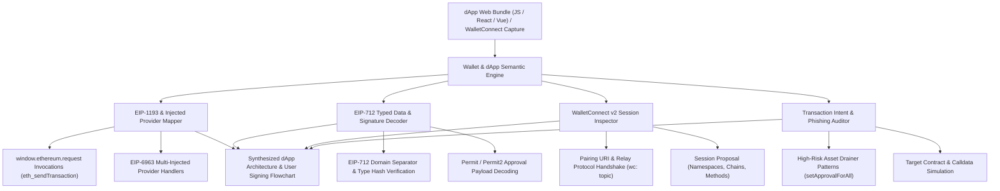

# Tier 5: wallets and frontends

[Master tracker](README.md). Status read from GitHub 2026-11-28.

| Issue                                               | Title                                                                                                                            | Author  | State | Priority / labels            | Comments | Linked PRs |
| --------------------------------------------------- | -------------------------------------------------------------------------------------------------------------------------------- | ------- | ----- | ---------------------------- | -------- | ---------- |
| [#3737](https://github.com/morluto/rea/issues/3737) | Wallet and dApp reverse engineering: EIP-1193 providers, WalletConnect sessions, JSON-RPC requests and frontend-to-wallet graphs | matbrgz | open  | enhancement, area: providers | 0        | none found |

## Source text

Verbatim issue text and comments follow. Badge images are removed and heading levels shifted. Claims are the authors', not verified here.

### [#3737](https://github.com/morluto/rea/issues/3737) [Feature] Wallet and dApp reverse engineering: EIP-1193 providers, WalletConnect sessions, JSON-RPC requests and frontend-to-wallet graphs

_matbrgz, open, https://github.com/morluto/rea/issues/3737_

#### Problem Statement & Context

Decentralized applications (dApps) are web-based or mobile client applications that interface with users' Web3 wallets. The bridge between the frontend application and the blockchain network is governed by standardized provider and messaging interfaces:

1. **Injected EIP-1193 Providers**: Standardized JavaScript object (`window.ethereum`) implementing `request({ method, params })`, events (`connect`, `disconnect`, `chainChanged`, `accountsChanged`), and EIP-6963 multi-provider discovery (`eip6963:announceProvider`).
2. **Standard Web3 JSON-RPC Calls**:
   - Transaction submission: `eth_sendTransaction`, `eth_sendRawTransaction`.
   - Off-chain signing: `personal_sign`, `eth_signTypedData_v4` (EIP-712 structured data signing).
   - Network control: `wallet_switchEthereumChain`, `wallet_addEthereumChain`, `wallet_watchAsset`.
3. **WalletConnect v2 Protocol**: Cross-device relay protocol over WebSocket using pairing topics, cryptographic session handshakes, namespaces, and JSON-RPC relay envelopes.
4. **Permit & Approval Phishing / Drainer Logic**: Malicious or aggressive dApps misleading users into signing unlimited token approvals (`permit`, `permit2`, `setApprovalForAll`) masked behind innocuous UI buttons.

While REA has powerful browser, React ([#3608](https://github.com/morluto/rea/issues/3608)), and JavaScript analysis tools, it lacks domain comprehension of Web3 wallet interfaces. REA needs a wallet/dApp analyzer capable of parsing dApp client bundles, intercepting or simulating EIP-1193 calls, decoding EIP-712 typed signatures, and modeling the frontend-to-wallet interaction graph.

#### Proposed Architecture

#### Technical Capabilities & Modules

1. **EIP-1193 Provider Call Site Extraction:**
   - Scan frontend JavaScript bundles for instances of `window.ethereum.request`, `ethers.BrowserProvider`, `viem/createWalletClient`, and `wagmi`.
   - Extract targeted JSON-RPC methods and parameter schemas without running the browser.

2. **EIP-712 Structured Data Deserialization:**
   - Parse `eth_signTypedData_v4` JSON payloads: domain separator (`name`, `version`, `chainId`, `verifyingContract`), primary type, and message contents.
   - Recognize standardized permit schemas: EIP-2612 (`Permit`), Uniswap `Permit2` (`PermitSingle`, `PermitBatch`), and Seaport orders.
   - Highlight expiration deadlines and authorized spender contracts.

3. **WalletConnect v2 Session Inspection:**
   - Parse WalletConnect pairing URIs (`wc:<topic>@2?relay-protocol=...&symKey=...`).
   - Decode session proposal and session request messages across WebSocket capture streams: required/optional namespaces, target chains (`eip155:1`), and permitted RPC methods.

4. **Security & Intent Audit (Drainer Detection):**
   - Identify deceptive UI patterns where low-value actions trigger high-value signatures (e.g. "Claim Airdrop" button invoking `setApprovalForAll` or ERC-20 `approve(address, type(uint256).max)`).
   - Flag unconstrained gas limits and unrecognized target contract addresses.

5. **Frontend-to-Wallet Graph Synthesis:**
   - Reconstruct the complete interaction graph linking UI buttons and user actions to emitted wallet signing prompts and on-chain contract calls.

#### Acceptance Criteria

- [ ] Automated discovery of EIP-1193 wallet interactions in compiled frontend JavaScript bundles.
- [ ] Complete decoding and structural validation of EIP-712 typed signing payloads.
- [ ] Parsing and session tracking of WalletConnect v2 handshake and request messages.
- [ ] Flagging of high-risk approval and permit signatures with parameter highlight.
- [ ] Generation of an interactive user journey flowchart from UI click to wallet confirmation.

#### Related Issues & Dependencies

- Complements [#3608](https://github.com/morluto/rea/issues/3608) (React Semantic Reconstruction & Decompiler Engine)
- Complements [#972](https://github.com/morluto/rea/issues/972) (Solidity/EVM reverse engineering)
- Complements [#117](https://github.com/morluto/rea/issues/117) (Full-stack reconstruction)
