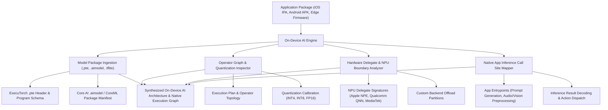

<a id="top"></a>

# Edge accelerators, ML runtimes and model topologies

<!-- nav --> [← Tier 1](1-agentic-ai.md) · [Master tracker](README.md) · [Dashboard](../dashboard/README.md) · [Tier 3 →](3-trust-crypto.md)

Status read from GitHub 2026-11-28.

| Issue                                               | Title                                                                                                                                             | Author  | State | Labels                                     | Comments | Linked PRs                                                                   | Notes                                                                        |
| --------------------------------------------------- | ------------------------------------------------------------------------------------------------------------------------------------------------- | ------- | ----- | ------------------------------------------ | -------- | ---------------------------------------------------------------------------- | ---------------------------------------------------------------------------- |
| [#3722](https://github.com/morluto/rea/issues/3722) | [Feature] On-device AI runtime reverse engineering: Core AI, Foundation Models, ExecuTorch, LiteRT and NPU delegate reconstruction                | matbrgz | open  | enhancement, area: runtime, area: evidence | 0        | none found                                                                   | -                                                                            |
| [#3637](https://github.com/morluto/rea/issues/3637) | [Feature] ML model graph reverse engineering: ONNX, TFLite, CoreML, and TensorRT topology                                                         | matbrgz | open  | enhancement, area: domain                  | 1        | [#8255](https://github.com/morluto/rea/pull/8255) (open, ORT format (#8097)) | zdmilot cross-referenced [#8097](https://github.com/morluto/rea/issues/8097) |
| [#3652](https://github.com/morluto/rea/issues/3652) | [Feature] PyTorch checkpoint reverse engineering: ZIP/pickle opcode graph, tensor storages, state_dict reconstruction and unsafe-global detection | matbrgz | open  | enhancement, area: evidence                | 0        | none found                                                                   | -                                                                            |
| [#3673](https://github.com/morluto/rea/issues/3673) | [Feature] ML compiler IR reverse engineering: MLIR bytecode, StableHLO, TOSA and XLA HLO graph reconstruction                                     | matbrgz | open  | enhancement, area: evidence                | 0        | none found                                                                   | -                                                                            |

## Jump to an issue

[#3722](#issue-3722) · [#3637](#issue-3637) · [#3652](#issue-3652) · [#3673](#issue-3673)

## Source text

Verbatim issue text and comments follow. Badge images are removed and heading levels shifted. Claims are the authors', not verified here.

---

<a id="issue-3722"></a>

**━━━━━━━━ ISSUE 1 of 4 · #3722 ━━━━━━━━**

[↑ Top](#top) · [#3637 →](#issue-3637)

### [#3722](https://github.com/morluto/rea/issues/3722) [Feature] On-device AI runtime reverse engineering: Core AI, Foundation Models, ExecuTorch, LiteRT and NPU delegate reconstruction

_matbrgz, open, https://github.com/morluto/rea/issues/3722_

##### Problem Statement & Context

Operating systems and mobile/embedded platforms are aggressively shifting AI inference from remote cloud APIs to local on-device hardware accelerators (Neural Processing Units / NPUs):

- **Apple Core AI & System Foundation Models**: Frameworks for running local 3B+ parameter models on Apple Silicon Neural Engine (NPE/ANE), distributing models in `.aimodel` packages, adapter binaries, and CoreML runtime graphs.
- **PyTorch ExecuTorch**: PyTorch's standardized on-device runtime targeting mobile, IoT, wearables, and AR/VR, deploying ahead-of-time (AOT) exported `.pte` program packages.
- **Google LiteRT (formerly TensorFlow Lite)**: High-performance on-device AI runtime utilizing hardware delegates (Hexagon NPU, MediaTek APU, GPU OpenCL/Vulkan).
- **Hardware Acceleration Delegates**: Proprietary NPU compilation pipelines compiling quantized operators into proprietary microcode binaries.

When analyzing modern mobile or edge software, security analysts and reverse engineers encounter opaque binary model files (`.pte`, `.aimodel`, `.tflite`) linked to native application shells. REA needs a dedicated on-device AI analyzer capable of decompiling model packages, identifying hardware delegate offloads, and mapping the application-to-inference call graph.

##### Proposed Architecture



##### Technical Capabilities & Modules

1. **Model Package Parsing (`.pte`, `.aimodel`, `.tflite`):**
   - Parse ExecuTorch `.pte` FlatBuffers containers: extract Program metadata, method headers (`forward`), execution plans, and tensor storages.
   - Parse Apple `.aimodel` and compiled CoreML packages: model parameters, context window limits, and tokenizer configurations.
   - Parse modern LiteRT / TFLite FlatBuffers schemas.

2. **Operator Topology & Execution Graph Recovery:**
   - Map neural network operator sequences, subgraphs, control flow (loops, conditionals), and custom kernel registrations.
   - Detect activation functions, normalization layers, and attention mechanisms.

3. **Quantization & Weight Inspection:**
   - Decode mixed-precision quantization: 4-bit integer (INT4), 8-bit integer (INT8), bfloat16, and fp16 weights.
   - Extract quantization scales, zero-points, and group dimensions.

4. **Hardware Delegate & Acceleration Mapping:**
   - Detect backend delegation partitions: identify which graph operators execute on CPU fallback vs GPU vs dedicated NPU (Apple Neural Engine, Qualcomm QNN, Samsung NPU).
   - Flag un-accelerated fallback bottlenecks.

5. **App-to-Inference Call Graph Correlation:**
   - Locate native C++, Swift, or Kotlin call sites initializing the on-device AI runtime: model loading, buffer allocations, tensor input binding.
   - Correlate application sensory inputs (camera frames, microphone audio, text queries) to model input tensors and subsequent output action triggers.

##### Acceptance Criteria

- [ ] Automated detection and deserialization of `.pte` (ExecuTorch), `.aimodel`, and LiteRT model packages.
- [ ] Structural recovery of operator topologies, tensor shapes, and data types.
- [ ] Identification of quantization schemas and per-tensor calibration parameters.
- [ ] Mapping of hardware delegate partitions across CPU, GPU, and NPU backends.
- [ ] End-to-end correlation linking application code call sites to model execution entrypoints.

##### Related Issues & Dependencies

- Complements [#3637](https://github.com/morluto/rea/issues/3637) (ML model graph reverse engineering: ONNX, TFLite, CoreML)
- Complements [#3668](https://github.com/morluto/rea/issues/3668) (Local LLM runtime reverse engineering: llama.cpp, ExecuTorch)

---

<a id="issue-3637"></a>

**━━━━━━━━ ISSUE 2 of 4 · #3637 ━━━━━━━━**

[← #3722](#issue-3722) · [↑ Top](#top) · [#3652 →](#issue-3652)

### [#3637](https://github.com/morluto/rea/issues/3637) [Feature] ML model graph reverse engineering: ONNX, TFLite, CoreML, and TensorRT topology

_matbrgz, open, https://github.com/morluto/rea/issues/3637_

#### Summary

Modern desktop applications (Electron, native Windows/macOS/Linux), mobile apps (Android, iOS), and IoT edge devices increasingly bundle deep learning models for on-device inference: computer vision (object detection, biometric facial recognition), speech recognition, noise cancellation, natural language embeddings, optical character recognition (OCR), and autonomous agent logic.

While issue [#3323](https://github.com/morluto/rea/issues/3323) (`inspect_model_artifact`) introduced read-only header inspection for LLM weight containers (GGUF and safetensors), it explicitly identified the follow-up milestone:

> _"Later: ONNX (protobuf graph and initializer inventory), as a separate follow-up once this contract is settled."_

Beyond passive weight storage, on-device AI features depend on executable computation graphs. When reverse engineering an AI-powered application, an analyst needs to:

- Invert the computational Directed Acyclic Graph (DAG) without running Python, PyTorch, or GPU runtimes;
- Identify input/output tensor shapes, data types, and dynamic dimensions;
- Recover image/audio input preprocessing parameters (scaling, normalization mean/std, color channels);
- Inspect quantization parameters (INT8 scale and zero-point);
- Detect custom operators, proprietary layers, and hardware delegate acceleration targets (Apple Neural Engine, NNAPI, TensorRT).

This feature proposal introduces dedicated **ML Model Graph Reverse Engineering** to REA, covering **ONNX**, **TensorFlow Lite (TFLite)**, **Apple CoreML**, and **NVIDIA TensorRT**.

---

#### Technical Capabilities & Architecture

```
                                    +-----------------------------------------+
                                    | Input: Model File (.onnx, .tflite,      |
                                    |        .mlmodel, .mlpackage, .plan)     |
                                    +--------------------+--------------------+
                                                         |
                         +-------------------------------+-------------------------------+
                         |                               |                               |
                         v                               v                               v
           +---------------------------+   +---------------------------+   +---------------------------+
           | ONNX Protobuf Graph       |   | TFLite FlatBuffers        |   | CoreML & TensorRT         |
           | (Nodes, Initializers, Ops)|   | (Subgraphs, Quant, Ops)   |   | (MIL, ANE, Preprocessing) |
           +-------------+-------------+   +-------------+-------------+   +-------------+-------------+
                         |                               |                               |
                         +-------------------------------+-------------------------------+
                                                         |
                                                         v
                                     +---------------------------------------+
                                     | Graph Topology & DAG Inversion        |
                                     | (Inputs, Outputs, Layer Connections)  |
                                     +-------------------+-------------------+
                                                         |
                         +-------------------------------+-------------------------------+
                         |                                                               |
                         v                                                               v
           +---------------------------+                                   +---------------------------+
           | Quantization & Precision  |                                   | Input Preprocessing       |
           | (INT8, FP16, Scales, ZP)  |                                   | (Normalization, Mean/Std) |
           +-------------+-------------+                                   +-------------+-------------+
                                                         |
                                                         v
                                     +---------------------------------------+
                                     | REA Evidence: Graph Topology Dossier, |
                                     | Operators, Shapes, and Backbones      |
                                     +---------------------------------------+
```

##### 1. ONNX (Open Neural Network Exchange) Graph Inversion

- **Protobuf Parser:** Parse binary ONNX `.onnx` files via inert Protocol Buffers schemas (`ModelProto`, `GraphProto`, `NodeProto`, `TensorProto`) without external Python/C++ ONNX runtime dependencies.
- **Graph & Node Extraction:**
  - Extract Graph Inputs and Outputs: tensor names, element types (`FLOAT`, `FLOAT16`, `INT8`, `BFLOAT16`), and dimension shapes (including symbolic/dynamic batch and sequence dimensions `?`).
  - Map Node Sequence: operator types (e.g. `Conv`, `BatchNormalization`, `Relu`, `MatMul`, `Softmax`, `LayerNormalization`, `Attention`), operator domains, node attributes, and input/output edge names.
  - Initializers & Weights Inventory: report parameter tensor shapes, data types, and byte offsets without materializing multi-gigabyte weight arrays into memory.
  - Subgraph Detection: extract nested control flow subgraphs within `If`, `Loop`, and `Scan` nodes.

##### 2. TensorFlow Lite (TFLite) FlatBuffers Inversion

- **FlatBuffers Parser:** Parse `.tflite` models (magic `TFL3`) across schema revisions:
  - SubGraphs, OperatorCodes, Operators, Tensors, and Buffer tables.
- **Quantization Analysis:**
  - Extract `QuantizationParameters`: scale factors, zero points, and quantization dimensions (per-tensor vs. per-channel quantization).
- **Hardware Delegate & Custom Op Discovery:**
  - Detect custom operator strings (`custom_code`) representing proprietary or OEM native kernels.
  - Identify delegate compatibility (GPU, NNAPI, Hexagon DSP, Edge TPU).

##### 3. Apple CoreML Model & Preprocessing Inversion

- **Format Ingestion:** Parse legacy `.mlmodel` Protobuf descriptors and modern `.mlpackage` directory bundles.
- **Neural Network & MIL Layer Recovery:** Parse Model Intermediate Language (MIL) operations and neural network layer specifications.
- **Target Hardware Mapping:** Detect designated execution targets (CPU, GPU, Apple Neural Engine / ANE).
- **Input Preprocessing Extraction:** Recover exact image preprocessing pipelines embedded in the model:
  - Color space formats (RGB, BGR, Grayscale).
  - Channel normalization offsets (blue/green/red biases).
  - Scaling factors (e.g. $1/255.0$ or $0.5$).
  - Expected resolution and aspect ratio constraints.

##### 4. NVIDIA TensorRT Plan Inspection

- **Plan Header Inversion:** Parse serialized `.plan` / `.engine` binaries, extracting CUDA compute capability requirements (sm_75, sm_80, sm_89, sm_90), precision profiles (FP32, FP16, INT8), layer bindings, and GPU memory workspace budgets.

##### 5. Architectural Backbone & Topology Recognition

- **Structural Heuristics:** Identify common vision and language architectures based on graph motifs:
  - Vision: ResNet residual blocks, MobileNet depthwise-separable convolutions, YOLO detection heads, Vision Transformers (ViT).
  - Audio / NLP: Mel-spectrogram frontends, Multi-Head Self-Attention blocks, RMSNorm / LayerNorm sequences.
- **Graph Summary Export:** Output structured JSON adjacency lists connecting nodes, layer types, and tensor dimensions.

---

#### Acceptance Criteria

1. Introduce `analyze_model_graph` in REA CLI and MCP contracts, accepting `.onnx`, `.tflite`, `.mlmodel`, and `.plan` files.
2. Invert synthetic ONNX test models, outputting full node sequences, operator names, and input/output shapes.
3. Extract INT8 quantization parameters (scale, zero-point) from synthetic TFLite models into structured evidence.
4. Extract input image normalization parameters (bias, scale, color space) from synthetic CoreML models.
5. Enforce strict memory bounds during parsing: weight payloads are referenced by offset and digest rather than read into RAM.

---

#### Related

- [#3323](https://github.com/morluto/rea/issues/3323) [Feature] Inspect GGUF and safetensors model files without loading them
- [#3599](https://github.com/morluto/rea/issues/3599) [Feature] Passive DNS extraction and cybersecurity analysis primitives
- [#3620](https://github.com/morluto/rea/issues/3620) [Feature] Shader and GPU Bytecode Reverse Engineering
- [#3621](https://github.com/morluto/rea/issues/3621) [Feature] Unknown binary file-format inference

#### Comment by zdmilot (2026-10-30) on [#3637](https://github.com/morluto/rea/issues/3637)

Cross-reference: [#8097](https://github.com/morluto/rea/issues/8097) requests a reader for the **ONNX Runtime `.ort` format**, which I think is a sibling of this issue rather than part of it.

The distinction is the serialization. This issue covers the `.onnx` **protobuf** graph (alongside TFLite, CoreML, and TensorRT). `.ort` is ONNX Runtime's own **FlatBuffers** format, identified by the `ORTM` file identifier at bytes 4..8 and defined by the upstream `ort.fbs` schema, so it needs a different reader even though the recovered facts — graph I/O, operators, initializers, quantization — are the same ones this issue describes.

It seemed worth flagging because `.ort` is ORT's deployment format, so it is a likely encounter in shipped products. The concrete case in [#8097](https://github.com/morluto/rea/issues/8097) is a commercial Windows barcode SDK whose nine bundled models are all `.ort`; I extracted them and confirmed all nine load in `onnxruntime` 1.27, with symbolic input dimensions (`['batch', 3, 'height', 'width']`) and a `com.microsoft:QuickGelu:1` contrib operator among the op entries.

No action implied for this issue. If maintainers would rather treat `.ort` as one more format under this umbrella than as its own request, [#8097](https://github.com/morluto/rea/issues/8097) can be folded in or closed as a duplicate — I filed it separately only because the protobuf reader proposed here would not cover it.

---

<a id="issue-3652"></a>

**━━━━━━━━ ISSUE 3 of 4 · #3652 ━━━━━━━━**

[← #3637](#issue-3637) · [↑ Top](#top) · [#3673 →](#issue-3673)

### [#3652](https://github.com/morluto/rea/issues/3652) [Feature] PyTorch checkpoint reverse engineering: ZIP/pickle opcode graph, tensor storages, state_dict reconstruction and unsafe-global detection

_matbrgz, open, https://github.com/morluto/rea/issues/3652_

#### Summary

PyTorch model checkpoints (`.pt`, `.pth`, `.bin`, `.ckpt`) are the standard serialization format for training checkpoints, fine-tuned weights, and model weights across modern machine learning. Under the hood, PyTorch checkpoints are ZIP archives containing serialized Python pickle streams and binary tensor storage files (`archive/data.pkl`, `archive/data/0`, `archive/data/1`).

Issue [#3323](https://github.com/morluto/rea/issues/3323) (`inspect_model_artifact`) specifically noted:

> _"Out of scope: PyTorch pickle checkpoints (.pt, .bin, .ckpt), because a faithful reading needs unpickling semantics. They stay unsupported, with a remediation message."_

Relying on standard Python `pickle.load` or `torch.load` to inspect a checkpoint is a **severe security risk**, as unpickling arbitrary pickle byte streams can execute arbitrary code (RCE) via `__reduce__` exploit payloads.

This feature proposal introduces dedicated **PyTorch Checkpoint Reverse Engineering** to REA, implementing an **inert, safe static pickle decompiler** that reconstructs the full `state_dict`, tensor shapes, dtypes, and storage offsets, while detecting and flagging unsafe global imports and exploit payloads—without executing code or invoking Python!

---

#### Technical Capabilities & Architecture

```
                                    +-----------------------------------------+
                                    | Input: PyTorch Checkpoint (.pt / .ckpt) |
                                    +--------------------+--------------------+
                                                         |
                         +-------------------------------+-------------------------------+
                         |                                                               |
                         v                                                               v
           +---------------------------+                                   +---------------------------+
           | ZIP Archive Container     |                                   | Unsafe Global / RCE       |
           | Reader (archive/data.pkl) |                                   | Detector (GLOBAL, REDUCE) |
           +-------------+-------------+                                   +-------------+-------------+
                         |                                                               |
                         +-------------------------------+-------------------------------+
                                                         |
                                                         v
                                     +---------------------------------------+
                                     | Inert Static Pickle Opcode Engine     |
                                     | (No execution, stack & memo emulation)|
                                     +-------------------+-------------------+
                                                         |
                         +-------------------------------+-------------------------------+
                         |                                                               |
                         v                                                               v
           +---------------------------+                                   +---------------------------+
           | Tensor Storage Resolver   |                                   | state_dict Key-Value Tree |
           | (Shapes, dtypes, offsets) |                                   | Reconstruction            |
           +-------------+-------------+                                   +-------------+-------------+
                                                         |
                                                         v
                                     +---------------------------------------+
                                     | REA Evidence: Checkpoint Dossier,     |
                                     | Architecture Schemas & Security Flags |
                                     +---------------------------------------+
```

##### 1. Safe Container Ingestion & Extraction

- **ZIP Packaging:** Parse PyTorch's standard ZIP container (v0.1.1+ format), extracting archive member names (`archive/version`, `archive/data.pkl`, and individual tensor storage files `archive/data/*`).
- **Legacy Tarball Support:** Parse legacy PyTorch tarball checkpoints.

##### 2. Inert Static Pickle Opcode Emulation

- **Pure Static Pickle Engine:** Implement an inert pickle virtual machine emulating pickle opcodes (protocols 0 through 5) without executing arbitrary Python:
  - Stack and memo operations: `PROTO`, `GLOBAL`, `STACK_GLOBAL`, `BINGET`, `BINPUT`, `MEMOIZE`, `MARK`, `TUPLE`, `LIST`, `DICT`, `SETITEMS`.
  - Object instantiation: Emulate `_rebuild_tensor_v2`, `_rebuild_parameter`, `OrderedDict`, and `torch.storage._load_from_bytes`.
- **Zero-Code Execution Guarantee:** No native dynamic imports or Python `eval` are ever executed.

##### 3. Unsafe Global & Malicious Payload Detection

- **RCE Payload Audit:** Inspect all `GLOBAL`, `STACK_GLOBAL`, and `REDUCE` opcodes:
  - Flag any non-standard or dangerous global call (e.g. `posix.system`, `subprocess.Popen`, `os.system`, `builtins.eval`, `builtins.exec`, `pty.spawn`, `socket.socket`).
  - Surface exact byte offsets and arguments of malicious exploit payloads.
- **Allowlist Verification:** Verify whether all referenced globals belong strictly to standard PyTorch and NumPy namespaces (`torch._utils`, `torch`, `collections.OrderedDict`).

##### 4. `state_dict` & Tensor Storage Reconstruction

- **Tensor Reconstruction:** Map `_rebuild_tensor_v2` declarations to their corresponding storage files:
  - Parameter / buffer name (e.g. `model.layers.0.self_attn.q_proj.weight`).
  - Tensor dimensions / shape (e.g. `[4096, 4096]`).
  - Data type (`torch.float32`, `torch.float16`, `torch.bfloat16`, `torch.int8`).
  - Storage offset, stride, and byte length.
- **Architecture Parameter Summary:** Derive total parameter count, memory footprint by dtype, and model layer hierarchy directly from the reconstructed `state_dict`.

---

#### Acceptance Criteria

1. Introduce `analyze_pytorch_checkpoint` in REA CLI and MCP contracts, accepting `.pt`, `.pth`, `.bin`, and `.ckpt` files.
2. Safely parse synthetic PyTorch checkpoints without invoking Python `pickle.load` or `torch.load`.
3. Output the complete `state_dict` hierarchy, tensor shapes, dtypes, and total parameter counts in structured JSON.
4. Detect synthetic `posix.system` RCE exploit payloads and report typed security violations with byte locations.
5. Enforce bounded parsing budgets, preventing memory exhaustion from malicious recursive pickle data.

---

#### Related

- [#3323](https://github.com/morluto/rea/issues/3323) [Feature] Inspect GGUF and safetensors model files without loading them
- [#3637](https://github.com/morluto/rea/issues/3637) [Feature] ML model graph reverse engineering: ONNX, TFLite, CoreML, and TensorRT topology
- [#3599](https://github.com/morluto/rea/issues/3599) [Feature] Passive DNS extraction and cybersecurity analysis primitives

---

<a id="issue-3673"></a>

**━━━━━━━━ ISSUE 4 of 4 · #3673 ━━━━━━━━**

[← #3652](#issue-3652) · [↑ Top](#top)

### [#3673](https://github.com/morluto/rea/issues/3673) [Feature] ML compiler IR reverse engineering: MLIR bytecode, StableHLO, TOSA and XLA HLO graph reconstruction

_matbrgz, open, https://github.com/morluto/rea/issues/3673_

#### Summary

Machine learning compilers (such as Google XLA, IREE, TVM, PyTorch Inductor, and ONNX Runtime) compile high-level neural network graphs into intermediate representations (IR) using **MLIR (Multi-Level Intermediate Representation)** and hardware-specific dialects:

- **MLIR Bytecode:** Compact binary serialization of MLIR modules;
- **StableHLO / MHLO:** High-Level Optimizer dialect used across JAX, TensorFlow, OpenXLA, and PyTorch;
- **TOSA (Tensor Operator Set Architecture):** Arm's standard neural network operator dialect;
- **XLA HLO:** Computation graph IR compiled into target CPU/GPU/TPU machine code.

In compiled AI binaries, model artifacts, and accelerator kernels, the high-level framework information is lowered into these IR dialects before code generation.

While issue [#3637](https://github.com/morluto/rea/issues/3637) covers runtime model formats (ONNX, TFLite), it does not cover compiler intermediate representations.

This feature proposal introduces dedicated **ML Compiler IR Reverse Engineering** to REA, enabling automated parsing of MLIR bytecode, extraction of dialect operations (StableHLO, TOSA, Linalg, Affine, LLVM), and reconstruction of the tensor dataflow graph.

---

#### Technical Capabilities & Architecture

```
                                    +-----------------------------------------+
                                    | Input: MLIR Binary Bytecode (.mlirbc)   |
                                    |        or Compiled XLA HLO Artifact     |
                                    +--------------------+--------------------+
                                                         |
                         +-------------------------------+-------------------------------+
                         |                                                               |
                         v                                                               v
           +---------------------------+                                   +---------------------------+
           | MLIR Bytecode Stream      |                                   | Dialect Registry &        |
           | Reader (Sections, Strings)|                                   | Operation Classifier      |
           +-------------+-------------+                                   +-------------+-------------+
                         |                                                               |
                         +-------------------------------+-------------------------------+
                                                         |
                                                         v
                                     +---------------------------------------+
                                     | Region, Block & Operation Traversal   |
                                     | (Blocks, Values, Operands, Results)   |
                                     +-------------------+-------------------+
                                                         |
                         +-------------------------------+-------------------------------+
                         |                                                               |
                         v                                                               v
           +---------------------------+                                   +---------------------------+
           | StableHLO & TOSA Dialect  |                                   | Type, Tensor Shape &      |
           | Inversion (Dot, Conv, Pad)|                                   | Quantization Extraction   |
           +-------------+-------------+                                   +-------------+-------------+
                                                         |
                                                         v
                                     +---------------------------------------+
                                     | REA Evidence: Lowered IR Graph,       |
                                     | Dialect Operations & Source Provenance|
                                     +---------------------------------------+
```

##### 1. MLIR Bytecode Container Ingestion

- **Bytecode Parser:** Implement an inert parser for the MLIR bytecode format (`ML\xefR` magic bytes, version numbers, section headers).
- **String & Dialect Section:** Extract dialect names, operation names, and attribute/type tables without requiring full LLVM/MLIR native libraries.

##### 2. Multi-Dialect Operation Recovery

- **StableHLO Dialect:** Recognize and reconstruct StableHLO tensor operations:
  - `stablehlo.dot_general`: matrix multiplications and batch contractions.
  - `stablehlo.convolution`: multi-dimensional convolutions, dilation, padding, and stride vectors.
  - `stablehlo.reduce_window`, `stablehlo.broadcast_in_dim`, `stablehlo.slice`.
- **TOSA Dialect:** Support Arm TOSA operations (`tosa.conv2d`, `tosa.matmul`, `tosa.rescale`).
- **Linalg & Affine Dialects:** Recognize structured loop operations (`linalg.generic`, `affine.for`) representing lowered tensor kernels.

##### 3. Tensor Types, Shapes & Attributes

- **Type System Decoding:** Extract tensor ranks, element types (FP32, FP16, BF16, INT8, quantized uniform types), and dynamic dimensions.
- **Attributes:** Recover dense resource elements, constant tensors, permutation arrays, and convolution padding geometries.

##### 4. Graph Reconstruction & Lowering Provenance

- **SSA Value Flow:** Track Static Single Assignment (SSA) values connecting operation results to downstream operands.
- **Source Location Mapping:** Extract embedded `loc("...")` debug locations, correlating compiler IR operations back to original Python / PyTorch / JAX source lines.

---

#### Acceptance Criteria

1. Introduce `analyze_mlir_artifact` in REA CLI and MCP contracts, accepting MLIR bytecode and textual IR files.
2. Safely parse MLIR bytecode section tables and extract dialect names and operations.
3. Reconstruct StableHLO and TOSA tensor operations into structured JSON graph nodes.
4. Extract tensor shapes, dtypes, and operation attributes in structured evidence.
5. Map SSA dataflow dependencies and preserve source code location metadata.

---

#### Related

- [#3637](https://github.com/morluto/rea/issues/3637) [Feature] ML model graph reverse engineering
- [#3620](https://github.com/morluto/rea/issues/3620) [Feature] Shader and GPU Bytecode Reverse Engineering
- [#3323](https://github.com/morluto/rea/issues/3323) [Feature] Inspect GGUF and safetensors model files without loading them

---

<!-- nav --> [← Tier 1](1-agentic-ai.md) · [Master tracker](README.md) · [Dashboard](../dashboard/README.md) · [Tier 3 →](3-trust-crypto.md)
