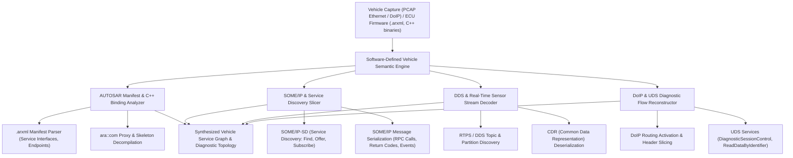
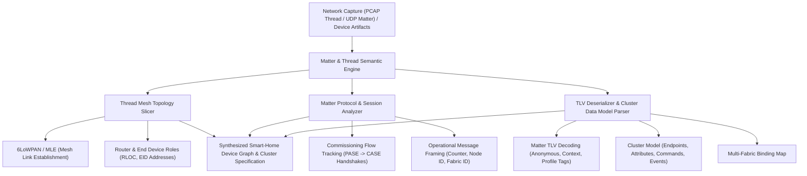

# Software-defined vehicles and industrial IoT

<!-- nav --> [← Tier 3](3-trust-crypto.md) · [Master tracker](README.md) · [Dashboard](../dashboard/README.md) · [Tier 5 →](5-web-gpu.md)

Status read from GitHub 2026-11-28.

| Issue                                               | Title                                                                                                                                     | Author  | State | Labels                                     | Comments | Linked PRs | Notes |
| --------------------------------------------------- | ----------------------------------------------------------------------------------------------------------------------------------------- | ------- | ----- | ------------------------------------------ | -------- | ---------- | ----- |
| [#3725](https://github.com/morluto/rea/issues/3725) | [Feature] Software-defined vehicle reverse engineering: AUTOSAR Adaptive, SOME/IP, DDS, DoIP, UDS and service graphs                      | matbrgz | open  | enhancement                                | 0        | none found | -     |
| [#3726](https://github.com/morluto/rea/issues/3726) | [Feature] Matter & Thread reverse engineering: commissioning captures, TLV, clusters, endpoints, fabrics and mesh topology reconstruction | matbrgz | open  | enhancement, area: runtime, area: evidence | 0        | none found | -     |

## Jump to an issue

[#3725](#issue-3725) · [#3726](#issue-3726)

## Source text

Verbatim issue text and comments follow. Badge images are removed and heading levels shifted. Claims are the authors', not verified here.

---

**━━━━━━━━ ISSUE 1 of 2 · #3725 ━━━━━━━━**

[↑ Top](#top) · [#3726 →](#issue-3726)

### [#3725](https://github.com/morluto/rea/issues/3725) [Feature] Software-defined vehicle reverse engineering: AUTOSAR Adaptive, SOME/IP, DDS, DoIP, UDS and service graphs

_matbrgz, open, https://github.com/morluto/rea/issues/3725_

##### Problem Statement & Context

Modern automotive systems are transitioning from hardware-centric microcontrollers to **Software-Defined Vehicles (SDV)** governed by high-performance Electronic Control Units (ECUs), vehicle computers, and service-oriented architectures (SOA):

- **AUTOSAR Adaptive Platform & CAPI (Common Application Programming Interface)**: C++ application framework standardizing communication management (`ara::com`), execution management (`ara::exec`), and diagnostic services.
- **Service-Oriented Protocols (SOME/IP & SOME/IP-SD)**: Scalable service-Oriented MiddlewarE over IP handling service discovery, remote procedure calls, events, and field notifications over automotive Ethernet.
- **Data Distribution Service (DDS)**: Publish/subscribe middleware for real-time sensor streams (radar, LiDAR, camera feeds, telematics).
- **Diagnostics over IP (DoIP) & Unified Diagnostic Services (UDS / ISO 14229)**: Diagnostics framing over TCP/UDP used for ECU flashing, calibration, and security routines.
- **Machine & Application Manifests (`.arxml`)**: AUTOSAR XML manifests declaring process startup configs, service deployment bindings, and access control policies.

Reverse engineering an automotive ECU binary or vehicle network capture currently requires fragmented tools. REA needs a dedicated SDV semantic engine capable of parsing SOME/IP and DDS traffic, decompiling `ara::com` bindings, and reconstructing vehicle service graphs.

##### Proposed Architecture

##### Technical Capabilities & Modules

1. **AUTOSAR Manifest & Binary Modeling:**
   - Parse AUTOSAR Adaptive XML (`.arxml`) manifests: service interfaces, methods, fields, events, deployment port configurations, and process startup configurations.
   - Decompile native C++ binaries using `ara::com`: identify Proxy classes (service consumers) and Skeleton classes (service providers).

2. **SOME/IP & Service Discovery Analysis:**
   - Dissect SOME/IP binary headers: Message ID (Service ID + Method/Event ID), Request ID, Protocol Version, Interface Version, Message Type (Request, Request_No_Return, Notification, Response, Error).
   - Parse SOME/IP-SD packets: track Service Offers, Service Finds, Eventgroup Subscriptions, and endpoint IP/port mappings.
   - Reconstruct serialized payload arguments (primitive types, dynamic arrays, structs).

3. **DDS & RTPS Protocol Dissection:**
   - Parse Real-Time Publish-Subscribe (RTPS) protocol frames: GUID prefixes, topic names, partition strings, and participant announcements.
   - Deserialize OMG Common Data Representation (CDR) payload formats.

4. **DoIP & UDS Diagnostic Flow Analysis:**
   - Parse DoIP (ISO 13400) headers: routing activation, diagnostic messages, alive checks.
   - Dissect UDS diagnostic request/response pairs:
     - `0x10`: DiagnosticSessionControl.
     - `0x22`: ReadDataByIdentifier (DID mappings).
     - `0x27`: SecurityAccess challenge/response sequences.
     - `0x2E`: WriteDataByIdentifier.
     - `0x31`: RoutineControl.

5. **Vehicle Service Graph Reconstruction:**
   - Synthesize an interactive service graph depicting which ECUs produce or consume specific vehicle services (e.g. Steering, Powertrain, ADAS, Infotainment).

##### Acceptance Criteria

- [ ] Automated dissection of SOME/IP, SOME/IP-SD, and DoIP network captures.
- [ ] Parsing of AUTOSAR Adaptive `.arxml` manifests and correlation with native C++ binaries.
- [ ] Decoding of UDS diagnostic service sessions and DID parameter values.
- [ ] Reconstruction of DDS pub/sub topics and CDR payload structures.
- [ ] Generation of an end-to-end vehicle service interaction graph.

##### Related Issues & Dependencies

- Complements [#3641](https://github.com/morluto/rea/issues/3641) (USB protocol reverse engineering)
- Complements [#3626](https://github.com/morluto/rea/issues/3626) (Windows kernel driver reverse engineering: IOCTL correlation)
- Complements [#3698](https://github.com/morluto/rea/issues/3698) (Interactive entertainment runtime and asset reverse engineering tracker)

---

**━━━━━━━━ ISSUE 2 of 2 · #3726 ━━━━━━━━**

[← #3725](#issue-3725) · [↑ Top](#top)

### [#3726](https://github.com/morluto/rea/issues/3726) [Feature] Matter & Thread reverse engineering: commissioning captures, TLV, clusters, endpoints, fabrics and mesh topology reconstruction

_matbrgz, open, https://github.com/morluto/rea/issues/3726_

##### Problem Statement & Context

The modern smart home and IoT ecosystem is rapidly consolidating around **Matter** (application protocol standard governed by the Connectivity Standards Alliance / CSA) and **Thread** (low-power, IPv6-based wireless mesh network protocol governed by the Thread Group).

Investigating Matter/Thread devices and captures presents unique challenges:

1. **Thread Mesh Networking (6LoWPAN / IEEE 802.15.4)**: IPv6 mesh topology consisting of Thread Leaders, Routers, End Devices (SEDs), and Border Routers, routing encrypted mesh packets via CoAP.
2. **Matter Session & Secure Channel Protocol**: Secure session establishment using Password-Authenticated Session Establishment (PASE) for onboarding/commissioning and Certificate-Authenticated Session Establishment (CASE) for operational device-to-device communication.
3. **Matter TLV (Tag-Length-Value) Serialization**: Highly compact binary encoding format supporting anonymous tags, context-specific tags, profile-specific tags, and nested structures.
4. **Data Model (Clusters & Endpoints)**: Standardized hierarchical application data model: Nodes -> Endpoints (0 to N) -> Clusters (e.g. On/Off, Level Control, Color Control, Door Lock, Thermostat) -> Attributes, Commands, and Events.
5. **Multi-Fabric Coordination**: Devices joined concurrently to multiple administrative fabrics (e.g. Apple Home, Google Home, Amazon Alexa) using distinct fabric credentials.

REA currently lacks a dedicated Matter/Thread inspector to decode commissioning captures, unpack Matter TLV streams, and reconstruct multi-fabric device topologies.

##### Proposed Architecture

##### Technical Capabilities & Modules

1. **Thread Mesh Capture Slicing:**
   - Ingest IEEE 802.15.4 / 6LoWPAN network captures (from hardware sniffers or Thread Border Router diagnostic logs).
   - Parse Mesh Link Establishment (MLE) packets and neighbor tables.
   - Reconstruct mesh network topology (Leader, Active Routers, Sleepy End Devices).

2. **Matter Secure Channel & Session Tracking:**
   - Parse Matter message framing over UDP (port 5540): Session ID, Security Flags, Message Counter, Source/Destination Node IDs.
   - Track session handshakes: PASE (commissioning) and CASE (operational communication).
   - Audit credentials and device attestation certificates (DAC).

3. **Matter TLV Parser:**
   - Implement universal, zero-copy Matter TLV stream deserializer.
   - Support all standard control tags: Anonymous, Context-Specific (1-byte), Common Profile (2/4-byte), and Fully-Qualified Profile tags.
   - Export decoded TLV structures to clean, formatted JSON.

4. **Cluster & Endpoint Data Model Reconstruction:**
   - Map messages to specific Endpoints and Cluster IDs (e.g., `0x0006` On/Off, `0x0008` LevelControl, `0x0038` Basic Information).
   - Dissect Interaction Model action frames: `ReadRequest`, `ReportData`, `WriteRequest`, `InvokeRequest`, `InvokeResponse`.
   - Correlate attribute subscriptions and asynchronous event reports.

5. **Multi-Fabric Topology Mapping:**
   - Detect fabric assignments (Fabric Index, Fabric ID, Root CA public keys).
   - Build a visual topology showing how devices are shared across multiple ecosystems.

##### Acceptance Criteria

- [ ] Complete parsing and decoding of Matter binary TLV payloads into JSON structures.
- [ ] Tracking and decoding of Matter Interaction Model operations (Read, Write, Invoke).
- [ ] Mapping of device endpoints, clusters, attributes, and command handlers.
- [ ] Extraction of Thread mesh topology and device routing relationships from captures.
- [ ] Multi-fabric device mapping showing fabric IDs and operational node IDs.

##### Related Issues & Dependencies

- Complements [#3641](https://github.com/morluto/rea/issues/3641) (USB protocol reverse engineering)
- Complements [#3644](https://github.com/morluto/rea/issues/3644) (Bluetooth/BLE reverse engineering)
- Complements [#3615](https://github.com/morluto/rea/issues/3615) (Hardware and Embedded Reverse Engineering)

---

<!-- nav --> [← Tier 3](3-trust-crypto.md) · [Master tracker](README.md) · [Dashboard](../dashboard/README.md) · [Tier 5 →](5-web-gpu.md)
