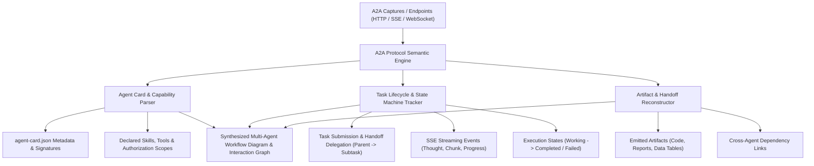

# Agentic AI protocols and LLM applications

[Master tracker](README.md). Status read from GitHub 2026-11-28.

| Issue                                               | Title                                                                                                                                                 | Author  | State | Labels                                                  | Comments | Linked PRs | Notes |
| --------------------------------------------------- | ----------------------------------------------------------------------------------------------------------------------------------------------------- | ------- | ----- | ------------------------------------------------------- | -------- | ---------- | ----- |
| [#3721](https://github.com/morluto/rea/issues/3721) | [Feature] A2A protocol reverse engineering: Agent Cards, task lifecycles, artifacts, streaming sessions and multi-agent workflow reconstruction       | matbrgz | open  | enhancement, area: build, area: evidence                | 0        | none found | -     |
| [#3651](https://github.com/morluto/rea/issues/3651) | [Feature] LLM application reverse engineering: system prompts, model/provider routing, tool schemas, RAG links and agent workflow reconstruction      | matbrgz | open  | enhancement, area: domain, area: build, area: providers | 0        | none found | -     |
| [#3653](https://github.com/morluto/rea/issues/3653) | [Feature] LLM tokenizer reverse engineering: tokenizer.json, SentencePiece, BPE/Unigram vocabularies, special tokens and chat-template reconstruction | matbrgz | open  | enhancement, area: evidence                             | 0        | none found | -     |

## Source text

Verbatim issue text and comments follow. Badge images are removed and heading levels shifted. Claims are the authors', not verified here.

### [#3721](https://github.com/morluto/rea/issues/3721) [Feature] A2A protocol reverse engineering: Agent Cards, task lifecycles, artifacts, streaming sessions and multi-agent workflow reconstruction

_matbrgz, open, https://github.com/morluto/rea/issues/3721_

##### Problem Statement & Context

The Agent-to-Agent (A2A) protocol (standardized at v1.0 by the Linux Foundation / A2A Protocol Working Group) establishes a vendor-neutral, interoperable communication standard for autonomous AI agents collaborating across enterprise boundaries.

While REA's issue [#3672](https://github.com/morluto/rea/issues/3672) covers general tool calling and Model Context Protocol (MCP) clients, A2A defines a distinct, multi-turn distributed protocol with unique entities:

1. **Agent Cards (`agent-card.json`)**: Cryptographically verifiable agent discovery manifests declaring capabilities, authentication requirements, supported skills, provider identity, and privacy policies.
2. **Task Lifecycle Management**: Asynchronous state machines tracking tasks (`submitted`, `working`, `completed`, `failed`, `cancelled`), context parameters, and task handoff delegations.
3. **Artifact Generation & Handoff**: Immutable data objects (files, diffs, code, structured JSON) produced by worker agents and passed downstream to supervisor or peer agents.
4. **Bi-Directional Streaming & SSE**: Server-Sent Events (SSE) and WebSocket channels streaming incremental thoughts, progress tokens, tool invocation checkpoints, and intermediate status messages.
5. **Multi-Agent Orchestration Graphs**: Complex topologies (hub-and-spoke, hierarchical delegation, peer-to-peer voting consensus) coordinating multiple specialized agents.

REA needs an A2A semantic analyzer capable of ingesting recorded network traffic (HTTP/SSE/WebSocket) or local agent configuration bundles to model agent capabilities and reconstruct multi-agent task workflows.

##### Proposed Architecture



##### Technical Capabilities & Modules

1. **Agent Card Discovery & Verification:**
   - Parse and validate `agent-card.json` specifications: schema versions, endpoint URLs, provider identity, and cryptographic signatures.
   - Index declared skills, supported message modalities, and authentication schemes (OAuth2, DPoP, mTLS).

2. **Task Lifecycle & Session State Reconstruction:**
   - Dissect A2A JSON-RPC / REST message envelopes.
   - Trace task progression across standardized states: `submitted` -> `working` -> `completed` / `failed`.
   - Track task context variables, history turns, and intermediate cancellation requests.

3. **Streaming Trace Slicing:**
   - Parse Server-Sent Events (`text/event-stream`) and WebSocket frames.
   - Decode A2A event types: token generation, reasoning/thought traces, tool invocation proposals, and status updates.

4. **Multi-Agent Delegation & Handoff Graph:**
   - Reconstruct parent-child task relationships (`parent_task_id`).
   - Detect routing patterns: Router Agent -> Specialist Agent, Critic Agent -> Generator Agent loops.
   - Generate Mermaid sequence and flowchart diagrams visualizing agent collaboration.

5. **Artifact Provenance & Audit:**
   - Extract and verify artifacts produced during task execution.
   - Trace artifact data flow across agents to detect data leakage or prompt injection vectors.

##### Acceptance Criteria

- [ ] Automated validation of A2A v1.0 Agent Cards and capability declarations.
- [ ] Parsing of recorded A2A sessions over REST, SSE, and WebSocket.
- [ ] Complete reconstruction of task lifecycle state transitions and subtask handoffs.
- [ ] Extraction of shared artifacts with cryptographic provenance tracking.
- [ ] Generation of an end-to-end interactive multi-agent workflow graph.

##### Related Issues & Dependencies

- Complements [#3672](https://github.com/morluto/rea/issues/3672) (AI agent protocol reverse engineering: MCP and tool calling)
- Complements [#3651](https://github.com/morluto/rea/issues/3651) (LLM application reverse engineering)

### [#3651](https://github.com/morluto/rea/issues/3651) [Feature] LLM application reverse engineering: system prompts, model/provider routing, tool schemas, RAG links and agent workflow reconstruction

_matbrgz, open, https://github.com/morluto/rea/issues/3651_

#### Summary

Desktop clients, developer tools, CLI utilities, and web backends increasingly embed Large Language Model (LLM) agents and AI workflows. In AI application reverse engineering and security audits, analysts need to understand the underlying AI decision logic:

- How the system prompt is assembled;
- Which model provider endpoints and fallback chains are targeted;
- Which external tools, function schemas, and MCP servers are declared;
- How user inputs are augmented via Retrieval-Augmented Generation (RAG);
- How the agent loops, handoffs, and tool results are orchestrated.

Currently, reverse engineering such applications requires tedious manual de-obfuscation across minified JavaScript bundles, Python wheels, or native executables.

This feature proposal introduces dedicated **LLM Application Reverse Engineering** to REA, enabling automated static extraction of system prompts, model routing pipelines, tool/function schemas, RAG vector retrievers, and end-to-end agent workflow graphs.

---

#### Technical Capabilities & Architecture

```
                                    +-----------------------------------------+
                                    | Input: Application Artifact (ASAR, JS,  |
                                    |        Python wheel, native executable) |
                                    +--------------------+--------------------+
                                                         |
                         +-------------------------------+-------------------------------+
                         |                                                               |
                         v                                                               v
           +---------------------------+                                   +---------------------------+
           | System Prompt Template    |                                   | Model & Provider Routing  |
           | Extractor (Jinja, strings)|                                   | Engine (OpenAI, Anthropic)|
           +-------------+-------------+                                   +-------------+-------------+
                         |                                                               |
                         +-------------------------------+-------------------------------+
                                                         |
                                                         v
                                     +---------------------------------------+
                                     | Tool & Function Schema Recovery       |
                                     | (JSON Schema, parameters, MCP servers)|
                                     +-------------------+-------------------+
                                                         |
                         +-------------------------------+-------------------------------+
                         |                                                               |
                         v                                                               v
           +---------------------------+                                   +---------------------------+
           | RAG Pipeline Inversion    |                                   | Agent Orchestration Graph |
           | (Embeddings, top-k, chunk)|                                   | (UI -> Prompt -> Tool loop|
           +-------------+-------------+                                   +-------------+-------------+
                                                         |
                                                         v
                                     +---------------------------------------+
                                     | REA Evidence: AI Agent Architecture,  |
                                     | Prompts, Tool Specs & Flow Diagram    |
                                     +---------------------------------------+
```

##### 1. System Prompt & Context Template Extraction

- **Template Discovery:** Statically locate system prompts, developer prompts, and persona instructions embedded across template literals, string pools, or companion files (`.prompt`, `.jinja`, `.yaml`).
- **Dynamic Slot Analysis:** Identify template interpolation placeholders (e.g. `{{user_name}}`, `{{current_date}}`, `{{retrieved_context}}`, `{{tools}}`), reconstructing the assembled prompt layout.
- **Safety & Guardrail Inversion:** Extract embedded guardrails, refusal rules, content policy strings, and output formatting constraints (e.g. "Output strictly in JSON").

##### 2. Model & Provider Routing Architecture

- **Provider Resolution:** Identify target LLM provider APIs:
  - OpenAI / Azure OpenAI endpoints (`/v1/chat/completions`).
  - Anthropic Messages API (`/v1/messages`).
  - Google Gemini API (`generateContent`).
  - Local endpoints (Ollama, vLLM, llama.cpp, LocalAI).
- **Configuration Parameters:** Extract default sampling parameters: model names (`gpt-4o`, `claude-3-5-sonnet`, `gemini-1.5-pro`), temperature, top_p, presence_penalty, frequency_penalty, and max_tokens.
- **Fallback Chains:** Trace model failover logic (e.g. Primary Model -> Fallback Model on 429/500 errors).

##### 3. Tool & Function Calling Schema Recovery

- **Function Definitions:** Statically extract tool/function definitions declared in JSON Schema or Zod schemas:
  - Function name, description, parameters, required fields, and parameter descriptions.
- **Tool Implementation Binding:** Correlate declared tools with their actual local implementation handlers (e.g. shell execution, file read/write, database queries, web scraping).
- **MCP Server Configuration:** Extract declarations of Model Context Protocol (MCP) server connections, command invocations, and capability handshakes.

##### 4. RAG (Retrieval-Augmented Generation) Inversion

- **Vector Pipeline:** Identify embedding model endpoints (e.g. `text-embedding-3-small`, HuggingFace models).
- **Retrieval Parameters:** Extract similarity metric configurations (Cosine, Dot Product, L2), top-$k$ values, score threshold cutoffs, and metadata filters.
- **Chunking Strategies:** Recover chunk size and overlap parameters used during document ingestion.

##### 5. Agent Orchestration Graph

- **Workflow State Machine:** Build a directed workflow graph mapping:
  `User Input -> Prompt Construction -> LLM Inference -> Tool Call Dispatch -> Tool Result Injection -> Final Response`.
- **Multi-Agent Handoffs:** Detect multi-agent orchestration architectures (e.g. Planner -> Coder -> Reviewer) and inter-agent communication channels.

---

#### Acceptance Criteria

1. Introduce `analyze_llm_application` in REA CLI and MCP contracts.
2. Accurately extract system prompt templates and dynamic variable slots from synthetic application fixtures.
3. Recover declared tool calling JSON schemas and identify their backing JavaScript/Python function handlers.
4. Extract model provider endpoints, default model IDs, and sampling hyperparameters.
5. Export an end-to-end agent workflow diagram in structured JSON evidence.

---

#### Related

- [#3323](https://github.com/morluto/rea/issues/3323) [Feature] Inspect GGUF and safetensors model files without loading them
- [#3608](https://github.com/morluto/rea/issues/3608) [RFC/Feature] React Semantic Reconstruction & Decompiler Engine
- [#3599](https://github.com/morluto/rea/issues/3599) [Feature] Passive DNS extraction and cybersecurity analysis primitives

### [#3653](https://github.com/morluto/rea/issues/3653) [Feature] LLM tokenizer reverse engineering: tokenizer.json, SentencePiece, BPE/Unigram vocabularies, special tokens and chat-template reconstruction

_matbrgz, open, https://github.com/morluto/rea/issues/3653_

#### Summary

In modern Large Language Models (LLMs), the **Tokenizer** is the foundational translator between human language and neural network token embeddings. A model's behavior, multilingual performance, prompt length, token boundary vulnerabilities (token smuggling, Glitch tokens), and chat formatting are directly dictated by its tokenizer.

Production models distribute tokenizers in several formats:

- Hugging Face `tokenizer.json` (Fast Tokenizers format);
- Google SentencePiece binary models (`tokenizer.model`, based on Protocol Buffers);
- Legacy Byte-Pair Encoding (BPE) vocabulary and merge files (`vocab.json` + `merges.txt`);
- Tiktoken binary rank files (`.tiktoken`).

While issue [#3323](https://github.com/morluto/rea/issues/3323) (`inspect_model_artifact`) extracts basic tokenizer type and embedded chat templates from GGUF metadata, it does not inspect full external tokenizer files or analyze vocabulary topologies.

This feature proposal introduces dedicated **LLM Tokenizer Reverse Engineering** to REA, enabling static inspection of `tokenizer.json`, SentencePiece `.model`, and Tiktoken files, reconstructing token vocabularies, special tokens, pre-tokenization regexes, and Jinja chat templates.

---

#### Technical Capabilities & Architecture

```
                                    +-----------------------------------------+
                                    | Input: Tokenizer File (tokenizer.json,  |
                                    |        tokenizer.model, vocab.json)     |
                                    +--------------------+--------------------+
                                                         |
                         +-------------------------------+-------------------------------+
                         |                                                               |
                         v                                                               v
           +---------------------------+                                   +---------------------------+
           | Hugging Face Fast         |                                   | Google SentencePiece      |
           | Tokenizer (tokenizer.json)|                                   | Model (Protobuf .model)   |
           +-------------+-------------+                                   +-------------+-------------+
                         |                                                               |
                         +-------------------------------+-------------------------------+
                                                         |
                                                         v
                                     +---------------------------------------+
                                     | Vocabulary & Merge Rule Inversion     |
                                     | (BPE, WordPiece, Unigram, Byte-Level) |
                                     +-------------------+-------------------+
                                                         |
                         +-------------------------------+-------------------------------+
                         |                                                               |
                         v                                                               v
           +---------------------------+                                   +---------------------------+
           | Special & Added Tokens    |                                   | Chat Template & Prompt    |
           | (BOS, EOS, PAD, FIM, Mask)|                                   | Formatting (Jinja2 AST)   |
           +-------------+-------------+                                   +-------------+-------------+
                                                         |
                                                         v
                                     +---------------------------------------+
                                     | REA Evidence: Tokenizer Dossier,      |
                                     | Vocabulary Metrics & Prompt Structure |
                                     +---------------------------------------+
```

##### 1. Tokenizer Format Ingestion

- **Hugging Face `tokenizer.json`:** Parse the unified Fast Tokenizer JSON schema: `normalizer`, `pre_tokenizer`, `model`, `post_processor`, `decoder`, and `added_tokens`.
- **Google SentencePiece (`tokenizer.model`):** Parse the Protocol Buffers `ModelProto` specification, extracting trainer specifications, normalizer specs, and piece pieces/scores.
- **OpenAI Tiktoken (`.tiktoken`):** Parse base64-encoded token and rank files.
- **Legacy BPE (`vocab.json` + `merges.txt`):** Parse vocabulary dictionaries and ordered merge rule lists.

##### 2. Vocabulary & Model Algorithm Analysis

- **Model Type Identification:** Classify the underlying tokenization algorithm:
  - Byte-Pair Encoding (BPE)
  - WordPiece
  - Unigram (SentencePiece language model)
  - Character / Byte-Level fallback.
- **Vocabulary Metrics:**
  - Total vocabulary size.
  - Character coverage ratio.
  - Longest tokens, token length distributions, and subword compression efficiency metrics.
- **Pre-tokenization Regular Expressions:** Extract the splitting regex patterns (e.g. GPT-4 / LLaMA 3 regex patterns separating contractions, letters, numbers, and whitespace).

##### 3. Special Tokens & Marker Inventory

- **Reserved Token Catalog:** Extract and categorize special tokens and their exact integer token IDs:
  - Beginning of Sequence (`BOS`), End of Sequence (`EOS`), Padding (`PAD`), Unknown (`UNK`).
  - Fill-in-the-Middle (`FIM`) tokens: `<|fim_prefix|>`, `<|fim_middle|>`, `<|fim_suffix|>`.
  - Tool / Function Calling tokens: e.g. `<|start_header_id|>`, `<|end_header_id|>`, `<tools>`, `</tools>`.
  - Vision / Multimodal markers: `<image>`, `<video>`, `<|quad_start|>`.

##### 4. Chat Template & Formatter Inversion

- **Jinja2 Chat Template Parsing:** Statically parse the embedded `chat_template` string in `tokenizer_config.json` or model metadata:
  - Role mappings: `system`, `user`, `assistant`, `tool`.
  - Header delimiters and turn delimiters.
  - Generation prompt suffixes (e.g. `<|start_header_id|>assistant<|end_header_id|>

`).

- **Template Simulation:** Test formatting of a standard dialogue conversation (`system`, `user`, `assistant`) against the recovered template to produce the exact prompt byte stream.

---

#### Acceptance Criteria

1. Introduce `analyze_tokenizer` in REA CLI and MCP contracts, accepting `tokenizer.json`, `tokenizer.model`, and `vocab.json` files.
2. Ingest synthetic Hugging Face `tokenizer.json` and SentencePiece `tokenizer.model` fixtures without error.
3. Extract vocabulary size, algorithm type, and merge counts into structured JSON evidence.
4. Identify all added and special tokens with their exact token IDs.
5. Invert and simulate the Jinja2 chat template, outputting formatted prompt boundaries.

---

#### Related

- [#3323](https://github.com/morluto/rea/issues/3323) [Feature] Inspect GGUF and safetensors model files without loading them
- [#3637](https://github.com/morluto/rea/issues/3637) [Feature] ML model graph reverse engineering
- [#3608](https://github.com/morluto/rea/issues/3608) [RFC/Feature] React Semantic Reconstruction & Decompiler Engine
