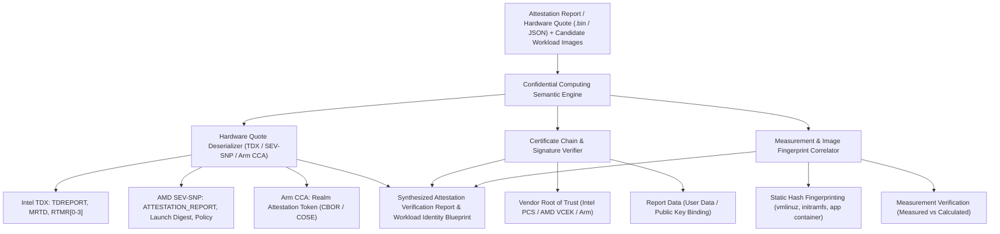
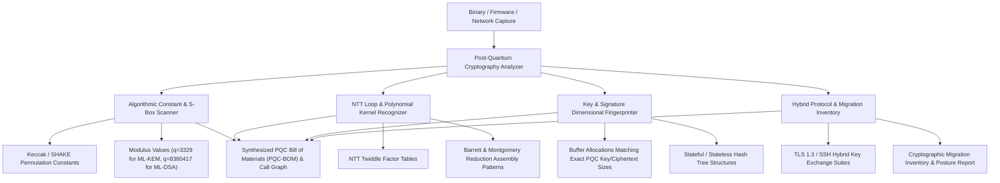

# Hardware trust and cryptography

[Master tracker](README.md). Status read from GitHub 2026-11-28.

| Issue                                               | Title                                                                                                                                | Author  | State | Labels      | Comments | Linked PRs | Notes |
| --------------------------------------------------- | ------------------------------------------------------------------------------------------------------------------------------------ | ------- | ----- | ----------- | -------- | ---------- | ----- |
| [#3723](https://github.com/morluto/rea/issues/3723) | [Feature] Confidential-computing reverse engineering: TDX, SEV-SNP, Arm CCA attestation, measurements and workload binding           | matbrgz | open  | enhancement | 0        | none found | -     |
| [#3724](https://github.com/morluto/rea/issues/3724) | [Feature] Post-quantum cryptography reverse engineering: ML-KEM, ML-DSA and SLH-DSA fingerprints, parameters and migration inventory | matbrgz | open  | enhancement | 0        | none found | -     |

## Source text

Verbatim issue text and comments follow. Badge images are removed and heading levels shifted. Claims are the authors', not verified here.

### [#3723](https://github.com/morluto/rea/issues/3723) [Feature] Confidential-computing reverse engineering: TDX, SEV-SNP, Arm CCA attestation, measurements and workload binding

_matbrgz, open, https://github.com/morluto/rea/issues/3723_

##### Problem Statement & Context

Confidential Computing—enforced via hardware Trusted Execution Environments (TEEs) such as Intel TDX (Trust Domain Extensions), AMD SEV-SNP (Secure Encrypted Virtualization-Secure Nested Paging), and Arm CCA (Confidential Compute Architecture)—is becoming the cornerstone of secure cloud computing, privacy-preserving AI, and cryptographic agent identity.

In confidential computing architectures, software runs inside hardware-isolated virtual machines or enclaves whose memory is encrypted against the host hypervisor. Verifying what is running inside a confidential workload relies on **Remote Attestation**:

1. **Attestation Reports (`TDREPORT`, `SNP_ATTESTATION_REPORT`)**: Binary hardware structures signed by platform root keys containing measurement registers (PCRs / MRTD / RTMR), SVN versions, and platform configuration digests.
2. **Launch & Runtime Measurements**: Cryptographic SHA-256/384 hashes representing initial kernel binaries, initramfs images, boot parameters, and runtime policy definitions.
3. **Endorsement & Certificate Chains**: X.509 certificate hierarchies linking hardware platform quotes back to vendor roots of trust (Intel SGX/TDX Provisioning Certification Services, AMD VCEK).
4. **Workload & Data Binding**: User-supplied data fields (e.g. `REPORT_DATA`) binding an ephemeral public key or agent identity to the attestation quote.

Security researchers, compliance auditors, and reverse engineers auditing confidential workloads cannot rely on runtime memory dumps or hypervisor inspection. REA needs a dedicated static analyzer capable of dissecting binary attestation reports, verifying certificate chains, and correlating launch measurements with static workload binaries.

##### Proposed Architecture

##### Technical Capabilities & Modules

1. **Hardware Attestation Report Parsing:**
   - Parse Intel TDX 1.0 / 1.5 quotes and reports: extract `MRTD` (Measurement of Trust Domain), `RTMR[0..3]` (Runtime Measurement Registers), TEE TCB SVN, and `REPORT_DATA`.
   - Parse AMD SEV-SNP attestation reports: extract `MEASUREMENT` (launch digest), `GUEST_SVN`, `POLICY` bitmasks, and platform flags.
   - Parse Arm CCA Realm Attestation Tokens (RAT): decode CBOR/COSE envelopes, realm challenge, and personalization values.

2. **Certificate Chain & Vendor Root Verification:**
   - Validate X.509 certificate hierarchies against official vendor trust bundles (Intel PCS PCK certificates, AMD KDS certificates).
   - Check revocation lists (CRL) and firmware security versions.

3. **Launch Measurement Reconstruction:**
   - Ingest static candidate workload components: bootloader, kernel binary (`vmlinuz`), initial RAM disk (`initramfs`), system configuration, and application binaries.
   - Simulate measurement accumulation algorithms (e.g. SHA-384 extend operations) to verify whether static components precisely match the reported hardware measurement registers.

4. **Workload & Agent Identity Binding Analysis:**
   - Extract user data fields (`REPORT_DATA` / `REPORT_DATA_64`).
   - Correlate bound data with public keys, TLS certificates, or agent identities to prove whether an external communication session originates from the attested enclave.

5. **Security Policy & Downgrade Risk Audit:**
   - Audit guest policies: flag unconstrained debugging flags (`DEBUG_ALLOWED`), unencrypted memory configurations, or outdated microcode SVNs.

##### Acceptance Criteria

- [ ] Static deserialization of Intel TDX, AMD SEV-SNP, and Arm CCA binary attestation reports.
- [ ] Cryptographic validation of attestation report signatures against vendor certificate chains.
- [ ] Simulation of measurement extend algorithms matching static disk images to reported hashes.
- [ ] Extraction and correlation of bound user data and public key payloads.
- [ ] Generation of a comprehensive verification report detailing workload identity and security policy posture.

##### Related Issues & Dependencies

- Complements [#3621](https://github.com/morluto/rea/issues/3621) (Unknown binary file-format inference)
- Complements [#3672](https://github.com/morluto/rea/issues/3672) (AI agent protocol reverse engineering)

### [#3724](https://github.com/morluto/rea/issues/3724) [Feature] Post-quantum cryptography reverse engineering: ML-KEM, ML-DSA and SLH-DSA fingerprints, parameters and migration inventory

_matbrgz, open, https://github.com/morluto/rea/issues/3724_

##### Problem Statement & Context

With NIST officially standardizing post-quantum cryptographic (PQC) standards in FIPS 203 (ML-KEM / Kyber), FIPS 204 (ML-DSA / Dilithium), and FIPS 205 (SLH-DSA / SPHINCS+), modern software architectures are actively migrating away from classical RSA and Elliptic Curve Cryptography (ECC).

In reverse engineering, identifying cryptographic primitives is essential for understanding protocols, software protections, and secure communications. However, post-quantum algorithms exhibit fundamentally different mathematical and structural characteristics compared to classical public-key cryptography:

1. **Lattice-Based Structures (ML-KEM / ML-DSA)**: High-degree polynomial arithmetic over polynomial rings ($R_q = \mathbb{Z}_q[X]/(X^{256} + 1)$), Number Theoretic Transform (NTT) butterfly loops, and rejection sampling.
2. **Signature & Key Dimensions**: Distinctive key and ciphertext sizes:
   - ML-KEM-512 / 768 / 1024: Public keys (800 to 1568 bytes), ciphertexts (768 to 1568 bytes).
   - ML-DSA-44 / 65 / 87: Public keys (1312 to 2592 bytes), signatures (2420 to 4627 bytes).
   - SLH-DSA: Extremely large signatures (up to 49 KB) utilizing stateless hash trees.
3. **Hybrid Cryptographic Suites**: Coexistence of classical algorithms and PQC algorithms (e.g. X25519 + ML-KEM-768 hybrid key exchanges in TLS 1.3 / SSH).
4. **Hash Function Pipelines**: Extensive usage of Keccak / SHAKE128 / SHAKE256 / SHA3-512 for polynomial expansion and random sampling.

REA requires a dedicated post-quantum cryptography analyzer capable of fingerprinting PQC implementations in static binaries, firmware, and network protocols.

##### Proposed Architecture

##### Technical Capabilities & Modules

1. **Mathematical Constant & Modulus Detection:**
   - Scan for canonical lattice modulus constants in data and immediate instructions:
     - $q = 3329$ (`0x0D01`): ML-KEM (Kyber).
     - $q = 8380417$ (`0x007FE001`): ML-DSA (Dilithium).
     - Number Theoretic Transform (NTT) twiddle factor tables ($\zeta$ exponents).
   - Scan for Keccak round constants and SHAKE-128/256 sponge permutation loops.

2. **NTT Arithmetic Loop & Kernel Recognition:**
   - Disassemble and detect Cooley-Tukey or Gentleman-Sande NTT butterfly loops.
   - Detect optimized Barrett and Montgomery modular reduction assembly idioms across x86-64 (AVX2/AVX-512) and ARM64 (NEON).

3. **Key, Ciphertext & Buffer Size Fingerprinting:**
   - Detect static buffer allocations and structure fields matching exact standardized PQC dimensions.
   - Classify candidate implementations into specific security levels (e.g. Level 2, Level 3, Level 5).

4. **Hybrid Protocol Handshake Analysis:**
   - Inspect recorded TLS 1.3 and SSH handshakes to identify post-quantum and hybrid key exchange cipher suites (e.g., `X25519MLKEM768`, `secp256r1_mlkem768`).
   - Extract public key shares and verify protocol negotiation framing.

5. **Cryptographic Bill of Materials (PQC-BOM) Generation:**
   - Synthesize a comprehensive cryptographic inventory detailing:
     - Identified algorithms (classical vs hybrid vs post-quantum).
     - Exact algorithm parameters and FIPS conformance status.
     - Call sites and functions interacting with PQC primitives.

##### Acceptance Criteria

- [ ] Automated identification of ML-KEM, ML-DSA, and SLH-DSA implementations in native binaries (x86, ARM).
- [ ] Detection of NTT loop kernels and modular reduction constants.
- [ ] Detection and decoding of PQC / hybrid key exchange handshakes in network captures.
- [ ] Generation of a Cryptographic Bill of Materials (PQC-BOM) flagging post-quantum readiness.
- [ ] Zero false positive confusion between PQC lattice loops and standard matrix multiplication code.

##### Related Issues & Dependencies

- Complements [#3621](https://github.com/morluto/rea/issues/3621) (Unknown binary file-format inference)
- Complements [#3624](https://github.com/morluto/rea/issues/3624) (Native C++ semantic reconstruction)
