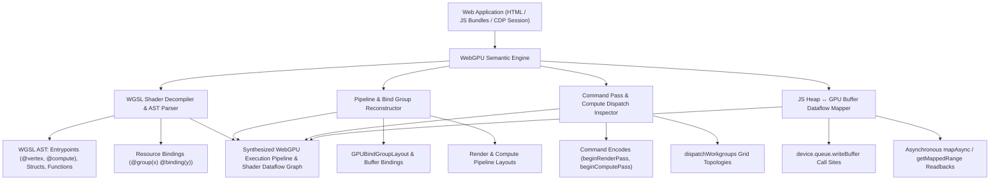

# WebGPU, shader bytecode and web runtimes

[Master tracker](README.md). Status read from GitHub 2026-11-28.

| Issue                                               | Title                                                                                                                       | Author  | State | Labels                                   | Comments | Linked PRs                                               | Notes                             |
| --------------------------------------------------- | --------------------------------------------------------------------------------------------------------------------------- | ------- | ----- | ---------------------------------------- | -------- | -------------------------------------------------------- | --------------------------------- |
| [#3727](https://github.com/morluto/rea/issues/3727) | [Feature] WebGPU application reverse engineering: WGSL, pipelines, bind groups, compute passes and JavaScript-to-GPU graphs | matbrgz | open  | enhancement, area: native, provider: gpu | 0        | none found                                               | -                                 |
| [#3620](https://github.com/morluto/rea/issues/3620) | [Feature] Shader and GPU Bytecode Reverse Engineering: SPIR-V, DXBC, DXIL, and Metal AIR reflection and decompilation       | matbrgz | open  | enhancement, area: native, provider: gpu | 2        | none found                                               | morluto commented with a baseline |
| [#2350](https://github.com/morluto/rea/issues/2350) | [Feature] Inspect WebAssembly components and canonical ABI declarations offline                                             | matbrgz | open  | enhancement, P2: medium, area: native    | 1        | [#2406](https://github.com/morluto/rea/pull/2406) (open) | all-black-493 offered a PR        |

## Source text

Verbatim issue text and comments follow. Badge images are removed and heading levels shifted. Claims are the authors', not verified here.

### [#3727](https://github.com/morluto/rea/issues/3727) [Feature] WebGPU application reverse engineering: WGSL, pipelines, bind groups, compute passes and JavaScript-to-GPU graphs

_matbrgz, open, https://github.com/morluto/rea/issues/3727_

##### Problem Statement & Context

WebGPU is the modern W3C graphics and compute standard now supported natively across all major browsers (Chrome, Edge, Firefox, Safari) and desktop runtimes (Deno, Node.js with Dawn/wgpu). It replaces WebGL with a low-overhead, compute-first API modeled after Vulkan, Metal, and DirectX 12.

WebGPU is rapidly becoming the dominant execution substrate for **in-browser 3D rendering, creative media tools, and client-side machine learning inference** (WebLLM, Transformers.js, ONNX Runtime Web).

While REA issue [#3620](https://github.com/morluto/rea/issues/3620) covers low-level compiled GPU bytecode (SPIR-V, DXBC, DXIL, Metal), WebGPU introduces a distinct application-level architecture that sits between JavaScript/TypeScript and the GPU hardware:

1. **WebGPU Shading Language (WGSL)**: A text-based, strongly-typed shading language with custom attributes (`@vertex`, `@fragment`, `@compute`, `@workgroup_size`, `@group(N)`, `@binding(M)`).
2. **Pipelines & Bind Groups**: `GPURenderPipeline`, `GPUComputePipeline`, `GPUBindGroupLayout`, and `GPUBindGroup` defining resource bindings between CPU memory buffers and GPU shader registers.
3. **Pass Encoders & Commands**: Command buffers recorded via `GPUCommandEncoder`, scheduling render passes, compute dispatches (`dispatchWorkgroups(x, y, z)`), and asynchronous buffer copies.
4. **Buffer Storage & Uniforms**: Storage buffers (`read_write`), uniform buffers, texture samplers, and staging buffers synchronizing dynamic data between the V8 JavaScript heap and GPU VRAM.

REA lacks a dedicated WebGPU semantic engine capable of decompiling WGSL shaders, reconstructing pipeline state objects, and mapping the end-to-end JavaScript-to-GPU dataflow graph.

##### Proposed Architecture



##### Technical Capabilities & Modules

1. **WGSL Shader Parsing & Static Analysis:**
   - Parse embedded or dynamically constructed WGSL source strings.
   - Build a typed Abstract Syntax Tree (AST): structs, global variables, uniform blocks, storage buffers, and functions.
   - Extract entrypoint annotations: `@vertex`, `@fragment`, `@compute` with workgroup dimensions (`@workgroup_size(X, Y, Z)`).

2. **Bind Group & Pipeline Layout Reconstruction:**
   - Map `@group()` and `@binding()` indices in WGSL to JavaScript `device.createBindGroupLayout()` calls.
   - Reconstruct layout schemas: buffer visibility, texture sample types, storage buffer access modes (`read`, `read_write`).
   - Match `createRenderPipeline` / `createComputePipeline` configurations with compiled shader modules.

3. **Compute Pass & Dispatch Geometry Analysis:**
   - Detect `beginComputePass` sequences and trace `passEncoder.dispatchWorkgroups(x, y, z)` calls.
   - Calculate total invocation grids ($X \times Y \times Z \times \text{workgroup\_size}$) to deduce tensor shapes and image processing kernel tiling.

4. **CPU-to-GPU Buffer Dataflow Tracing:**
   - Trace data uploads: `device.queue.writeBuffer`, `writeTexture`, and mapped staging buffer writes.
   - Correlate JavaScript typed arrays (Float32Array, Uint32Array) with WGSL buffer struct layouts.
   - Trace asynchronous readback operations (`mapAsync`, `getMappedRange`) to identify output consumers in JavaScript.

5. **AI Inference & Tensor Operator Mapping:**
   - Recognize common WGSL compute patterns: GEMM (General Matrix Multiply), FlashAttention, LayerNorm, Convolution, Softmax kernels.
   - Reconstruct high-level neural network execution topologies when WebGPU is used as an ML execution backend.

##### Acceptance Criteria

- [ ] Robust parsing and AST generation for WGSL shader modules.
- [ ] Automated reconstruction of `GPUBindGroupLayout` resource bindings matched to shader attributes.
- [ ] Tracing of compute pass dispatches and workgroup geometry calculations.
- [ ] Mapping of dataflow between JavaScript typed memory and GPU buffers.
- [ ] Export of an interactive WebGPU pipeline diagram depicting shader passes and resource bindings.

##### Related Issues & Dependencies

- Complements [#3620](https://github.com/morluto/rea/issues/3620) (Shader and GPU bytecode reverse engineering: SPIR-V, DXBC, DXIL)
- Complements [#3608](https://github.com/morluto/rea/issues/3608) (React Semantic Reconstruction & Decompiler Engine)
- Complements [#3637](https://github.com/morluto/rea/issues/3637) (ML model graph reverse engineering)

### [#3620](https://github.com/morluto/rea/issues/3620) [Feature] Shader and GPU Bytecode Reverse Engineering: SPIR-V, DXBC, DXIL, and Metal AIR reflection and decompilation

_matbrgz, open, https://github.com/morluto/rea/issues/3620_

#### Summary

Shaders and GPU compute kernels represent a critical, often opaque component of modern software: games, 3D engines, computer vision pipelines, graphics drivers, machine learning accelerators, and UI composition systems. In production binaries and asset packages, high-level shader languages (HLSL, GLSL, Metal Shading Language, WGSL) are compiled into low-level intermediate representations and GPU bytecodes:

- **SPIR-V:** Khronos standard portable intermediate representation for Vulkan, OpenCL, and WebGPU.
- **DXBC:** DirectX 9/10/11 Shader Bytecode container format (`DXBC`).
- **DXIL:** DirectX 12 Intermediate Language based on LLVM 3.7 bitcode with DirectX intrinsics.
- **Metal AIR (.metallib):** Apple Metal Intermediate Representation containing LLVM bitcode for Apple Silicon GPUs.

Currently, REA does not cover shader binaries or GPU bytecodes. When encountered in game binaries, assets, or driver caches, these payloads remain unanalyzed blobs.

This feature proposal introduces dedicated **Shader and GPU Bytecode Reverse Engineering** to REA, enabling container parsing, shader reflection (resource bindings, constant buffers, input/output signatures), disassembly, high-level decompilation (HLSL/GLSL/WGSL), and rendering pipeline reconstruction.

---

#### Technical Capabilities

##### 1. Shader Container & Format Ingestion

- **SPIR-V Binary Parser:** Parse 32-bit SPIR-V binary modules (magic `0x07230203`), extracting version, generator ID, bound ID, schema, and instruction streams (`OpCapability`, `OpExtension`, `OpMemoryModel`, `OpEntryPoint`, `OpExecutionMode`).
- **DirectX Bytecode (DXBC):** Parse `DXBC` container headers, checksums, and chunk tables (`RDEF` Resource Definition, `ISGN` Input Signature, `OSGN` Output Signature, `SHDR` / `SHEX` Shader Code, `STAT` Statistics).
- **DirectX 12 Intermediate Language (DXIL):** Extract `DXIL` / `ILDB` chunks and parse the embedded LLVM bitcode module, recognizing DirectX driver intrinsics, resource handles, and shader models (SM 6.0 through 6.8+).
- **Apple Metal Library (.metallib):** Parse Metal library headers, function tables, and Apple LLVM bitcode (AIR) modules.

##### 2. Shader Reflection & Interface Extraction

- **Resource Binding Map:**
  - Constant Buffers / Uniform Buffers (`cbuffer` / UBO): extract buffer names, slots, byte sizes, and member variable layouts with exact byte offsets.
  - Shader Resource Views (SRV): textures (2D, 3D, Cube, Array), samplers, and storage buffers.
  - Unordered Access Views (UAV): read/write storage buffers and images.
  - Push Constants / Specialization Constants: extract offset ranges, default values, and constant IDs.
- **Input & Output Signatures:**
  - Recover vertex input layouts: semantic names (`POSITION`, `NORMAL`, `TEXCOORD`), register indices, component masks, and system values (`SV_Position`, `SV_VertexID`, `SV_InstanceID`).
  - Recover pixel/fragment output targets: `SV_Target0`..`N`, `SV_Depth`, blend indices.
- **Compute Kernel Attributes:** Extract thread group / workgroup dimensions (`local_size_x, y, z`), shared memory allocation sizes, and barrier synchronization points.

##### 3. Disassembly & High-Level Decompilation

- **Disassembly:** Emit clean, symbolic disassembly for DXBC assembly, DXIL LLVM IR, and SPIR-V human-readable assembly text.
- **High-Level Decompilation:** Reconstruct high-level shader source code (HLSL, GLSL, or WGSL) from bytecode:
  - Invert control flow graphs (loops, branches, switch statements, discards).
  - Reconstruct mathematical vector/matrix operations (`dot`, `cross`, `mul`, swizzling `.xyzw`, `normalize`, `saturate`).
  - Reconstruct texture sampling operations (`Sample`, `SampleLevel`, `SampleGrad`, `texelFetch`).

##### 4. Rendering Pipeline & Visual Effect Reconstruction

- **Pipeline Pairing:** Correlate complementary shader stages (Vertex + Pixel / Fragment, Hull + Domain / Tessellation, Compute) into coherent graphics pipeline states.
- **Lighting & Material Model Recovery:** Identify standard shading models (PBR / Cook-Torrance, Blinn-Phong, Subsurface Scattering, Volumetric Fog) and post-processing passes (SSAO, Bloom, Tone Mapping, TAA).

---

#### Acceptance Criteria

1. Introduce `analyze_shader_artifact` in REA CLI and MCP contracts, accepting SPIR-V (`.spv`), DXBC/DXIL (`.cso`, `.bin`), and `.metallib` files.
2. Accurately extract shader stage (Vertex, Pixel/Fragment, Compute, Geometry, Mesh, RayTracing) and shader model version.
3. Output complete reflection metadata (constant buffer layouts, texture bindings, input/output registers) in structured JSON evidence.
4. Decompile synthetic SPIR-V and DXBC test shaders into valid HLSL/GLSL code.
5. Enforce bounded parsing and safe error handling for malformed or corrupted shader blobs.

---

#### Related

- [#743](https://github.com/morluto/rea/issues/743) [Feature] Recover .NET NativeAOT metadata in Ghidra workflows
- [#3607](https://github.com/morluto/rea/issues/3607) [Feature] Comprehensive Unity extraction and reverse engineering
- [#3609](https://github.com/morluto/rea/issues/3609) [Feature] Video Reverse Engineering

#### Comment by morluto (2026-11-23) on [#3620](https://github.com/morluto/rea/issues/3620)

Current observed state, as a concrete baseline for the container/reflection layer of this request (rea 6.10.1 at `bf913bc3dc`, Node 24.22.1, macOS arm64).

| Input                                                                                                                                                                           | `inspect-artifact` / `extract-artifact` | `inspect-gpu-code-objects`                                            |
| ------------------------------------------------------------------------------------------------------------------------------------------------------------------------------- | --------------------------------------- | --------------------------------------------------------------------- |
| 4 standalone SPIR-V modules (180 B to a few KB) from a public open-source Vulkan test build                                                                                     | `file_format_rejected`                  | "No supported CUDA/HIP container or PTX declarations were identified" |
| Synthetic 512-byte DXBC container, 10 parts: SFI0, ISG1, OSG1, PSV0, RTS0, HASH, ILDN, DXIL (ps_6_6 program header + bitcode magic), plus two vendor/private parts (PRIV, XVND) | `file_format_rejected`                  | same refusal                                                          |
| PE32+ from the same public build with a SPIR-V 1.5 module in `.rdata` (file offset 0x84c50, bound 12980)                                                                        | n/a                                     | `objects: []`, `discovery: "complete"` over 9 examined sections       |

A first, cheap slice that would already help port work, before any decompilation:

- DXBC: header (total size, part count), part table with FourCC, offset, size; known parts named, unknown/vendor parts kept as opaque extents rather than failing; DXIL program header (shader kind, model, bitcode offset/size); RTS0 version; ILDN debug name.
- SPIR-V: header (version, generator, bound), capabilities, entry points with execution models, extension list. Instruction-level decoding can come later.
- In `inspect-gpu-code-objects`, a scan of read-only sections for these headers, reported as candidates, so the `complete` discovery verdict stays accurate when shaders are embedded in a host binary.

Generator for the DXBC case (standard library, own bytes; the bitcode is a magic plus filler, not valid IR):

<details><summary>gen_dxbc.py</summary>

```python
# DXBC container with standard parts plus two vendor/private parts (own bytes).
import struct, sys, hashlib
def dxbc(parts):
    off = 32 + 4 * len(parts); offs = []; blob = b''
    for cc, data in parts:
        offs.append(off); c = cc + struct.pack('<I', len(data)) + data; blob += c; off += len(c)
    return b'DXBC' + bytes(16) + struct.pack('<III', 1, off, len(parts)) + b''.join(struct.pack('<I', o) for o in offs) + blob
bc = b'BC\xc0\xde' + b'\x35\x14\x00\x00' * 8          # LLVM bitcode magic + filler, not valid IR
prog = struct.pack('<II', 0x66, 0) + b'DXIL' + struct.pack('<III', 0x106, 16, len(bc)) + bc   # ps_6_6
prog = prog[:4] + struct.pack('<I', len(prog) // 4) + prog[8:]
sig = struct.pack('<II', 0, 8)
parts = [(b'SFI0', bytes(8)), (b'ISG1', sig), (b'OSG1', sig), (b'PSV0', struct.pack('<I', 24) + bytes(24)),
         (b'RTS0', struct.pack('<6I', 2, 0, 24, 0, 24, 0)), (b'HASH', bytes(4) + hashlib.md5(b'x').digest()),
         (b'ILDN', struct.pack('<HH', 0, 8) + b'a.pdb\0\0\0'), (b'DXIL', prog),
         (b'PRIV', hashlib.sha512(b'p').digest()), (b'XVND', hashlib.sha512(b'v').digest() * 2)]
open(sys.argv[1], 'wb').write(dxbc(parts))
```

</details>

Related: AMDGPU PAL code objects are tracked separately in [#14154](https://github.com/morluto/rea/issues/14154).

#### Comment by morluto (2026-11-23) on [#3620](https://github.com/morluto/rea/issues/3620)

Real public corpus for this request: bkaradzic/bgfx at commit `9714e329d7b9eda40254964634d57010d1e80659`, `examples/runtime/shaders/{dxbc,dxil,spirv,metal}/*.bin`. Each directory has 325 compiled shaders. Every file is a small bgfx header (`VSH`/`FSH`/`CSH` magic, version, hashes, uniform table, then a u32 code size) followed by the native blob. From my own byte scan, not REA:

| Dir     | Files | Embedded blob                                                 | Example: `vs_cubes.bin`                                                                                        |
| ------- | ----- | ------------------------------------------------------------- | -------------------------------------------------------------------------------------------------------------- |
| `dxbc`  | 325   | `DXBC` container in 325/325                                   | `DXBC` at offset 52, 532-byte file, SHA-256 `093af972008023a5be1e3dba1ad8d69b8b649cf1de0a8b0846a1a04f2d059b96` |
| `dxil`  | 325   | `DXBC` container (with `DXIL` part) in 325/325                | `DXBC` at 52, `DXIL` at 644, SHA-256 `e6cb77e2b446cff528b06defde0655bce23cf6061d26db3a84a7a1ea508251e9`        |
| `spirv` | 325   | SPIR-V magic `03 02 23 07` in 325/325                         | magic at 52, SHA-256 `b0efc79dd44d6b51a3e33b1323dcc748180a89863efffd5fa4802e2be2ff2d7a`                        |
| `metal` | 325   | MSL **source text** (`#include <metal_stdlib>`), not metallib | n/a                                                                                                            |

REA 6.10.1 (`bf913bc3dc`, macOS arm64, CLI):

- `inspect-artifact` and `extract-artifact` on all sampled `dxbc`/`dxil`/`spirv`/`metal` files: `target_unavailable` / `file_format_rejected` ("unsupported binary format"). The embedded offset isn't reported.
- `inspect-gpu-code-objects`: `unsupported_target`, "No supported CUDA/HIP container or PTX declarations were identified".
- `inspect-byte-entropy` works (e.g. SPIR-V `fs_bloom_combine.bin`: 3.16 bits/byte), but it says nothing about structure.

So this is a ready-made regression corpus for DXBC part tables (`RDEF`/`ISGN`/`OSGN`/`SHEX`/`DXIL`/`STAT`), SPIR-V headers (version, generator, bound) and an "embedded at offset N inside an unknown wrapper" result. All three blob types start at a fixed, discoverable offset, which also makes these files a good test for the scan-for-magic part of [#14151](https://github.com/morluto/rea/issues/14151).

### [#2350](https://github.com/morluto/rea/issues/2350) [Feature] Inspect WebAssembly components and canonical ABI declarations offline

_matbrgz, open, https://github.com/morluto/rea/issues/2350_

#### Analyst question and current scope

The shipped offline WASM lane is documented around WABT 1.0.42 and core-module section/WAT results. There is no declared component-model result profile or component ABI contract in src/wasm or src/contracts. Component binaries use their own layer/version and contain component/core index spaces; treating them as ordinary core modules would lose relevant structure.

#### Acceptance criteria

- [ ] Define component identity, admitted binary proposal/tool versions, typed imports/exports, embedded core modules and canonical lift/lower relationships.
- [ ] Use a pinned decoder/tool profile and report unsupported component features without claiming full validation.
- [ ] Preserve original byte hashes, source ranges, per-facet coverage, cancellation and owned cleanup.
- [ ] Generate original valid/malformed fixtures and verify real CLI/MCP behavior; never instantiate or execute the selected component.

#### Source and related work

- https://github.com/WebAssembly/component-model/blob/main/design/mvp/Binary.md

This is separate from function pseudocode request [#2298](https://github.com/morluto/rea/issues/2298).

Priority: P2. The current surface was checked at upstream 1c3791430, and open/closed issues were searched before filing. Proposed file-analysis features need their own spec/plan/tasks under docs/specs/. If implementation requires a new provider or expands execution authority, obtain the maintainer scope decision required by CONTRIBUTING.md before integration; this proposal itself does not authorize that expansion.

#### Comment by all-black-493 (2026-10-12) on [#2350](https://github.com/morluto/rea/issues/2350)

I'd like to take this on with a focused PR. Here is the proposed boundary, so it can be corrected before review.

**Approach: an in-process, read-only decoder, no new external tool.**
WABT 1.0.42 cannot parse component binaries, so the WABT lane cannot cover this. Like the Go build-info reader ([#1363](https://github.com/morluto/rea/issues/1363)), a REA-owned decoder in `src/wasm/` would read the selected file through the existing stable artifact reader. It starts no subprocess, writes no temporary files, and never instantiates or executes the component or its embedded core modules. It would be a new target-free tool, `inspect_wasm_component` / `rea inspect-wasm-component <path>`, with CLI/MCP parity and Evidence.

**Pinned decoder profile**

- Admits only the component preamble `00 61 73 6D 0D 00 01 00` (version `0x0d`, layer `0x01`). The grammar is pinned to component-model `design/mvp/Binary.md` at [`06e3db0`](https://github.com/WebAssembly/component-model/blob/06e3db039e38588e2643a9417bf5d03100feafde/design/mvp/Binary.md) (2026-09-23).
- Other versions or layers return `unsupported_target` with the observed bytes. A core module (layer `0x00`) points to `inspect_wasm_artifact`.
- `validation` is always `not_performed`. The decoder checks only structure (LEB128, lengths, bounds, opcodes), never typing, uniqueness or the canonical ABI.

**Result facets, each with byte ranges and its own coverage**

- Identity: path, SHA-256, size, preamble, decoder profile.
- Sections: id, payload range, SHA-256.
- Imports and exports: names with attributes (`implements`, `versionsuffix`, `external-id`) and decoded extern types.
- Types: value, function (including async), resource, component and instance types.
- Embedded core modules: index, byte range, SHA-256 and size only; they are not decoded or run.
- Core and component instances, and aliases.
- Canon definitions: lift, lower, `resource.*` and the gated async/thread built-ins, with options, and with operands resolved through the index spaces. For example: export `run` ← canon lift of core func 2 ← core export alias `run` of core instance 0 ← instantiate core module 0.
- Nested components (bounded depth), the `component-name` section, and other custom sections by name and range.
- Gated features actually observed (🔀 🧵 📝 🔧 🗺️ 🪙 🏷️ 🔗).

Anything the decoder does not handle, for example GC core types in a core type section, is reported as `not_decoded` with its range. Decoding then continues with the next section, because sections are length-prefixed.

**Limits and lifecycle:** 8 MiB input (same as the WASM lane), a nesting-depth bound, an inline output budget, and cancellation checks between sections. Apart from the stable read there are no owned resources to clean up.

**Routing:** `open_binary` and `inspect_wasm_artifact` would recognize the component preamble and point to the new tool, instead of treating the file as a core module or an unknown binary.

**Verification:** original valid and malformed components are generated at test time by a byte builder (no committed binaries), with real CLI and MCP boundary tests, including truncation, bad lengths, unknown sections and opcodes, unsupported versions, nesting limits and cancellation.

**docs/specs:** that directory doesn't exist, and AGENTS.md says not to commit local planning artifacts. So the design lives here and in the PR, and user docs go in `docs/wasm-artifacts.md`. Please say if a spec file is wanted anyway.

**Questions**

1. Is a separate tool preferred, or should `inspect_wasm_artifact` dispatch on the layer? I chose a separate tool because its provider needs no WABT and its result shape differs.
2. Does this read-only in-process decoder need a separate maintainer scope decision as a new provider? I'll keep that item open in the PR until you say.
3. Complete inline results first, with summary delivery as in [#2193](https://github.com/morluto/rea/issues/2193) as a follow-up, or both in this PR?

This stays separate from [#2298](https://github.com/morluto/rea/issues/2298) (pseudocode) and [#2356](https://github.com/morluto/rea/issues/2356) (interface comparison), though [#2356](https://github.com/morluto/rea/issues/2356) could build on these typed imports and exports.
