# REA emerging domains: master tracker

Built 2026-11-28 from [#3720](https://github.com/morluto/rea/issues/3720). Kept in `emerging-notes/` on the fork's `main` only, never on a PR branch or upstream.

**The tracker issue is closed** (matbrgz, 2026-10-15, reason "completed"). All 14 issues it indexes were still open on 2026-11-28.

| File                                   | Covers                                              | Issues                                                                                                                                                                                                             |
| -------------------------------------- | --------------------------------------------------- | ------------------------------------------------------------------------------------------------------------------------------------------------------------------------------------------------------------------ |
| [1-agentic-ai.md](1-agentic-ai.md)     | Agentic AI protocols and LLM applications           | [#3721](https://github.com/morluto/rea/issues/3721), [#3651](https://github.com/morluto/rea/issues/3651), [#3653](https://github.com/morluto/rea/issues/3653)                                                      |
| [2-ml-runtimes.md](2-ml-runtimes.md)   | Edge accelerators, ML runtimes and model topologies | [#3722](https://github.com/morluto/rea/issues/3722), [#3637](https://github.com/morluto/rea/issues/3637), [#3652](https://github.com/morluto/rea/issues/3652), [#3673](https://github.com/morluto/rea/issues/3673) |
| [3-trust-crypto.md](3-trust-crypto.md) | Hardware trust and cryptography                     | [#3723](https://github.com/morluto/rea/issues/3723), [#3724](https://github.com/morluto/rea/issues/3724)                                                                                                           |
| [4-vehicles-iot.md](4-vehicles-iot.md) | Software-defined vehicles and industrial IoT        | [#3725](https://github.com/morluto/rea/issues/3725), [#3726](https://github.com/morluto/rea/issues/3726)                                                                                                           |
| [5-web-gpu.md](5-web-gpu.md)           | WebGPU, shader bytecode and web runtimes            | [#3727](https://github.com/morluto/rea/issues/3727), [#3620](https://github.com/morluto/rea/issues/3620), [#2350](https://github.com/morluto/rea/issues/2350)                                                      |

**What to work on:** see the [roadmap](roadmap.md). Blockchain notes are separate, in [blockchain-notes](../blockchain-notes/README.md).

## The tracker as matbrgz wrote it

##### Scope & Strategic Vision

Software systems developed for the 2026–2030 horizon are undergoing a fundamental architectural paradigm shift. Reverse engineering is expanding beyond traditional single-binary programs (`binary -> CPU -> OS`) into complex, composite systems composed of:

- **Agentic Multi-Agent Systems**: Agent-to-Agent (A2A) protocols, streaming multi-turn dialogues, tool-use loops, and memory architectures.
- **On-Device AI & Specialized Accelerators**: Edge neural processing units (NPU), ExecuTorch, Core AI Foundation Models, LiteRT, and host-device execution graphs.
- **Hardware-Enforced Confidential Computing**: Attestation reports, TEE measurements (Intel TDX, AMD SEV-SNP, Arm CCA), and cryptographic workload bindings.
- **Post-Quantum Cryptography (PQC)**: NIST FIPS 203/204/205 algorithms (ML-KEM, ML-DSA, SLH-DSA) and hybrid migration patterns across binaries and protocols.
- **Software-Defined Vehicles (SDV) & Industrial IoT**: AUTOSAR Adaptive architectures, SOME/IP, DDS, Matter/Thread smart-home mesh fabrics.
- **Modern Accelerated Web Runtimes**: WebGPU shader pipelines (WGSL) and async WebAssembly Component Models (WASI 0.3).

This tracker coordinates REA's strategic capabilities across these forward-looking, next-generation reverse engineering domains.

##### Architectural Breakdown

```mermaid
flowchart TD
    A["Emerging Reverse Engineering Architecture (2026-2030)"] --> B["Tier 1: Agentic AI Protocols & Memory"]
    A --> C["Tier 2: Edge Accelerators & On-Device AI"]
    A --> D["Tier 3: Trust & Cryptographic Security (TEE & PQC)"]
    A --> E["Tier 4: Distributed & Physical Systems (SDV & IoT)"]
    A --> F["Tier 5: Modern Web & GPU Shaders (WebGPU & WASI 0.3)"]

    B --> B1["A2A Multi-Agent Workflows (#3721)"]
    B --> B2["LLM Applications, Tool Schemas & RAG (#3651)"]
    B --> B3["Tokenizers & Vocabulary Deconstruction (#3653)"]

    C --> C1["On-Device AI: Core AI & ExecuTorch (#3722)"]
    C --> C2["ML Model Topology: ONNX, TFLite, CoreML, TensorRT (#3637)"]
    C --> C3["ML Compiler IR: MLIR, StableHLO, XLA (#3673)"]
    C --> C4["PyTorch Checkpoints & Opcode Graphs (#3652)"]

    D --> D1["Confidential Computing & Attestation (#3723)"]
    D --> D2["Post-Quantum Cryptography Inventory (#3724)"]

    E --> E1["AUTOSAR Adaptive & SOME/IP Graphs (#3725)"]
    E --> E2["Matter & Thread Mesh Forensics (#3726)"]

    F --> F1["WebGPU Application & WGSL Graphs (#3727)"]
    F --> F2["Shader Bytecode: SPIR-V, DXBC, DXIL, Metal AIR (#3620)"]
    F --> F3["Wasm Components & Canonical ABI (#2350)"]
```

---

#### Complete Tracked Issues Index

##### 1. Agentic AI Protocols & LLM Applications

- [ ] [#3721](https://github.com/morluto/rea/issues/3721) — `[Feature] A2A protocol reverse engineering: Agent Cards, task lifecycles, artifacts, streaming sessions and multi-agent workflow reconstruction`
- [ ] [#3651](https://github.com/morluto/rea/issues/3651) — `[Feature] LLM application reverse engineering: system prompts, model/provider routing, tool schemas, RAG links and agent workflow reconstruction`
- [ ] [#3653](https://github.com/morluto/rea/issues/3653) — `[Feature] Tokenizer and vocabulary reverse engineering: BPE merges, WordPiece models, SPM unigrams, special tokens and regex splitters`

##### 2. Edge Accelerators, ML Runtimes & Model Topologies

- [ ] [#3722](https://github.com/morluto/rea/issues/3722) — `[Feature] On-device AI runtime reverse engineering: Core AI, Foundation Models, ExecuTorch, LiteRT and NPU delegate reconstruction`
- [ ] [#3637](https://github.com/morluto/rea/issues/3637) — `[Feature] ML model graph reverse engineering: ONNX, TFLite, CoreML, and TensorRT topology`
- [ ] [#3652](https://github.com/morluto/rea/issues/3652) — `[Feature] PyTorch checkpoint and model artifact reverse engineering: ZIP/pickle opcode graph, tensor storages, state_dict reconstruction and unsafe-global detection`
- [ ] [#3673](https://github.com/morluto/rea/issues/3673) — `[Feature] ML compiler IR reverse engineering: MLIR bytecode, StableHLO, TOSA and XLA HLO graph reconstruction`

##### 3. Hardware Trust & Cryptography

- [ ] [#3723](https://github.com/morluto/rea/issues/3723) — `[Feature] Confidential-computing reverse engineering: TDX, SEV-SNP, Arm CCA attestation, measurements and workload binding`
- [ ] [#3724](https://github.com/morluto/rea/issues/3724) — `[Feature] Post-quantum cryptography reverse engineering: ML-KEM, ML-DSA and SLH-DSA fingerprints, parameters and migration inventory`

##### 4. Software-Defined Vehicles (SDV) & Industrial IoT

- [ ] [#3725](https://github.com/morluto/rea/issues/3725) — `[Feature] Software-defined vehicle reverse engineering: AUTOSAR Adaptive, SOME/IP, DDS, DoIP, UDS and service graphs`
- [ ] [#3726](https://github.com/morluto/rea/issues/3726) — `[Feature] Matter & Thread reverse engineering: commissioning captures, TLV, clusters, endpoints, fabrics and mesh topology reconstruction`

##### 5. WebGPU, Shader Bytecode & Modern Web Runtimes

- [ ] [#3727](https://github.com/morluto/rea/issues/3727) — `[Feature] WebGPU application reverse engineering: WGSL, pipelines, bind groups, compute passes and JavaScript-to-GPU graphs`
- [ ] [#3620](https://github.com/morluto/rea/issues/3620) — `[Feature] Shader and GPU Bytecode Reverse Engineering: SPIR-V, DXBC, DXIL, and Metal AIR reflection and decompilation`
- [ ] [#2350](https://github.com/morluto/rea/issues/2350) — `[Feature] Inspect WebAssembly components and canonical ABI declarations offline`
