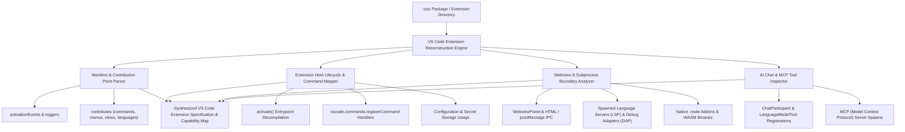

# #3687 VS Code extension analysis

<!-- nav --> [← #3672 Agent protocols](3672-agent-protocols.md) · [Dashboard](../dashboard/README.md)

| Field      | Value                                                                                                                                                         |
| ---------- | ------------------------------------------------------------------------------------------------------------------------------------------------------------- |
| Issue      | [#3687](https://github.com/morluto/rea/issues/3687)                                                                                                           |
| Group      | Not in a tier (game and engine RE label)                                                                                                                      |
| State      | Open; update posted 2026-11-28 ([comment](https://github.com/morluto/rea/issues/3687#issuecomment-7237981346)), no maintainer reply seen                      |
| Our status | All six parts built; 1 to 3 upstream, 4 to 6 in the fork                                                                                                      |
| Our PRs    | [#14977](https://github.com/morluto/rea/pull/14977), [#14978](https://github.com/morluto/rea/pull/14978), [#14979](https://github.com/morluto/rea/pull/14979) |

## Summary

Static analysis of VS Code extensions: link what a package declares to the code behind it. [#12469](https://github.com/morluto/rea/pull/12469) (mvanhorn, merged) added package inspection; mvanhorn released the rest to us.

## Parts

The split is ours, not the issue's.

| Part | Content                                                | Fork PR                                             | Upstream PR                                         | Status                         |
| ---- | ------------------------------------------------------ | --------------------------------------------------- | --------------------------------------------------- | ------------------------------ |
| 0    | Package inspection, native and WebAssembly members     | none                                                | [#12469](https://github.com/morluto/rea/pull/12469) | Merged (not ours)              |
| 1    | Commands, menus, keybindings to handlers               | [fork #1](https://github.com/akshad-exe/rea/pull/1) | [#14977](https://github.com/morluto/rea/pull/14977) | Ready for review               |
| 2    | Chat participants, language model tools, MCP providers | [fork #2](https://github.com/akshad-exe/rea/pull/2) | [#14978](https://github.com/morluto/rea/pull/14978) | Draft; after part 1            |
| 3    | Views, custom editors, settings list                   | [fork #3](https://github.com/akshad-exe/rea/pull/3) | [#14979](https://github.com/morluto/rea/pull/14979) | Draft; after part 2            |
| 4    | Installed extension folders                            | [fork #5](https://github.com/akshad-exe/rea/pull/5) | none                                                | Raise after parts 1 to 3 merge |
| 5    | Webview messages and fixed HTML                        | [fork #6](https://github.com/akshad-exe/rea/pull/6) | none                                                | Raise after part 4             |
| 6    | Debugger types, language and debug server processes    | [fork #7](https://github.com/akshad-exe/rea/pull/7) | none                                                | Raise after part 5             |

Fork PRs are stacked in that order. [fork #4](https://github.com/akshad-exe/rea/pull/4) (debugger types) is closed into [fork #7](https://github.com/akshad-exe/rea/pull/7).

## Acceptance items

| Issue item                                                 | Status                                        |
| ---------------------------------------------------------- | --------------------------------------------- |
| Read `.vsix` or installed folders                          | Done with part 4                              |
| Map all contribution points to handlers                    | Partial; not fully possible statically        |
| Webview messaging and HTML                                 | Partial: literal message types and fixed HTML |
| Language and debug server processes, native and WASM files | Partial: fixed values only                    |
| Chat participants, prompt handlers, MCP                    | Registrations done; prompt handling missing   |

Use `Refs #3687`, not `Fixes`, unless morluto narrows the scope.

## Design decisions

- The JavaScript analysis records `vscode` calls; the correlation reuses the package report and does not reparse `package.json`.
- A `require` behind an interop helper is reported as `loader_authority: candidate`, `wrapper: unverified`.
- Values built at run time stay unknown or unresolved; absence is not claimed when analysis was incomplete.
- Webview and language client facts sit on module nodes, so a truncated call analysis keeps them.

## Real trials

| Extension                                  | Result                                                            |
| ------------------------------------------ | ----------------------------------------------------------------- |
| EditorConfig, prettier-vscode              | Commands matched                                                  |
| GitLens                                    | All `undetermined`: call analysis dropped under the result budget |
| flowrelay, agent-kanban                    | Some registrations missed (helpers, constant IDs)                 |
| Biome, vscode-icons (installed folders)    | Folder read; commands `undetermined`                              |
| Hex Editor, PDF viewer                     | Webview messages found and paired where literal                   |
| Mock Debug, YAML, Even Better TOML, clangd | Debug adapters and language clients found; server paths unknown   |

## Known limitations

- Registrations through helper functions or constant IDs are missed.
- Very large bundles lose call results (commands, panels, spawns, debug adapters).
- Webview and language client recognition is by name; no fixed server path was found in any real sample.
- [fork #5](https://github.com/akshad-exe/rea/pull/5) to [fork #7](https://github.com/akshad-exe/rea/pull/7) have had no Greptile or outside review. Squash them before raising upstream.

## Review history

2026-11-28: Greptile scored parts 1 to 3 at 1/5, 0/5 and 2/5. Fixes went into part 1 and were merged upward; all three reached 5/5. Fixes to an earlier part must be merged into later branches.

## Next steps

1. Wait for review of [#14977](https://github.com/morluto/rea/pull/14977).
2. After each merge, merge `upstream/main` into the next branch and update its description.
3. Agree the scope with morluto before claiming the issue is fixed.

## Source text

Verbatim, badges removed and heading levels shifted. Claims are the author's, not verified here.

#### Problem Statement & Context

Visual Studio Code is the world's most widely adopted developer environment (>70% market share according to developer surveys), with over 80,000 extensions published on the Visual Studio Marketplace. Extensions range from simple syntax highlighters to complex, multi-process distributed systems featuring embedded language servers, debug adapters, custom webview GUIs, native Node.js C++ addons, WebAssembly modules, and AI agent / Model Context Protocol (MCP) bridges.

When auditing or reverse engineering an extension (`.vsix` package or installed extension directory), analysts lack a dedicated tool that comprehends VS Code's extension-host contract:

1. **Manifest Architecture (`package.json`)**: `activationEvents`, `contributes` points (commands, menus, views, keybindings, custom editors, languages, debuggers).
2. **Extension Lifecycle & Activation**: `activate(context: vscode.ExtensionContext)` entrypoint and registered disposables.
3. **Webview IPC**: Communication channels (`postMessage`, `onDidReceiveMessage`) between the extension host and embedded webview HTML panels.
4. **Language Server & Debug Adapter Boundaries**: Custom LSP (Language Server Protocol) and DAP (Debug Adapter Protocol) subprocesses spawned by the extension.
5. **AI & Agentic Integrations**: Modern extensions integrating language model tools, Chat Participant APIs (`vscode.chat.createChatParticipant`), and MCP servers.

REA already possesses engines for ZIP archives, JavaScript/Node.js ASTs, native modules, and MCP protocols (#3672). A dedicated VS Code extension engine will unify these into a high-level extension architecture reconstruction.

#### Proposed Architecture

#### Technical Capabilities & Modules

1. **VSIX Package Ingestion & Manifest Validation:**
   - Unpack `.vsix` Open Packaging Conventions (OPC) ZIP containers.
   - Parse `extension/package.json` to extract extension identity, version, dependencies, engines, `activationEvents`, and `contributes`.
   - Validate contribution points: commands, views, configuration settings, keybindings, menus, and custom editors.

2. **Command Registration & Handler Correlation:**
   - Decompile extension entrypoint (`main` or `browser`).
   - Correlate `contributes.commands` IDs with `vscode.commands.registerCommand(id, handler)` implementations in bundled JavaScript/TypeScript.
   - Map menu clicks and keyboard shortcuts directly to backend handler functions.

3. **Webview IPC & Frontend Reconstruction:**
   - Detect `vscode.window.createWebviewPanel` and `WebviewViewProvider`.
   - Extract inline or external webview HTML, scripts, and CSS.
   - Map bidirectional `webview.postMessage` and `webview.onDidReceiveMessage` protocol flows.

4. **Language Server & Subprocess Architecture:**
   - Detect Language Server Client (`vscode-languageclient`) and Debug Adapter (`vscode.DebugAdapterDescriptorFactory`) instantiations.
   - Trace executable paths for spawned backend language servers (e.g., Python binaries, Rust LSPs, Java daemons).
   - Identify native Node.js binary addons (`.node`) and WebAssembly modules (`.wasm`).

5. **AI Tools & MCP Protocol Integration:**
   - Inspect `vscode.chat.createChatParticipant` registrations and prompt handling logic.
   - Detect language model tool definitions (`vscode.lm.registerTool`).
   - Identify bundled MCP servers, stdio command configurations, and remote tool bridge endpoints.

#### Acceptance Criteria

- [ ] Ingest `.vsix` packages or installed extension directories and extract all assets.
- [ ] Map 100% of declared contribution points (`package.json`) to their runtime JavaScript handlers.
- [ ] Reconstruct webview IPC messaging channels and extract rendered webview HTML/assets.
- [ ] Identify spawned LSP/DAP subprocesses, native `.node` addons, and embedded WASM binaries.
- [ ] Detect modern AI chat participants, prompt handlers, and MCP server integrations (#3672).

#### Related Issues & Dependencies

- Complements #3672 (AI agent protocol reverse engineering: MCP, A2A, tool calling)
- Complements #3608 (React Semantic Reconstruction & Decompiler Engine)
- Complements #117 (Full-stack reconstruction)

---

<!-- nav --> [← #3672 Agent protocols](3672-agent-protocols.md) · [Dashboard](../dashboard/README.md)
