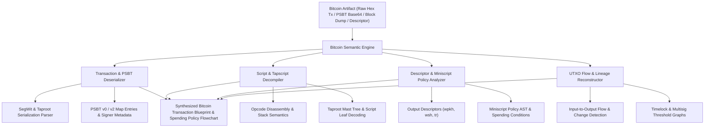
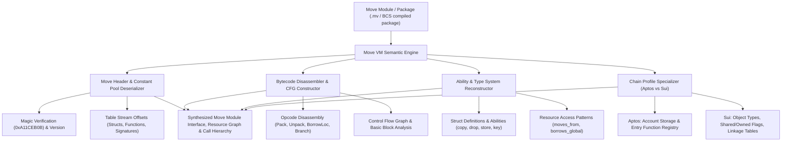
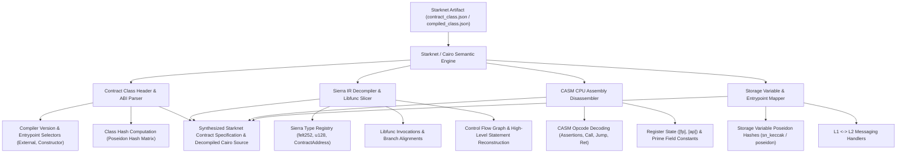
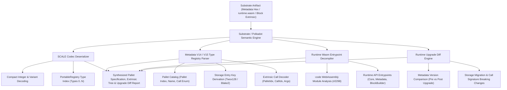
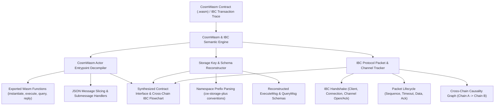
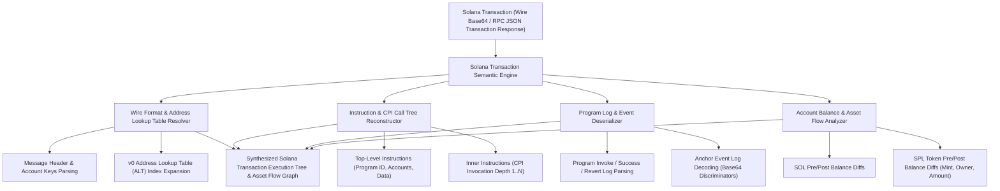

# Tier 2: non-EVM VMs and UTXO chains

[Master tracker](README.md). Status read from GitHub 2026-11-28.

| Issue | Title | Author | State | Priority / labels | Comments | Linked PRs |
| --- | --- | --- | --- | --- | --- | --- |
| [#3730](https://github.com/morluto/rea/issues/3730) | Bitcoin reverse engineering: raw transactions, PSBT, Script/Tapscript, descriptors, Miniscript and UTXO-flow reconstruction | matbrgz | open | enhancement, area: evidence | 0 | none found |
| [#3731](https://github.com/morluto/rea/issues/3731) | Move VM reverse engineering: bytecode modules, abilities, resources, types and call graphs | matbrgz | open | enhancement | 0 | none found |
| [#3732](https://github.com/morluto/rea/issues/3732) | Starknet reverse engineering: Cairo, Sierra/CASM, class hashes, entrypoints and storage graphs | matbrgz | open | enhancement | 0 | none found |
| [#3738](https://github.com/morluto/rea/issues/3738) | Polkadot/Substrate reverse engineering: SCALE metadata, runtime Wasm, pallets, extrinsics and runtime-upgrade diffs | matbrgz | open | enhancement, area: setup, area: runtime | 0 | none found |
| [#3739](https://github.com/morluto/rea/issues/3739) | CosmWasm and IBC reverse engineering: Wasm contracts, schemas, packet lifecycles and cross-chain state machines | matbrgz | open | enhancement, area: domain, area: evidence | 0 | none found |
| [#3747](https://github.com/morluto/rea/issues/3747) | Solana transaction reverse engineering: instructions, CPIs, account roles, logs and state-change graphs | matbrgz | open | enhancement | 0 | none found |
| [#2003](https://github.com/morluto/rea/issues/2003) | Offline Solana sBPF program interface recovery | trenbonole | open | enhancement, P3: low, area: native | 3 | none found |

## Source text

Verbatim issue text and comments follow. Badge images are removed and heading levels shifted. Claims are the authors', not verified here.

### #3730 [Feature] Bitcoin reverse engineering: raw transactions, PSBT, Script/Tapscript, descriptors, Miniscript and UTXO-flow reconstruction

*matbrgz, open, https://github.com/morluto/rea/issues/3730*

#### Problem Statement & Context

Bitcoin represents the foundational UTXO (Unspent Transaction Output) blockchain architecture. Modern Bitcoin development has evolved significantly beyond legacy P2PKH/P2SH scripts into complex multi-sig policies, smart custody setups, and privacy protocols:
1. **Raw Transaction & Serialization Formats**: Legacy, Segregated Witness (SegWit / BIP141), and Taproot (BIP341/342) transaction serializations, parsing inputs, outputs, locktimes, sequence numbers, and witness stacks.
2. **Partially Signed Bitcoin Transactions (PSBT v0 & v2 / BIP174, BIP370)**: Key-value binary maps containing global, input, and output maps. Tracks BIP32 derivation paths, non-witness and witness UTXOs, sighash types, partial signatures, Taproot key/script spend trees, and MuSig2 aggregation metadata.
3. **Script, Tapscript & Execution Engine**: Forth-like stack-based bytecode (`OP_CHECKSIG`, `OP_CHECKMULTISIG`, `OP_CHECKLOCKTIMEVERIFY`, `OP_CHECKSEQUENCEVERIFY`, `OP_CHECKSIGADD`).
4. **Output Descriptors & Miniscript**: Standardized human-readable and machine-analyzable spending policies (`wpkh()`, `wsh()`, `tr()`, Miniscript Boolean expressions modeling `and`, `or`, `thresh`, `older`, `after`).
5. **UTXO Graph & Transaction Lineage**: Graphing spending chains, change detection heuristics, and multi-input clustering across analyst-provided transaction datasets.

REA currently lacks a dedicated Bitcoin engine capable of parsing raw transactions, inspecting PSBT signing states, disassembling Taproot trees, and modeling Miniscript policies offline.

#### Proposed Architecture



#### Technical Capabilities & Modules

1. **Raw Transaction & Block Parsing:**
   - Deserialize raw transaction byte streams supporting legacy, SegWit (marker `0x00`, flag `0x01`), and Taproot formats.
   - Decode input outpoints (TxID + Vout), scriptSig, nSequence (BIP68 relative timelocks), outputs (value in satoshis + scriptPubKey), and nLockTime (BIP65 absolute timelocks).

2. **PSBT v0 and v2 Inspection:**
   - Parse binary PSBT maps: Global, Inputs, and Outputs.
   - Extract BIP32 key derivations (fingerprints + paths), proprietary fields, sighash types, and partial signatures.
   - Decode Taproot PSBT fields: internal keys, Taproot output keys, leaf hashes, script trees, and MuSig2 participant states without signing.

3. **Script & Tapscript Disassembly:**
   - Disassemble Bitcoin Script opcodes into clean symbolic representations.
   - Trace execution semantics on an abstract stack to determine satisfiability conditions.
   - Reconstruct Taproot MAST (Merkelized Alternative Script Tree) hierarchies: internal key, leaf scripts, leaf versions, and parity bits.

4. **Output Descriptors & Miniscript Analysis:**
   - Parse standard output script descriptors: `pk()`, `pkh()`, `wpkh()`, `sh()`, `wsh()`, `tr()`.
   - Parse Miniscript expressions: compile spending policies into logical trees detailing required signatures, time delays (`older()`, `after()`), and hash preimages (`sha256()`, `ripemd160()`).
   - Audit spending policies for malleability risks or unreachable spending branches.

5. **UTXO Lineage & Spending Graph:**
   - Build a directed acyclic graph (DAG) tracing transaction inputs back to parent UTXOs across provided transaction batches.
   - Apply standard change output heuristics (round values, script type matching) to model economic transfer flows.

#### Acceptance Criteria

- [ ] Static decoding of raw Bitcoin transactions across Legacy, SegWit, and Taproot.
- [ ] Complete parsing and auditing of PSBT v0 and v2 packages, detailing missing signatures and required keys.
- [ ] Disassembly of Tapscript leaves and visualization of Taproot script trees.
- [ ] Parsing and AST validation of Miniscript spending policies.
- [ ] Generation of an interactive UTXO flow graph depicting inputs, outputs, and locktime constraints.

#### Related Issues & Dependencies

- Complements #3621 (Unknown binary file-format inference)
- Complements #3698 (Interactive entertainment and asset reverse engineering tracker)

### #3731 [Feature] Move VM reverse engineering: bytecode modules, abilities, resources, types and call graphs

*matbrgz, open, https://github.com/morluto/rea/issues/3731*

#### Problem Statement & Context

The Move programming language and MoveVM represent a modern smart contract execution model designed around linear types, first-class resources, and formal verifiability. Move powers major high-throughput Layer 1 blockchains, primarily **Aptos** and **Sui**, each featuring unique architectural extensions:
- **Core MoveVM Bytecode**: Bytecode modules (`.mv`) composed of 16-bit table headers, constant pools, address/module handles, struct definitions, function signatures, field handles, and register-less stack-based opcodes (`MoveLoc`, `CopyLoc`, `BorrowField`, `Pack`, `Unpack`).
- **First-Class Resources & Abilities**: Struct abilities (`copy`, `drop`, `store`, `key`) strictly enforcing ownership semantics (resources cannot be copied or dropped unless explicitly permitted).
- **Aptos Move**: Global storage partitioned by user account addresses (`0x1::coin::CoinStore<AptosCoin>`), resource groups, and module table changesets.
- **Sui Move**: Object-centric architecture where state is stored in discrete, typed objects (UID, version, owner: address/shared/immutable), package linkage tables, type-origin records, and programmable transaction blocks (PTB).

Reverse engineering a compiled Move package currently requires disparate command-line tools. REA needs a unified MoveVM reverse engineering engine capable of disassembling Move bytecode, analyzing struct abilities, and reconstructing cross-module call graphs for both Aptos and Sui targets.

#### Proposed Architecture



#### Technical Capabilities & Modules

1. **Move Bytecode Deserialization (`.mv`):**
   - Parse Move binary header: magic bytes (`0xA11CEB0B`), bytecode version, and table count.
   - Deserialize internal table streams: `ModuleHandle`, `StructHandle`, `FunctionHandle`, `FieldHandle`, `TypeSignature`, `ConstantPool`.
   - Support both module binaries and Move script binaries.

2. **Opcode Disassembly & Control Flow Reconstruction:**
   - Disassemble all standard MoveVM instructions: local variable operations, reference operations, struct operations (`Pack`, `Unpack`, `BorrowField`), and arithmetic/comparison opcodes.
   - Reconstruct basic blocks and control flow graphs from relative jump targets.

3. **Abilities & Resource Safety Verification:**
   - Extract declared abilities for every struct definition:
     - `copy`: Can be cloned.
     - `drop`: Can be popped or discarded.
     - `store`: Can be stored inside other structs.
     - `key`: Can serve as a global storage resource key or Sui object root.
   - Detect operations interacting with global storage (`move_to`, `move_from`, `borrow_global`, `borrow_global_mut`).

4. **Sui Object & Package Linkage Reconstruction:**
   - Parse Sui-specific package metadata:
     - Linkage table mapping original package IDs to upgraded package addresses.
     - Type origin table tracking struct provenance across package versions.
   - Reconstruct programmable transaction block entrypoints (`public entry fun`) and object parameters (owned vs shared vs immutable references).

5. **Aptos Resource & Changeset Modeling:**
   - Map entry functions, initialization functions, and view functions.
   - Model resource group definitions and account storage layouts.

#### Acceptance Criteria

- [ ] Automated detection and parsing of Move bytecode binaries (`.mv`) across Aptos and Sui format revisions.
- [ ] Disassembly of MoveVM bytecode opcodes into structured instructions with typed operand references.
- [ ] Accurate extraction of struct definitions, field types, and declared abilities (`copy`, `drop`, `store`, `key`).
- [ ] Reconstruction of cross-module dependencies and function call hierarchies.
- [ ] Generation of an interactive resource and object interaction diagram.

#### Related Issues & Dependencies

- Complements #3621 (Unknown binary file-format inference)
- Complements #3716 (Common Bytecode and VM Framework)

### #3732 [Feature] Starknet reverse engineering: Cairo, Sierra/CASM, class hashes, entrypoints and storage graphs

*matbrgz, open, https://github.com/morluto/rea/issues/3732*

#### Problem Statement & Context

Starknet is the leading validity rollup (zk-STARK Layer 2) on Ethereum, executing provable smart contracts compiled via the Cairo programming language.

Unlike standard register or stack virtual machines, Starknet smart contracts operate through a unique two-stage intermediate compilation architecture:
1. **Cairo Assembly (CASM)**: Low-level algebraic assembly executed on the Cairo CPU, operating over field elements in the Stark prime field ($P = 2^{251} + 17 \cdot 2^{192} + 1$). Instructions manipulate memory cells (`[fp + N]`, `[ap + M]`) ensuring all operations satisfy polynomial algebraic constraints.
2. **Sierra (Safe Intermediate Execution Representation)**: An intermediate representation that guarantees every program execution is provable (preventing non-halting loops and out-of-gas reverts from evading proof generation). Sierra code consists of strongly-typed libfunc calls (`branch_align`, `array_new`, `felt252_add`, `u256_sub`).
3. **Contract Class Artifacts (`contract_class.json`)**: Compiled contract artifacts declaring ABI, Sierra program bytecode, entrypoint selectors (External, L1 Handler, Constructor), and Cairo compiler versions.
4. **Class Hash & Identity**: Unique Pedersen or Poseidon cryptographic hash over the contract class definition uniquely identifying code on-chain.
5. **Storage Layout & State Mapping**: Storage variables addressed via Poseidon hashes of variable names and key mappings.

Reverse engineering a deployed Starknet contract requires decompiling Sierra and CASM bytecode, mapping entrypoints to function selectors, and modeling contract storage layouts.

#### Proposed Architecture



#### Technical Capabilities & Modules

1. **Starknet Contract Class Deserialization:**
   - Ingest modern Cairo 1.x / 2.x `contract_class.json` and compiled CASM classes.
   - Parse ABI descriptors: function signatures, event definitions, struct definitions, and custom enum types.
   - Verify Starknet class hash calculation (Poseidon hash of contract class components).

2. **Sierra IR Decompilation & Libfunc Analysis:**
   - Parse Sierra type declarations and libfunc declarations (`core::integer`, `core::array`, `core::starknet`).
   - Disassemble Sierra statement lists into basic blocks.
   - Reconstruct high-level control flow: match expressions, loops, and conditional branches.

3. **CASM (Cairo Assembly) Disassembly:**
   - Disassemble raw CASM instructions into mnemonic statements: `[ap] = [fp + 1] + [fp + 2]`, `jmp rel X if [fp] != 0`, `call rel Y`.
   - Validate prime field arithmetic constants ($P = 2^{251} + 17 \cdot 2^{192} + 1$).
   - Correlate compiled CASM byte offsets with corresponding Sierra statement indices.

4. **Storage Layout & Entrypoint Selector Resolution:**
   - Map entrypoint selectors (250-bit hashes of function names via `sn_keccak`) to corresponding Sierra functions.
   - Reconstruct storage variable names and calculate their base storage address slots.

5. **L1 ↔ L2 Messaging Handler Reconstruction:**
   - Map L1 Handler entrypoints (`#[l1_handler]`) receiving messages from Ethereum Layer 1 contracts.
   - Model outgoing `send_message_to_l1` call signatures.

#### Acceptance Criteria

- [ ] Parsing and structural validation of Cairo contract class artifacts (`contract_class.json`).
- [ ] Disassembly and control flow graph generation for Sierra program bytecodes.
- [ ] Disassembly of CASM algebraic instructions with register offset resolution.
- [ ] Accurate resolution of entrypoint selectors to public functions.
- [ ] Reconstruction of contract storage variables and L1 handler entrypoints.

#### Related Issues & Dependencies

- Complements #3621 (Unknown binary file-format inference)
- Complements #3716 (Common Bytecode and VM Framework)

### #3738 [Feature] Polkadot/Substrate reverse engineering: SCALE metadata, runtime Wasm, pallets, extrinsics and runtime-upgrade diffs

*matbrgz, open, https://github.com/morluto/rea/issues/3738*

#### Problem Statement & Context

Polkadot and Substrate-based blockchains employ a unique runtime architecture: the entire blockchain state transition logic is compiled into a WebAssembly binary (`runtime.wasm`) stored directly within the on-chain storage. When a blockchain upgrade occurs, the runtime Wasm is overwritten on-chain (forkless runtime upgrade), fundamentally altering pallets, storage structures, extrinsics, and dispatch calls.

Reverse engineering a Substrate chain, node snapshot, or transaction requires decoding:
1. **SCALE Codec (Simple Concatenated Aggregate Little-Endian)**: Compact binary serialization format used across Substrate for types, storage entries, and network packets.
2. **SCALE Runtime Metadata (V14 & V15)**: Self-describing type registry (`PortableRegistry`) and pallet manifests embedded in the runtime. Defines every pallet, call function (`Call`), storage entry, event, custom error, and constant.
3. **Runtime Wasm Blob (`:code`)**: Compressed or uncompressed WebAssembly module implementing runtime API entrypoints (`Core_version`, `Metadata_metadata`, `BlockBuilder_apply_extrinsic`).
4. **Pallet Architecture & Extrinsics**: Modularity decomposed into individual pallets (`System`, `Balances`, `Staking`, `Governance`). Extrinsics (transactions) encoded as pallet index + call index + arguments.
5. **Runtime Upgrade Diffing**: Comparing Metadata V14/V15 and Wasm binaries between Block $N$ and Block $N+1$ to determine what pallets were added, storage layouts migrated, or call signatures modified.

REA needs a dedicated Substrate engine capable of parsing SCALE metadata, disassembling runtime Wasm entrypoints, decoding extrinsics, and performing semantic diffs across runtime upgrades.

#### Proposed Architecture



#### Technical Capabilities & Modules

1. **SCALE Codec & PortableRegistry Parser:**
   - Decode SCALE primitive types (Compact integers, booleans, fixed arrays, vectors, options, results).
   - Parse Metadata V14 and V15 `PortableRegistry`: reconstruct user-defined structs, enums, tuples, and bit sequences.

2. **Pallet Catalog & Storage Key Derivation:**
   - Enumerate all pallets registered in the runtime: name, index, calls, storage, events, errors, constants.
   - Calculate Substrate storage keys: apply hasher algorithms (`Twox128(PalletName) ++ Twox128(StorageName) ++ Hasher(Key)` using Blake2_128Concat, Twox64Concat, Identity).

3. **Extrinsic (Transaction) Dissection:**
   - Parse signed and unsigned extrinsic payloads: version header, signature, nonce, tip, era (mortality), and call data.
   - Resolve pallet index and call index into human-readable function names and typed parameter values.

4. **Runtime Wasm Introspection:**
   - Ingest runtime WebAssembly blobs (`:code`) utilizing REA's WASM engine (#2298, #2350).
   - Trace exported Substrate runtime API functions: `Core_version`, `Metadata_metadata`, `TaggedTransactionQueue_validate_transaction`.

5. **Semantic Runtime Upgrade Diffing:**
   - Compare two metadata snapshots across runtime upgrades.
   - Identify added/removed/renamed pallets.
   - Detect breaking changes in storage item types and extrinsic call parameter schemas.

#### Acceptance Criteria

- [ ] Automated parsing and decoding of Substrate SCALE Metadata V14 and V15 payloads.
- [ ] Complete reconstruction of pallet catalogs, call functions, and storage item keys.
- [ ] Accurate decoding of raw extrinsics into human-readable JSON call trees.
- [ ] Introspection of runtime Wasm modules and export of runtime API signatures.
- [ ] Semantic diff reporting structural changes between consecutive runtime versions.

#### Related Issues & Dependencies

- Complements #2350 (Inspect WebAssembly binaries)
- Complements #2298 (Decompile WebAssembly modules)
- Complements #3621 (Unknown binary file-format inference)

### #3739 [Feature] CosmWasm and IBC reverse engineering: Wasm contracts, schemas, packet lifecycles and cross-chain state machines

*matbrgz, open, https://github.com/morluto/rea/issues/3739*

#### Problem Statement & Context

The Cosmos ecosystem and interchain network rely on two foundational smart contract and networking standards:
1. **CosmWasm (WebAssembly Smart Contracts)**: Rust-compiled WebAssembly binaries (`.wasm`) tailored for the Cosmos SDK, exporting deterministic actor entrypoints: `instantiate`, `execute`, `query`, `sudo`, `migrate`, `reply`. Uses JSON message passing over raw memory pointers.
2. **CosmWasm JSON Schemas (`schema/*.json`)**: JSON Schema definitions declaring message variants (`ExecuteMsg`, `QueryMsg`, `InstantiateMsg`), state models, and response formats generated via `cosmwasm-schema`.
3. **Storage Namespaces**: Key-value storage partitioned by length-prefixed ASCII prefixes (e.g. `^Fconfig`, `^Gbalance<address>`).
4. **Inter-Blockchain Communication (IBC / ICS)**: Trust-minimized cross-chain communication protocol:
   - Client: Light client tracking consensus state of a counterparty chain (e.g. Tendermint light client).
   - Connection: Cryptographic connection handshake across clients.
   - Channel: Ordered or unordered communication pipe between contract ports (`ics20-1` token transfer, custom CosmWasm contract ports).
   - Packet Lifecycle: `SendPacket` -> `RecvPacket` -> `WriteAcknowledgement` -> `AcknowledgePacket` / `TimeoutPacket`.

REA needs a CosmWasm and IBC reverse engineering engine capable of decompiling CosmWasm Wasm bytecode, extracting message schemas, and modeling IBC packet transmission state machines across chains.

#### Proposed Architecture



#### Technical Capabilities & Modules

1. **CosmWasm Wasm Binary Decompilation:**
   - Ingest CosmWasm `.wasm` binaries using REA's Wasm framework (#2298).
   - Identify standard CosmWasm export signatures: `instantiate`, `execute`, `query`, `sudo`, `migrate`, `reply`.
   - Trace JSON deserialization logic (`serde_json_wasm`) to reconstruct expected message fields.

2. **Storage Layout & Key Prefix Mapping:**
   - Detect `cw-storage-plus` conventions: `Item<T>`, `Map<K, V>`, `IndexedMap`.
   - Decode composite storage keys (length prefixes, namespace prefixes, byte-encoded keys).

3. **Submessage & Reply Handling:**
   - Trace `SubMsg` dispatches and map `reply` handlers (`ReplyOn::Success`, `ReplyOn::Error`, `ReplyOn::Always`).
   - Reconstruct intra-contract and cross-contract call graphs.

4. **IBC Handshake & Packet Dissection:**
   - Dissect IBC message types in Cosmos transactions:
     - `MsgCreateClient`, `MsgUpdateClient`.
     - `MsgConnectionOpenInit`, `MsgConnectionOpenTry`, `MsgConnectionOpenAck`, `MsgConnectionOpenConfirm`.
     - `MsgChannelOpenInit`, `MsgChannelOpenTry`, `MsgChannelOpenAck`, `MsgChannelOpenConfirm`.
     - `MsgRecvPacket`, `MsgAcknowledgement`, `MsgTimeout`.
   - Decode ICS-20 fungible token transfer payloads and custom contract IBC packets.

5. **Cross-Chain State Machine Reconstruction:**
   - Reconstruct complete packet lifecycles from recorded chain transactions: track a packet from issuance on Chain A, receipt on Chain B, to final acknowledgement on Chain A.

#### Acceptance Criteria

- [ ] Automated detection and entrypoint classification of CosmWasm `.wasm` binaries.
- [ ] Reconstruction of `ExecuteMsg` and `QueryMsg` JSON schemas from bytecode or accompanying schema artifacts.
- [ ] Decoding of storage namespaces and key access patterns.
- [ ] Dissection of IBC transaction messages and channel handshakes.
- [ ] Generation of an interactive cross-chain packet lifecycle diagram.

#### Related Issues & Dependencies

- Complements #2350 (Inspect WebAssembly binaries)
- Complements #2298 (Decompile WebAssembly modules)
- Complements #3621 (Unknown binary file-format inference)

### #3747 [Feature] Solana transaction reverse engineering: instructions, CPIs, account roles, logs and state-change graphs

*matbrgz, open, https://github.com/morluto/rea/issues/3747*

#### Problem Statement & Context

Solana executes smart contracts through high-performance SeaLevel runtime running Solana Bytecode Format (sBPF). While REA issue #2003 addresses static disassembly of standalone sBPF binaries and Anchor IDL introspection, analyzing a recorded Solana transaction on-chain requires a distinct runtime reverse engineering approach:
1. **Transaction Wire Format**: Signatures array, message header (num_required_signatures, num_readonly_signed_accounts, num_readonly_unsigned_accounts), account keys array, recent blockhash, instructions array, and Address Lookup Tables (ALT / v0 transactions).
2. **Instruction & Inner Instruction (CPI) Hierarchy**: Top-level instructions invoking programs, which in turn spawn nested Cross-Program Invocations (CPI) recorded as inner instructions in execution metadata.
3. **Account Metas & Roles**: Explicit account declarations (Signer, Writable, Read-Only, Program ID) determining parallel execution scheduling.
4. **Program Log Traces**: Execution logs emitting `Program <id> invoke [depth]`, `Program log: ...`, `Program data: ...`, and `Program <id> success/failed`.
5. **Pre/Post State Balances & Token Balances**: Pre-execution vs post-execution SOL balances and SPL Token account balances (`preTokenBalances`, `postTokenBalances`) used to reconstruct asset transfers.

REA needs a Solana transaction semantic engine capable of ingesting raw transaction wire formats or JSON-RPC trace responses, resolving Address Lookup Tables, untangling nested CPI call trees, and reconstructing the asset flow and state mutation graph.

#### Proposed Architecture



#### Technical Capabilities & Modules

1. **Transaction Wire Format Deserialization:**
   - Parse compact-u16 encoded signatures array and transaction message.
   - Support both Legacy and Versioned (v0) transaction formats.
   - Resolve Address Lookup Table (ALT) indices (`loadedAddresses.writable`, `loadedAddresses.readonly`) to reconstitute the complete runtime account address array.

2. **Hierarchical Instruction & CPI Reconstruction:**
   - Map instruction accounts from local index arrays to resolved public keys.
   - Reconstruct the nested execution call tree by correlating top-level instructions with `meta.innerInstructions` (tracking invocation depth).
   - Identify well-known programs: System Program, Token Program, Associated Token Account Program, Compute Budget Program, BPF Loader.

3. **Instruction Data & Discriminator Decoding:**
   - Ingest Anchor IDLs or known program schemas (#2003) to decode 8-byte instruction discriminators (e.g. `sha256("global:instruction_name")[..8]`).
   - Decode instruction parameters (amounts, public keys, options).

4. **Program Log Stream Slicing:**
   - Parse execution log messages to track stack frames:
     - `Program <pubkey> invoke [depth]` -> Push call frame.
     - `Program <pubkey> success` -> Pop call frame.
     - `Program <pubkey> failed: <error>` -> Flag failure site.
   - Decode Anchor base64 event logs (`Program data: <base64>`).

5. **Asset Flow & Balance Diff Reconstruction:**
   - Calculate exact net SOL balance changes across all involved accounts.
   - Parse `preTokenBalances` and `postTokenBalances` to model SPL token transfers, mints, and burns.
   - Generate an asset flow diagram showing token movements between sender, recipient, and pool accounts.

#### Acceptance Criteria

- [ ] Automated decoding of raw Solana transactions (Legacy and v0) from base64 wire bytes.
- [ ] Resolution of Address Lookup Table (ALT) account keys.
- [ ] Reconstruction of nested Cross-Program Invocation (CPI) call trees.
- [ ] Decoding of instruction data for standard programs (Token, System, ComputeBudget) and Anchor-based programs.
- [ ] Generation of an interactive execution trace and token flow diagram.

#### Related Issues & Dependencies

- Complements #2003 (Solana sBPF/Anchor reverse engineering)
- Complements #3621 (Unknown binary file-format inference)

### #2003 [Feature] Offline Solana sBPF program interface recovery

*trenbonole, open, https://github.com/morluto/rea/issues/2003*

#### Before submitting

- [x] I searched the open and closed issues and pull requests for a related proposal.
- [x] I removed credentials, tokens, private paths, and sensitive target data.

#### Area

Other — Solana sBPF program analysis

#### Current limitation

REA has no Solana program support. Its offline bytecode coverage is JVM/Python and, since #1051, EVM runtime bytecode through `inspect_evm_interface`. Solana programs are ELF files for the sBPF virtual machine, and native providers do not establish sBPF interface semantics.

An agent holding a program today (from `solana program dump`, a build directory, or a CTF archive) has to combine a separate disassembler, an Anchor IDL fetch that fails for programs that never published one or returns a stale one, and hand-computed discriminators. Nothing ties a claimed instruction name back to the bytes that justify it.

#### Use cases

- List the instructions of an unverified or closed-source program before signing a transaction against it.
- Check a published IDL against the deployed binary: missing or extra instructions, mismatched discriminators.
- Find the account types a program validates, including other programs' types. Example below: pump.fun's bonding-curve program checks pump AMM's `GlobalConfig` and `Pool`, which its own IDL does not list.
- Triage audit and CTF targets: sBPF version, entrypoint, syscalls and their call sites.

As in #972, Web3 and CTF are showcases. The capability is reusable artifact inspection and interface recovery.

#### Desired outcome and success criteria

A first increment shaped like `inspect_evm_interface`: `inspect_sbpf_interface` / `inspect-sbpf-interface` over one explicitly selected local sBPF ELF, either a raw `.so` or a program-data dump with its trailing zero padding.

**Observations**, each with file offsets:

- `e_machine`, `e_flags` and the sBPF version as the Solana loader maps `e_flags` (v0 to v4, reserved)
- entrypoint and sections
- named call targets with every call site, flagged as registered syscalls or not

**Inferences**, labelled as inferences, each with the evidence behind it:

- Anchor instructions: handler name, logged name, `sha256("global:" + name)[..8]`, log-string offsets, and where the discriminator occurs (`lddw` immediate, `mov32` + `hor64` immediate on sBPF v2+, or data bytes). Each is marked `implemented` when the code compares the discriminator right after loading it, as dispatch does, or `referenced` when it is only written to memory, as when building a call to another program
- Anchor's IDL-management instructions, reported as framework instructions
- account and event types with their `account:` / `event:` discriminators

A name is reported only when its discriminator occurs in the binary, so a string that looks like a name is never promoted to one.

**Unknowns**, stated explicitly:

- event names absent from the binary
- programs without Anchor's instruction log strings
- instruction arguments, account lists and constraints
- deployment identity, upgrade authority and verified-build status

Malformed input and non-sBPF targets return errors distinct from provider failure.

Acceptance as in #972: source-owned Anchor and native fixtures built with a pinned toolchain, a real upstream run, packaged CLI/MCP examples, final schema validation, malformed input, and cancellation, bounds and owned-process cleanup matching the EVM worker.

#### Authority boundaries and non-goals

- Offline only. No program execution, RPC, explorer lookup or other network request.
- Fetching a program by address, reading its upgrade authority and checking verified builds stay out of this increment. They would come later as explicit operations recording slot and source.
- Recovered names are inferences, not a recovered IDL. Discriminator matches establish that a name's hash occurs in the binary, not how the program uses it.
- No decompilation in this increment.

#### Alternatives considered

| Tool | License | Fit |
|---|---|---|
| FuzzingLabs/sol-azy | SSPL | Cannot be bundled. A separate `solazy-mcp` server exists in FuzzingLabs' mcp-security-hub. |
| sec3-service/IDLGuesser | GPL-3.0 | Bring-your-own at most. Its published method originated recovering instruction names from Anchor's log strings, which sbpf-inspect also uses and credits; sbpf-inspect shares no code with it. |
| exreve/sol-bytecode-decompiler | none | No license, so not reusable. |
| otter-sec/bn-ebpf-solana | MIT | Needs Binary Ninja, which is not a REA provider. |
| Ghidra sBPF processor modules | LGPL-3.0 or none, mostly stale | Possible later path to decompilation through the Ghidra provider, not to interface recovery. |
| blueshift-gg/sbpf crates | MIT | Permissive, maintained, ships a WebAssembly binding. Used below. |
| anza-xyz/sbpf (`solana-sbpf`) | Apache-2.0 | The official VM. Compiles to wasm32 with its JIT feature off. Candidate for a later control-flow increment. |

#### Possible direction

Mirror #1051, which adapts an unchanged, pinned EVMole. The engine would be `sbpf-inspect` (https://github.com/trenbonole/sbpf-inspect, MIT OR Apache-2.0), a Rust crate on Blueshift's MIT `sbpf-disassembler`. It is shipped as a 178 KB WebAssembly module for Node, and its native and WebAssembly builds produce byte-identical reports on every program tested.

The layout would follow `src/evm`:

- an `src/sbpf` provider and worker with the same resource limits
- domain, contracts, application, server and CLI entries
- `docs/sbpf-programs.md`
- `third_party/sbpf-inspect` with its license

Later increments, each reviewable on its own:

1. Per-function disassembly and control flow through `solana-sbpf` static analysis.
2. Relating a supplied IDL to the binary, and decoding imported transaction instruction data against it.
3. Explicit RPC acquisition at a recorded slot, with upgrade authority.

I can implement the first increment if the direction fits.

#### References

Measured with sbpf-inspect 0.1.0. Each program is graded against an answer key the engine never sees. pump.fun program data was dumped on 2026-10-08 near mainnet slot 454,696,749; the others were measured on 2026-10-12.

| Program | Instructions | Account types | Wrong names | Time (WebAssembly) |
|---|---|---|---|---|
| pump.fun bonding curve `6EF8rrecthR5Dkzon8Nwu78hRvfCKubJ14M5uBEwF6P` | 56 of 56 | 7 of 7, plus pump AMM's `GlobalConfig` and `Pool` | 0 | 64 ms |
| pump.fun AMM `pAMMBay6oceH9fJKBRHGP5D4bD4sWpmSwMn52FMfXEA` | 38 of 38 | 7 of 7 | 0 | 55 ms |
| Bordrless companion `6ZUM1gWBH9hBBNoJoaVAGwSftyZ6CUda6vUZTW9MsJuo`, sBPF v3, graded against its public source | 27 of 27, plus 2 outgoing calls reported as `referenced` | 3 of 6 | 0 | 14 ms |
| Closed-source launchpad `BohF4FAftBwEBoa23sUgM8Vr5HL2nAHLx5s7b1iBK56f`, deleted by its owner, graded against its own runtime logs | 23 of 23 instructions it was ever called with | 11 found, no key | 0 | 76 ms native |

Every recovered discriminator matches the published IDL byte for byte. The two extra types' discriminators match pump AMM's IDL; the bonding curve checks them in `migrate`.

The deleted launchpad had no file to inspect. Its binary was rebuilt byte for byte from the upload transactions of its final deployment. The answer key pairs the first 8 bytes of each of its 2,263 calls with the `Instruction: <Name>` line it logged. The engine also reports 30 handlers never called on mainnet, which nothing outside the binary can grade. Both scripts ship in the repository. Event names are recovered only when they appear in the binary, which happened once across these programs.

To reproduce:

```sh
solana program dump -u mainnet-beta 6EF8rrecthR5Dkzon8Nwu78hRvfCKubJ14M5uBEwF6P pump.so
curl -sLO https://raw.githubusercontent.com/pump-fun/pump-public-docs/main/idl/pump.json
sbpf-inspect pump.so > pump.report.json
node scripts/grade-against-idl.mjs pump.report.json pump.json
```

- #972, #1051 (EVM increment and its adapter pattern), #740 (capability modularization)
- Loader version mapping: [`get_sbpf_version` in anza-xyz/sbpf](https://github.com/anza-xyz/sbpf/blob/main/src/elf.rs)
- [blueshift-gg/sbpf](https://github.com/blueshift-gg/sbpf)


#### Comment by trenbonole (2026-10-12) on #2003

Small update since I posted this. sbpf-inspect 0.2.0 now recovers each instruction's account list (order plus writable/signer), which the proposal above lists under unknowns.

Short version of how: it finds the `try_accounts` function Anchor generates for each instruction and follows the accounts slice through it. The names and flags come off the error paths (ConstraintMut, ConstraintSigner, AccountNotSigner). Every account comes with the offset where it's loaded and the error codes behind its flags, so it stays tied to bytes in the file like the rest of the report.

I wanted an honest number, so I ran it once without any tuning on 20 mainnet Anchor programs I hadn't touched while building it: Mango v4, Zeta, marginfi, Jupiter Perps and DCA, a bunch of Meteora and Kamino programs, Tensor, Bubblegum, and others. I graded against their on-chain IDLs:

- 652 of 677 instructions found
- 567 of 650 account lists exactly right (names, order, both flags)
- writable agrees on 5,373 of 5,385 accounts, signer on 5,368

Three times it marked an account writable and the IDL didn't. Each time the program really does check `mut` there (marginfi's source has it, and Zeta's binary raises ConstraintMut on that account), so those IDLs are just out of date. Some of the misses are stale IDLs too: Tensor renamed fields after publishing its IDL. The per-program table is here: https://github.com/trenbonole/sbpf-inspect#account-lists

I also found a gap I hadn't noticed. Older Anchor versions compile dispatch into byte-by-byte compares, so Marinade, OpenBook v2 and Squads v4 were coming back with zero instruction names. They now get all of them.

This doesn't change what I'd suggest for a first increment; account lists could land as a follow-up. Still happy to do the work if the direction fits.


#### Comment by trenbonole (2026-10-14) on #2003

Another update since 0.2.0. A few more of the things this proposal lists under unknowns now work, so I'll note them here.

**Instruction arguments.** It recovers each instruction's argument layout — the offset and size of every fixed field after the discriminator — by following the handler's own reads of the instruction data. On the same 9 mainnet programs I held out while building this, 201 of 227 instructions come back exactly right, and of the layouts that do report fields, 96% put every field edge on a real boundary. It stops at the first variable-length value (a string or vec) and says so instead of guessing past it.

**Programs without log strings.** Two parts:

- It can now find an instruction that has no logged name at all, by its 8-byte discriminator. It runs the program's own entrypoint on a made-up input to see where the instruction data ends up, then confirms a discriminator by walking from there and checking the code really compares all 8 bytes. To make sure it isn't inventing them, I ran it over 45 programs with name-matching turned off and let it re-find the instructions the logs already name — it got all 1,524, and the one thing it reported that wasn't in an IDL turned out to be a real instruction the IDL had left out. It also flags when a deployed program is smaller than its published IDL: Drift's binary only dispatches 3 of the 241 instructions the IDL lists, and Tensor Swap and Switchboard are the same.
- Native (non-Anchor) programs get their instruction dispatch too — the one-byte tag switch and each handler's offset.

It also pulls out the program's own error and log messages. Those are in the binary even when the field names aren't, and they usually say what the arguments are for ("Name is empty or longer than 32 characters", that kind of thing).

One cleanup worth mentioning if you ever embed it: it no longer uses a third-party disassembler. The ELF reader, decoder and loader are its own now, so the whole analysis path is one MIT/Apache crate.

None of this changes the first increment I suggested — it's all follow-on. Numbers and per-program tables are in the readme: https://github.com/trenbonole/sbpf-inspect. Still glad to do the work if the direction fits.


#### Comment by bornsl0ppy (2026-10-15) on #2003

+1 from a downstream user. We'd use this through REA, mostly on native (non-Anchor) programs, so the native dispatch recovery in sbpf-inspect is the part we'd lean on. Nice work on the recent updates, @trenbonole.

Happy to help test and review if the direction fits. A maintainer call on scope, even "not now", would unblock it.
