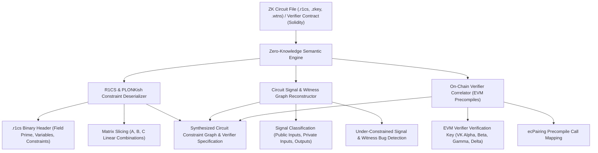
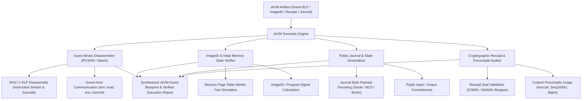

# Tier 4: zero knowledge

[Master tracker](README.md). Status read from GitHub 2026-11-28.

| Issue | Title | Author | State | Priority / labels | Comments | Linked PRs |
| --- | --- | --- | --- | --- | --- | --- |
| [#3740](https://github.com/morluto/rea/issues/3740) | Zero-knowledge circuit reverse engineering: Circom/R1CS, PLONKish/Halo2 constraints and verifier graphs | matbrgz | open | enhancement, area: tests | 0 | none found |
| [#3741](https://github.com/morluto/rea/issues/3741) | zkVM reverse engineering: RISC Zero, SP1 and zkWasm guest images, receipts, journals and proof metadata | matbrgz | open | enhancement | 0 | none found |

## Source text

Verbatim issue text and comments follow. Badge images are removed and heading levels shifted. Claims are the authors', not verified here.

### [#3740](https://github.com/morluto/rea/issues/3740) [Feature] Zero-knowledge circuit reverse engineering: Circom/R1CS, PLONKish/Halo2 constraints and verifier graphs

*matbrgz, open, https://github.com/morluto/rea/issues/3740*

#### Problem Statement & Context

Zero-Knowledge Proofs (ZKPs) are the mathematical backbone of privacy protocols, validity rollups (zk-Rollups), and verifiable computation. ZK programs are authored in domain-specific languages (Circom, Noir, Leo) and compiled into mathematical constraint systems:
1. **Rank-1 Constraint Systems (R1CS)**: Binary representation of arithmetic circuits composed of constraints of the form $\langle A, s \rangle \cdot \langle B, s \rangle - \langle C, s \rangle = 0$, where $s$ is the witness vector. Stored in binary `.r1cs` containers (magic `r1cs`, version, field size, variable counts, linear combination matrices).
2. **PLONKish & Custom Gates (Halo2 / UltraPLONK)**: Constraint tables structured as columns (Advice, Fixed, Instance), selector polynomials, permutation arguments (copy constraints), and custom non-linear lookup gates (Plookup).
3. **Witness & Proving Artifacts (`.wtns`, `.zkey`)**: Binary witness vectors assigning concrete values to circuit variables, and proving keys packing evaluation domain polynomials, G1/G2 elliptic curve points (BN254 / BLS12-381), and lagrange bases.
4. **On-Chain Verifier Contracts**: Solidity smart contracts verifying Groth16 or PLONK proofs using EVM pairing precompiles (`ecPairing` at `0x08`, `ecAdd` at `0x06`, `ecMul` at `0x07`).

Currently, reverse engineering a ZK artifact is nearly impossible without specialized cryptographic tools. REA needs a dedicated ZK circuit engine capable of parsing `.r1cs` files, analyzing constraint graphs, extracting public/private input relationships, and correlating circuit artifacts with on-chain EVM verifier contracts.

#### Proposed Architecture

#### Technical Capabilities & Modules

1. **Binary R1CS Constraint Parsing (`.r1cs`):**
   - Parse R1CS binary container: magic header (`0x73633172`), version, section offsets.
   - Decode prime field modulus (e.g. BN254 scalar field $r = 21888242871839275222246405745257275088548364400416034343698204186575808495617$).
   - Extract variable counts: total variables, public inputs, public outputs, private inputs, number of constraints.
   - Decompress and parse sparse matrices $A$, $B$, $C$.

2. **Signal Hierarchy & Constraint Graph Reconstruction:**
   - Map symbolic variable names using symbol files (`.sym`).
   - Categorize signals: public inputs, private inputs (secrets), intermediate witness variables, and outputs.
   - Construct a directed constraint graph: trace data dependencies from inputs through intermediate constraints to final public assertions.

3. **Circuit Audit & Under-Constrained Signal Analysis:**
   - Detect under-constrained signals: identify private or intermediate variables that appear in linear combinations but lack quadratic locking constraints (a common source of critical ZK vulnerabilities).
   - Detect unused or dead signals that do not influence public outputs.

4. **Proving Key (`.zkey`) & Witness (`.wtns`) Deserialization:**
   - Parse `.zkey` files: extract verification key parameters, toxic waste powers of tau commitments, and Groth16 evaluation points.
   - Parse binary `.wtns` witness files and verify satisfiability against candidate R1CS constraints.

5. **On-Chain Verifier Contract Correlation:**
   - Disassemble EVM verifier contracts (e.g. Tornado Cash, Semaphore, zkSync verifiers).
   - Extract verification key constants hardcoded in bytecode: $IC$ vectors, $^Glpha_1$, $eta_2$, $\gamma_2$, $\delta_2$.
   - Match on-chain verifying keys with static `.zkey` circuit artifacts to prove provenance.

#### Acceptance Criteria

- [ ] Automated parsing of binary `.r1cs` constraint files across standard prime fields.
- [ ] Structural mapping of public, private, and intermediate signals.
- [ ] Detection of under-constrained and unconstrained signals.
- [ ] Extraction of verification key parameters from on-chain Solidity verifier bytecodes.
- [ ] Generation of an interactive circuit dependency graph detailing constraint flows.

#### Related Issues & Dependencies

- Complements [#972](https://github.com/morluto/rea/issues/972) (Solidity/EVM reverse engineering)
- Complements [#3621](https://github.com/morluto/rea/issues/3621) (Unknown binary file-format inference)

### [#3741](https://github.com/morluto/rea/issues/3741) [Feature] zkVM reverse engineering: RISC Zero, SP1 and zkWasm guest images, receipts, journals and proof metadata

*matbrgz, open, https://github.com/morluto/rea/issues/3741*

#### Problem Statement & Context

Zero-Knowledge Virtual Machines (zkVMs) represent the next evolution in verifiable computation, enabling developers to write standard high-level code (Rust, C++, Go) compiled to standard ISAs (RISC-V or WebAssembly), executing inside a cryptographic prover that outputs a succinct zero-knowledge receipt:
- **RISC Zero**: Executes standard 32-bit RISC-V (RV32IM) binaries inside a zk-STARK circuit, producing a `Receipt` consisting of a cryptographic seal and a public `Journal`. Programs are uniquely identified by a 32-byte cryptographic `ImageID` (Merkle root of the initial memory state).
- **Succinct SP1**: High-performance, open-source zkVM targeting 32-bit RISC-V (RV32IM), utilizing Plonky3 and customized precompiles for hashes (Keccak, SHA-256) and elliptic curves (secp256k1, ed25519).
- **zkWasm**: Proves execution of WebAssembly bytecode modules within an algebraic constraint framework.

When investigating a zkVM-based system (e.g. verifiable coprocessors, ZK light clients, off-chain rollups), analysts encounter cryptographic receipts, image IDs, and public journals without visibility into what the guest program actually computed. REA needs a dedicated zkVM reverse engineering engine capable of disassembling guest ELF/Wasm binaries, validating ImageIDs, decoding public journals, and verifying receipt metadata.

#### Proposed Architecture

#### Technical Capabilities & Modules

1. **Guest Binary Disassembly (RISC-V RV32IM & Wasm):**
   - Ingest guest executables: 32-bit RISC-V ELF binaries (for RISC Zero and SP1) or WebAssembly modules (for zkWasm).
   - Disassemble standard instructions, identifying zkVM-specific host communication syscalls:
     - `sys_read` / `sys_write`: Reading private witness inputs from host.
     - `sys_commit`: Committing public outputs to the journal.
     - `sys_halt`: Terminating execution.

2. **ImageID & Initial State Verification:**
   - Simulate zkVM memory page initialization: partition the ELF image into standard 1 KB memory pages.
   - Compute the Merkle tree over the initial memory state using the zkVM's canonical hash function (BabyBear Poseidon2 or Keccak).
   - Verify whether a candidate guest binary produces the exact `ImageID` asserted in an on-chain verifier.

3. **Public Journal Deserialization:**
   - Extract raw byte slices from public receipt journals.
   - Deserialize payload schemas using standard Rust serialization codecs: `bincode`, `serde_json`, `borsh`, `postcard`.
   - Reconstruct structured public claims (e.g., aggregated state roots, verified light client headers).

4. **Hardware Precompile & Acceleration Mapping:**
   - Identify guest invocations of accelerated precompiles: SHA-256 compression, Keccak-256 f1600 permutations, Secp256k1 point additions/doublings, BigInt modular arithmetic.
   - Quantify compute cycles saved by specialized cryptographic hardware gates.

5. **Receipt Verification & On-Chain Wrapper Correlation:**
   - Verify receipt metadata structure (composite receipts, Groth16 / PLONK SNARK wrappers).
   - Correlate zkVM verification keys with deployed Ethereum verifier contracts (`RiscZeroGroth16Verifier`, `SP1Verifier`).

#### Acceptance Criteria

- [ ] Disassembly of RV32IM guest ELF binaries and identification of zkVM runtime syscalls.
- [ ] Simulation of memory page layout and calculation of deterministic ImageID digests.
- [ ] Structured deserialization of public journal byte buffers into typed records.
- [ ] Identification and mapping of accelerated cryptographic precompiles.
- [ ] Correlation of guest program hashes with on-chain verifier contracts.

#### Related Issues & Dependencies

- Complements [#3621](https://github.com/morluto/rea/issues/3621) (Unknown binary file-format inference)
- Complements [#3716](https://github.com/morluto/rea/issues/3716) (Common Bytecode and VM Framework)
